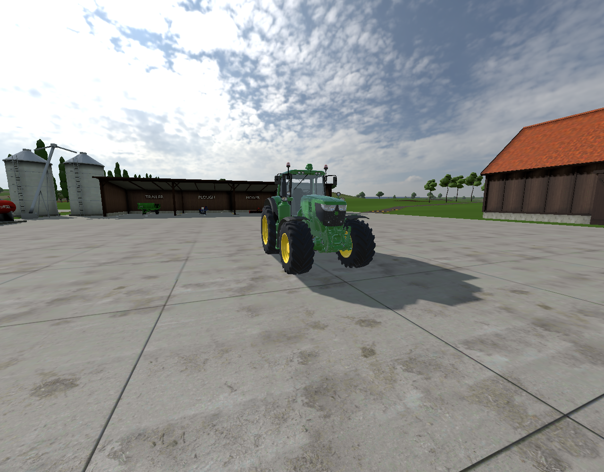
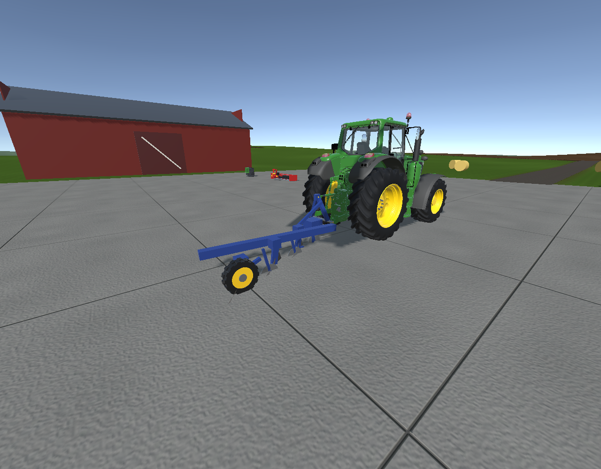
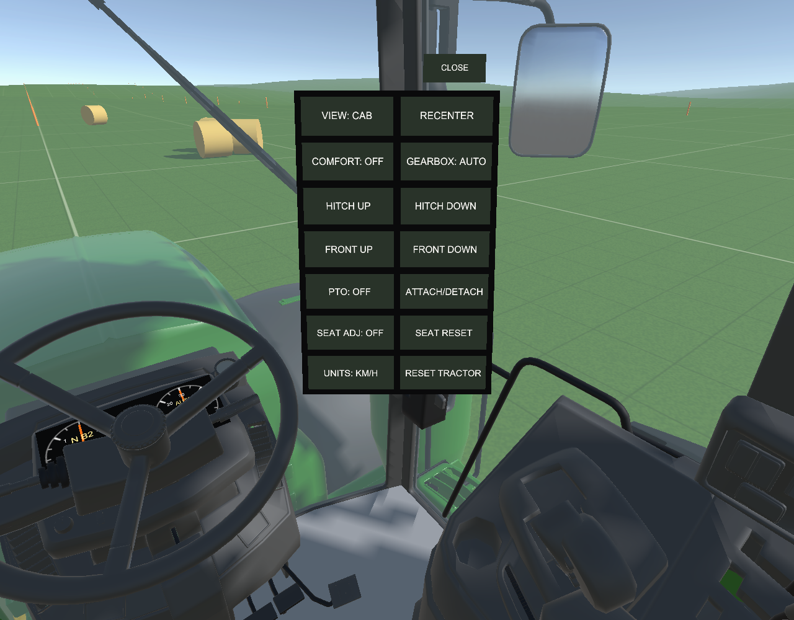

# Tractor VR — John Deere 6195M on Meta Quest 2

Unity **6000.6.3f1** · URP · OpenXR (Meta Quest feature) · Input System



Docs: [Roadmap](docs/ROADMAP.md) · [Development log](docs/DEVLOG.md) · [CLAUDE.md](CLAUDE.md) (project guide)

## Phase 1 (done)
- John Deere 6195M model (`Assets/Models/John_Deere_6195M.fbx`), real scale (wheelbase 2.80 m)
- Flat 2 km × 2 km field with a 10 m grid and marker posts every 25 m
- Two viewpoints: **cab** (driver's seat) and **third person** (behind and above)
- Driving with the Touch controller thumbsticks: Ackermann steering, wheel spin, front hubs steer
- Small speed readout (km/h, F/N/R, view)
- **Comfort**: edge vignette while turning / changing speed (off/low/high on X), gentle acceleration, yaw-rate and lateral-acceleration limits
- **Controllers visible**: official Quest 2 Touch models with moving stick, buttons, trigger and grip

## Phase 2 (in progress)
- **Steering wheel** turns with the steering (cut out of the cab mesh by the setup script)
- **Instrument cluster** on the steering column: rev counter, speedometer, direction + gear, AUTO/MAN
- **Gearbox** like the 6195M's AutoQuad Plus 20/20: ranges A–E × 4 powershift steps, automatic or manual, top speed 50 km/h
- **Sounds** (all synthesised by the setup script): diesel engine following RPM and load, shift clunk, reverse beeper, horn
- **Physics**: 7.5 t body on four raycast wheels with suspension and tyre grip, engine power limit on climbs, parking brake that holds on slopes
- **Terrain**: 2 × 2 km of gentle hills (flat around the start), round hay bales to push


- **Hydraulics**: rear three-point hitch (real linkage motion) and front linkage, PTO
- **Implements**: plough (rear hitch, leaves furrows, pulls 30 kN), front disc mower (PTO), tipping trailer (drawbar). Back up / drive up to one and press attach


- **VR interaction**: grab the steering wheel and the speed lever (grip button, or a fist with hand tracking), cab panel with touch buttons, tracked hands




## Controls
With **hand tracking** (controllers put down): make a fist on the wheel rim or the lever knob to grab, touch the panel buttons with a fingertip.
The panel's MENU tab is always visible at the right front of the cab.


| Quest 2 controller | Keyboard (editor) | Action |
|---|---|---|
| Left stick ← → | A / D | Steering |
| Right stick ↑ | W | Drive forward (stick amount = target speed, max 50 km/h; in manual mode, a share of the gear's top speed) |
| Right stick ↓ | S | Brake, then reverse when stopped (max 15 km/h) |
| Release stick | — | Coast to a stop |
| **A** | C | Switch view: cab ↔ third person |
| **B** | R | Recenter the view |
| **X** (left) | V | Comfort vignette: off / low / high (saved, default high) |
| Panel: SEAT ADJ ON + sticks | Hold Left Shift | Seat adjust: left stick ↑↓ = height, right stick = forward/back/sideways (saved) |
| **Grip** (either hand) near the wheel rim | — | Grab the steering wheel and turn it; it stays where you let go until you use the left stick |
| **Grip** on the lever knob (right armrest) | — | Speed lever: push forward = drive, pull back = reverse; stays set. The right stick puts it back to neutral |
| **Menu** button (left) | M | Cab panel at the right front: touch the buttons with a controller tip or a fingertip |
| Right stick flick → / ← | X / Z | Shift up / down (switches the gearbox to manual) |
| **Y** (left) | T | Gearbox: automatic ↔ manual (saved) |
| Right trigger | H | Horn |
| Left stick ↑ / ↓ | Q / E | Raise / lower the rear hitch |
| Hold left trigger + left stick ↑ / ↓ | Left Ctrl + Q / E | Raise / lower the front linkage |
| Right stick click | P | PTO on / off |
| Left stick click | J | Attach the implement in reach / detach (lower it first) |

## Project layout
```
Assets/Scripts/TractorInput.cs        input bindings (Quest + keyboard/gamepad fallback)
Assets/Scripts/TractorController.cs   driving physics (Rigidbody + raycast suspension, tyre forces, Ackermann, wheel animation)
Assets/Scripts/TerrainGenerator.cs    rolling hills, generated at startup
Assets/Scripts/Hitch.cs               rear hitch + front linkage + drawbar, PTO, attach / detach
Assets/Scripts/Implement.cs           coupling, depth, draft, PTO parts, work trails
Assets/Scripts/SimpleWheels.cs        trailer wheels
Assets/Scripts/VRHands.cs             hands from controllers or hand tracking (grab point, grabbing, poke tip)
Assets/Scripts/CabControls.cs         grab the steering wheel and the speed lever
Assets/Scripts/CabPanel.cs            cab panel with touch buttons
Assets/Models/Hands/                  hand models (XR Hands sample, Unity Package Distribution License)
Assets/Scripts/Editor/PhysicsTest.cs  offline driving test         (menu: Tractor VR > Run Physics Test)
Assets/Scripts/VRCameraRig.cs         cab / third-person views, recenter, seat calibration
Assets/Scripts/Drivetrain.cs          engine RPM + 20F/20R gearbox (auto / manual)
Assets/Scripts/TractorAudio.cs        engine, shift, reverse beeper and horn sounds
Assets/Scripts/Dashboard.cs           instrument cluster (needles, gear, mode)
Assets/Scripts/TractorHud.cs          speed / gear / rpm readout
Assets/Scripts/ComfortVignette.cs     comfort vignette (+ Assets/Shaders/ComfortVignette.shader)
Assets/Scripts/ControllerVisual.cs    animates the controller models
Assets/Models/MetaControllers/        Quest 2 controller models (Meta XR Core SDK, Oculus SDK License)
Assets/Scripts/Editor/ProjectSetup.cs settings + scene generator  (menu: Tractor VR > Run Full Setup)
Assets/Scripts/Editor/BuildQuest.cs   APK build                      (menu: Tractor VR > Build Quest APK)
Assets/Scenes/TractorFlat.unity       generated scene
```
`ProjectSetup` can be run as many times as you like. It regenerates the scene from the FBX, so
hand edits to `TractorFlat.unity` are overwritten. Change the generator instead, or save the
scene under a different name.

## Running on the Quest 2
1. Turn on Developer Mode on the headset (Meta Horizon phone app → Devices → Developer Mode).
2. Connect it over USB-C and accept "Allow USB debugging" inside the headset (tick *Always allow from this computer*).
3. In Unity: **File → Build Profiles → Android**, choose the Quest under *Run Device*, then **Build And Run**.
   Or install the ready APK: `adb install -r Builds/TractorVR.apk`
   (adb is at `C:\Program Files\Unity\Hub\Editor\6000.6.3f1\Editor\Data\PlaybackEngines\AndroidPlayer\SDK\platform-tools`).
4. On the headset: App Library → filter **Unknown Sources** → *Tractor VR*.

Testing in the editor without a headset: press Play and drive with the keyboard.
With Quest Link / Air Link, Play mode runs in the headset (Standalone OpenXR is enabled).

## Notes
- The FBX references external textures (`tex\*.tif`) that weren't included with the model.
  The setup script rebuilds the look from the material names instead (green paint, yellow rims, clear glass).
  If the original texture folder turns up, put it in `Assets/Models/tex/` and re-run the setup.
- Since phase 2 the tractor is a physics body (7.5 t) on rolling hills. The round hay bales near the start can be pushed around.
  In the cab view the view pitches and rolls with the tractor on slopes. If it ever ends up on its side, it resets to the start after 3 s.
- Turning is deliberately limited for comfort (max 25°/s yaw, 2.5 m/s² lateral). At speed the tractor turns wide, so slow down for tight turns.
- If you feel motion sick: set the vignette to high (X), prefer the cab view, keep sessions short.

## Next phase ideas
- Front loader / 3-point hitch / PTO with the hydraulic parts that are already separate in the model
  (`Rear_Holder_*`, `Rear_Forcer_*`, `Front_Forcer_*`)
- Crop rows, roads, a farmyard, better implement models
