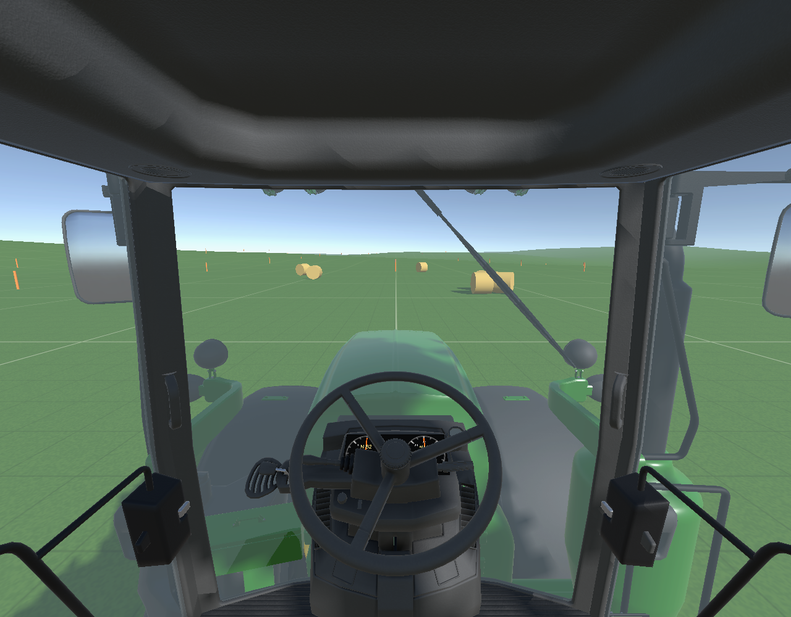
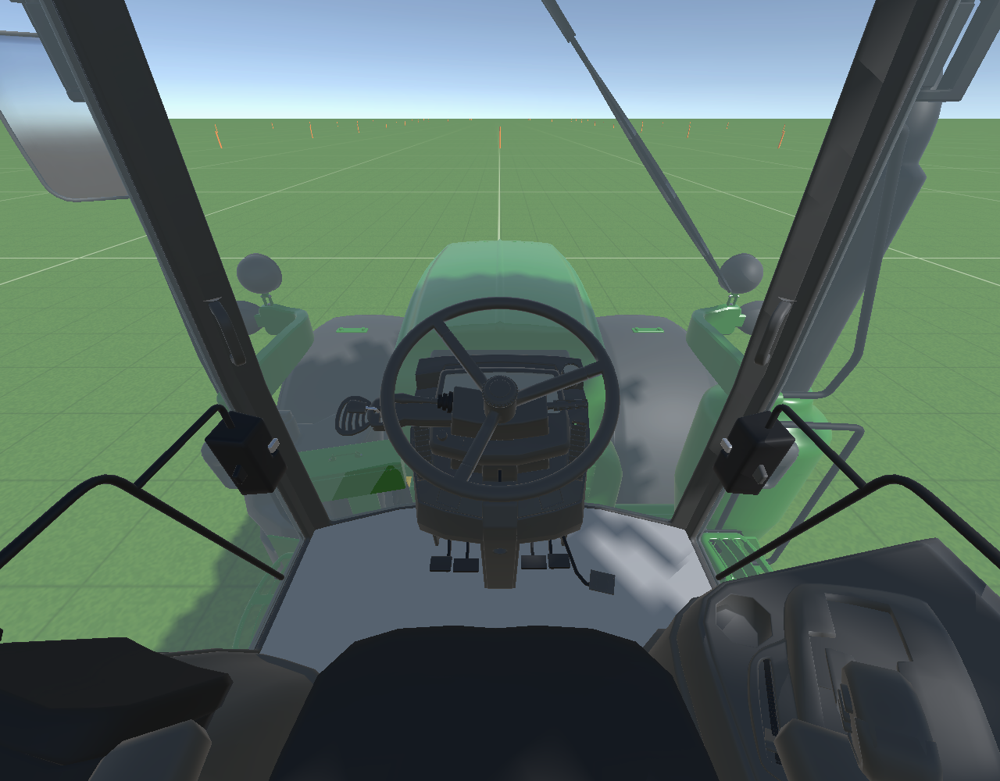
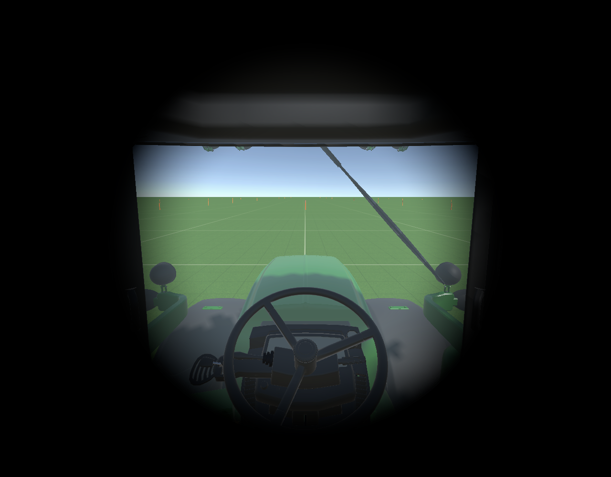

# Development log

## 2026-10-16: Phase 1 setup

**Starting point.** The folder `Irum_proj/IRUMSim/` contained a *compiled* Unity 2022.3.4f1 Windows build
("IRUMSim", Sapientia Hungarian University of Transylvania), with no sources, plus the model
`John_Deere_6195M.FBX`. A new Unity project was created: `Irum_proj/TractorVR/`.

**Engine choice.** Unity 6000.6.3f1 was already installed with Android support, which suits the Quest 2.
URP (recommended for Quest) + OpenXR with the Meta Quest feature (the vendor-neutral standard) + Input System.
All package versions are the ones bundled with the editor, so the project resolves offline.

**Automation.** All project configuration and scene construction lives in `Assets/Scripts/Editor/ProjectSetup.cs`
and runs in batch mode. That makes the setup reproducible and reviewable: the scene can be regenerated at any time.

### Model analysis
- Binary FBX 7.x, 65 model nodes, 31 materials, 34 texture references.
- Already metric and +Z forward in Unity. Measured wheelbase 2.809 m vs. spec 2.800 m, so scale ×0.997.
- Wheels and tires are separate objects. `rotater_*` nodes sit exactly at the front wheel centres (hubs/knuckles).
- The steering wheel is baked into the cab interior mesh (not separately animatable yet).
- **Textures are missing**: the references point to `..\tex\*.tif` / `D:\Turbosquid_2017\...`. They are not embedded and not on this PC.
  Fix: materials are rebuilt from their names (`Body_paint` → JD green, and yellow on wheel parts; glass → near-clear unlit).

### Driving model (phase 1)
- Kinematic bicycle model around the rear axle (the tractor origin is placed there), Ackermann angles per front wheel,
  wheel spin from distance / radius, steering lock reduced at speed.
- Speed governor: stick position = target speed. Moving the stick against the motion brakes; releasing it coasts.
- Runs in `Update` so the VR camera riding on the tractor never judders (no physics interpolation issues).
- No collisions yet. That is fine for a flat world, and the move to real physics is planned for phase 2.

### VR camera
- Rig > Camera Offset > Main Camera (TrackedPoseDriver). Recentering moves the Camera Offset so the eye lands exactly on
  the anchor (seat or third-person point), independent of the tracking origin.
- Cab view: the rig is locked to `Tractor/DriverEye`. Third person: 9.5 m behind, 4.2 m up, yaw-only with smoothing (comfort).
- The seat position was estimated from the cab geometry and checked with preview renders. It can be fine-tuned in the headset.

### Issues hit
| Problem | Cause | Fix |
|---|---|---|
| Tractor rendered white | FBX textures missing | Name-based URP materials |
| Cab view looked milky/grey | Batch-mode async shader compilation drew placeholder shaders | `ShaderUtil.allowAsyncCompilation = false` for previews (not an issue in builds) |
| Editor opened an empty scene | `-openfile` doesn't load scenes | Open the scene from the Project window |
| Couldn't open the editor during the batch build | Unity locks a project to one instance | Stopped the batch build; build from the editor menu |

### Preview renders

| Cab | Cab (looking down) |
|---|---|
|  |  |

| Third person | Side | Front |
|---|---|---|
|  |  |  |

## 2026-10-16 — First deploy to Quest 2
- Built `Builds/TractorVR.apk` in batch mode (`BuildQuest.Build`, 57.8 MB, 0 errors) and installed it over USB with the
  adb bundled in Unity's Android SDK (`...\PlaybackEngines\AndroidPlayer\SDK\platform-tools\adb.exe`). The app launches; it is under *Unknown Sources*.
- Closing the editor also kills its adb server. The fresh server had to be re-authorized on the headset ("Allow USB debugging").
- Logcat shows `ClassNotFoundException: com.google.android.play.core.assetpacks.AssetPackManager`. This is harmless: Unity probes for
  Play Asset Delivery, which Quest doesn't have.
- Headset test: everything works (controls, views, seat position, wheel spin/steer look great). The tester got **motion sickness**,
  so comfort (vignette, gentler acceleration and steering, a comfort setting) is now the next item on the ROADMAP.

## 2026-10-16: Comfort pass + visible controllers
The first headset session caused motion sickness, so this pass reduces the motion the inner ear notices.

**Gentler motion** (`TractorController`)
- Acceleration 1.8 → 1.0 m/s², braking 5 → 2.5, coast 1.0 → 0.8, steer rate 70 → 35°/s.
- Squared stick response for steering: fine control near centre.
- New steering limit instead of the old `steerAtMaxSpeed` factor: the lock angle is capped so the yaw rate stays ≤ 25°/s
  and v·ω ≤ 2.5 m/s². At 10 km/h this allows ~24° (radius ~6 m), at 40 km/h ~3° (radius ~50 m), which is also more realistic
  than before (the old model allowed ~74°/s yaw and ~14 m/s² lateral at full speed).

**Comfort vignette** (`ComfortVignette.cs`, `TractorVR/ComfortVignette` shader)
- Darkens the edge of the view in proportion to the rig's yaw rate and the tractor's speed change. It fades in fast and out slowly.
- Head-locked quad 1 m ahead (an eye offset of 32 mm then shifts it by only ~2°; at 0.1 m it would be off-centre by ~18° per eye).
- Shader works in view angles: clear inside `_InnerDeg`, black beyond `_OuterDeg`. Low: 38°/52°, High: 24°/40° at full strength.
- **X** cycles Off / Low / High (PlayerPrefs, default High). The HUD shows the level for 2.5 s.

**Controllers** (`ControllerVisual.cs`, `ProjectSetup.BuildController`)
- Stand-in Quest Touch models from primitives + a generated torus ring, under `Camera Offset`, posed with TrackedPoseDriver on the
  grip pose. The stick tilts, buttons sink and turn yellow when pressed, and the trigger and grip move. Hidden while not tracked.
- The official Meta controller models would need the Meta XR SDK. That can come later with hands/grab interaction.

**Previews**: `controller.png` and `vignette_high.png` were added. The first render of a batch session came out grey, so a warm-up
shot is now thrown away.

| Controller (stand-in) | Vignette, High, full strength |
|---|---|
|  |  |
