# Development log

## 2026-10-16: Phase 1 setup

**Starting point.** The folder `Irum_proj/IRUMSim/` contained a *compiled* Unity 2022.3.4f1 Windows build
("IRUMSim", Sapientia Hungarian University of Transylvania), with no sources, plus the model
`John_Deere_6195M.FBX`. A new Unity project was created: `Irum_proj/TractorVR/`.

**Engine choice.** Unity 6000.6.3f1 was already installed with Android support, which suits the Quest 2.
URP (recommended for Quest) + OpenXR with the Meta Quest feature (the vendor-neutral standard) + Input System.
All package versions are the ones bundled with the editor, so the project resolves offline.

**Automation.** All project configuration and scene construction lives in `Assets/Scripts/Editor/ProjectSetup.cs`
and runs in batch mode. That makes the setup reproducible and reviewable: the scene can be regenerated at any time.

### Model analysis
- Binary FBX 7.x, 65 model nodes, 31 materials, 34 texture references.
- Already metric and +Z forward in Unity. Measured wheelbase 2.809 m vs. spec 2.800 m, so scale ×0.997.
- Wheels and tires are separate objects. `rotater_*` nodes sit exactly at the front wheel centres (hubs/knuckles).
- The steering wheel is baked into the cab interior mesh (not separately animatable yet).
- **Textures are missing**: the references point to `..\tex\*.tif` / `D:\Turbosquid_2017\...`. They are not embedded and not on this PC.
  Fix: materials are rebuilt from their names (`Body_paint` → JD green, and yellow on wheel parts; glass → near-clear unlit).

### Driving model (phase 1)
- Kinematic bicycle model around the rear axle (the tractor origin is placed there), Ackermann angles per front wheel,
  wheel spin from distance / radius, steering lock reduced at speed.
- Speed governor: stick position = target speed. Moving the stick against the motion brakes; releasing it coasts.
- Runs in `Update` so the VR camera riding on the tractor never judders (no physics interpolation issues).
- No collisions yet. That is fine for a flat world, and the move to real physics is planned for phase 2.

### VR camera
- Rig > Camera Offset > Main Camera (TrackedPoseDriver). Recentering moves the Camera Offset so the eye lands exactly on
  the anchor (seat or third-person point), independent of the tracking origin.
- Cab view: the rig is locked to `Tractor/DriverEye`. Third person: 9.5 m behind, 4.2 m up, yaw-only with smoothing (comfort).
- The seat position was estimated from the cab geometry and checked with preview renders. It can be fine-tuned in the headset.

### Issues hit
| Problem | Cause | Fix |
|---|---|---|
| Tractor rendered white | FBX textures missing | Name-based URP materials |
| Cab view looked milky/grey | Batch-mode async shader compilation drew placeholder shaders | `ShaderUtil.allowAsyncCompilation = false` for previews (not an issue in builds) |
| Editor opened an empty scene | `-openfile` doesn't load scenes | Open the scene from the Project window |
| Couldn't open the editor during the batch build | Unity locks a project to one instance | Stopped the batch build; build from the editor menu |

### Preview renders

| Cab | Cab (looking down) |
|---|---|
|  |  |

| Third person | Side | Front |
|---|---|---|
|  |  | 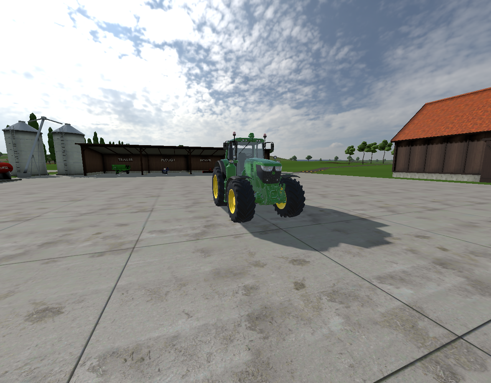 |

## 2026-10-16 — First deploy to Quest 2
- Built `Builds/TractorVR.apk` in batch mode (`BuildQuest.Build`, 57.8 MB, 0 errors) and installed it over USB with the
  adb bundled in Unity's Android SDK (`...\PlaybackEngines\AndroidPlayer\SDK\platform-tools\adb.exe`). The app launches; it is under *Unknown Sources*.
- Closing the editor also kills its adb server. The fresh server had to be re-authorized on the headset ("Allow USB debugging").
- Logcat shows `ClassNotFoundException: com.google.android.play.core.assetpacks.AssetPackManager`. This is harmless: Unity probes for
  Play Asset Delivery, which Quest doesn't have.
- Headset test: everything works (controls, views, seat position, wheel spin/steer look great). The tester got **motion sickness**,
  so comfort (vignette, gentler acceleration and steering, a comfort setting) is now the next item on the ROADMAP.

## 2026-10-16: Comfort pass + visible controllers
The first headset session caused motion sickness, so this pass reduces the motion the inner ear notices.

**Gentler motion** (`TractorController`)
- Acceleration 1.8 → 1.0 m/s², braking 5 → 2.5, coast 1.0 → 0.8, steer rate 70 → 35°/s.
- Squared stick response for steering: fine control near centre.
- New steering limit instead of the old `steerAtMaxSpeed` factor: the lock angle is capped so the yaw rate stays ≤ 25°/s
  and v·ω ≤ 2.5 m/s². At 10 km/h this allows ~24° (radius ~6 m), at 40 km/h ~3° (radius ~50 m), which is also more realistic
  than before (the old model allowed ~74°/s yaw and ~14 m/s² lateral at full speed).

**Comfort vignette** (`ComfortVignette.cs`, `TractorVR/ComfortVignette` shader)
- Darkens the edge of the view in proportion to the rig's yaw rate and the tractor's speed change. It fades in fast and out slowly.
- Head-locked quad 1 m ahead (an eye offset of 32 mm then shifts it by only ~2°; at 0.1 m it would be off-centre by ~18° per eye).
- Shader works in view angles: clear inside `_InnerDeg`, black beyond `_OuterDeg`. Low: 38°/52°, High: 24°/40° at full strength.
- **X** cycles Off / Low / High (PlayerPrefs, default High). The HUD shows the level for 2.5 s.

**Controllers** (`ControllerVisual.cs`, `ProjectSetup.BuildController`)
- Stand-in Quest Touch models from primitives + a generated torus ring, under `Camera Offset`, posed with TrackedPoseDriver on the
  grip pose. The stick tilts, buttons sink and turn yellow when pressed, and the trigger and grip move. Hidden while not tracked.
- The official Meta controller models would need the Meta XR SDK. That can come later with hands/grab interaction.

**Previews**: `controller.png` and `vignette_high.png` were added. The first render of a batch session came out grey, so a warm-up
shot is now thrown away.

| Controller (stand-in) | Vignette, High, full strength |
|---|---|
|  |  |

## 2026-10-16: Real Quest 2 controller models
The stand-in primitive controllers looked wrong in the headset (the tracking ring sat between the buttons). They are replaced by
the official **Quest 2 Touch models**, copied from the Meta XR Core SDK 207.0.1 (downloaded from Meta's npm registry; only
the two FBX files and the texture were taken, the SDK itself is not installed). They're under the Oculus SDK License, which is fine for a Quest app in a private repo.

- **Pose:** the bone positions showed that the models are authored in Meta's pointer frame (face plate at the origin, stick
  and buttons at y≈0, the laser along +Z), not the OpenXR grip frame. So the TrackedPoseDriver now uses the **aim pose**
  (`pointerPosition/pointerRotation`), and the model is offset so its `*_laser_begin` node coincides with that pose.
- **Animation:** the FBX is rigged. `ControllerVisual` drives the bones directly with the ranges read from Meta's animation curves:
  stick ±22°, A/B (X/Y) 1.78 mm, trigger 20°, grip (1.3°, 7.4°, 4.1°). No Animator is needed.
- Imported with Animation Type None and no materials. One URP Lit material uses the albedo texture.

| Controllers, front | Side |
|---|---|
|  |  |

## 2026-10-16: Headset check
- Real controller models, comfort vignette and the gentler driving were tested on the Quest 2: all good.

## 2026-10-16: Session summary
What happened today, in order:
1. First APK build (batch mode) and install over adb. The app ran first time, and the wheels and steering looked right.
2. Headset test: controls, views and seat were fine, but the tester got **motion sick**.
3. Comfort pass: gentler acceleration/braking, yaw-rate and lateral-acceleration limits, squared steering response, edge vignette with
   off/low/high on X.
4. Visible controllers: first primitive stand-ins (wrong ring placement), then the official Quest 2 models from the Meta XR Core SDK on the aim pose.
5. Headset re-test: all good.

Workflow lessons (also in CLAUDE.md): the editor must be closed for batch builds; closing it resets adb authorization unless
*Always allow* is ticked; a launch via adb is blocked while the headset sleeps; preview PNGs open in a viewer get locked by Windows.

## 2026-10-17: Phase 1 closed, phase 2 started (steering wheel + drivetrain)
Phase 1 was accepted after the headset tests. For phase 2 the first block chosen was **steering wheel + drivetrain**, because those
make the biggest difference to how the tractor feels in the headset.

**Steering wheel, without Blender** (`ProjectSetup.SplitSteeringWheel`)
- The wheel is baked into `Cab_Interier_01` (37 177 vertices, 11 submeshes). A temporary analysis split that mesh into connected pieces
  (union-find over triangles, with vertices welded by position so UV seams don't break pieces apart). The largest piece turned out to be the rim:
  centred at x = 0, 0.40 m across.
- The setup script now does this automatically. Rim = largest centred piece 0.3–0.5 m wide. Its best-fit plane (PCA via power iteration)
  gives the column axis (rim 23° from horizontal). Every piece lying flat inside the rim (the hub cap) goes with it. The interior is rebuilt
  without those triangles, and the wheel becomes its own mesh in a pivot frame (`SteeringColumn` > `SteeringWheel` > `WheelMesh`).
- `TractorController` turns it by `SteerAngle × 13` (40° lock → ±520°, ~2.9 turns lock to lock). Right turn = clockwise as seen by the driver.

**Instrument cluster** (`Dashboard.cs`)
- Placed on the glass piece nearest the wheel (0.257 × 0.109 m): a generated face texture with two tick rings (0–3000 rpm with a red zone
  above 2250, 0–60 km/h), needles, scale numbers, direction + gear, AUTO/MAN.
- The built-in TextMesh font shader ignores depth, so the text showed through the wheel hub. A small `TractorVR/WorldText` shader fixes it
  (with stereo macros for Quest multiview).
- From the seat the hub hides the middle of the cluster and the column shroud hides the lower half, so the readouts were moved to the upper half of the dials.
  The HUD also shows speed, direction, gear and rpm now.

**Drivetrain** (`Drivetrain.cs`), loosely after the 6195M's AutoQuad Plus 20/20
- 20 forward / 20 reverse gears, named A1–E4 (5 ranges × 4 powershift steps), geometric from 2.4 to 50 km/h at the rated 2100 rpm.
  Engine idle 850, high idle 2250 rpm.
- **Auto**: pulls away in B2, shifts up above 1950 rpm and down below 1300 rpm, at least 0.5 s between shifts.
  **Manual**: right stick flick → / ← shifts. The gear caps the speed (stick = share of the gear's top speed), and downshifts that would over-rev are refused.
- RPM is locked to the wheels through the gear, with clutch slip (idle + up to 250 rpm) when pulling away. Load (for sound) = accelerating share + rolling resistance.
- Design decision: the drivetrain does **not** change the acceleration. The comfort limits from phase 1 stay in charge, and the drivetrain is derived from the motion.
  Top speed is raised from 40 to the real 50 km/h. The lateral/yaw limits still keep turns at speed gentle.

**Sounds** (`TractorAudio.cs`, all synthesised by `ProjectSetup`, no third-party samples)
- Engine: two loops at 1000 rpm (light/heavy load). Six-cylinder firing at 50 Hz excites exhaust/body/block resonances (85/240/700 Hz), plus a short
  3.2 kHz clatter burst and some breath noise per firing. The cylinders differ slightly in strength for the uneven diesel beat. Each loop is exactly 10 engine cycles
  (1.2 s), so it repeats seamlessly. The loops are pitched by RPM/1000 and cross-faded by load (equal power), and low-passed at 2.2 kHz in the cab view.
- Spectrum check of the first version: 93 % of the energy was below 300 Hz and only 1 % in the clatter band. Quest speakers barely reproduce that,
  so the clatter was boosted and the loops normalised separately.
- Shift clunk (thump + click + hydraulic hiss), 1 kHz reverse beeper (whenever the shuttle is in R), two-tone 400/500 Hz horn on the right trigger.

**New controls**: right stick flick → / ← = shift (switches to manual), Y = auto/manual (saved), right trigger = horn.
Keyboard: X / Z, T, H.

**Build**: setup + APK build in batch mode without errors (59.3 MB), installed over adb. The launch check was blocked by the
"controllers required" dialog (headset asleep), so a **headset test is still to do**.

| Cab | Cluster close-up (wheel turned 90° right) |
|---|---|
|  |  |

## 2026-10-17: Phase 2 headset check
- Steering wheel (direction and ratio), instrument cluster, gearbox (auto/manual, shifting), engine/shift/beeper/horn sounds were tested on the Quest 2: all OK, no tuning needed.

## 2026-10-17: Phase 2 block 1, physics + terrain
Order for the rest of phase 2, agreed today: **physics + terrain → hydraulics + implements → VR interaction**.

**Driving physics** (`TractorController`, rewritten)
- Rigidbody, 7.5 t, centre of mass (0, 1.05, 1.12): 40 % on the front axle, like the unballasted 6195M.
- **Raycast suspension** instead of WheelColliders (more control, cheaper on Quest). Per wheel, a ray runs from 0.15 m above the wheel centre.
  A preloaded spring-damper makes the body sit exactly at the model's height at rest (front 300 kN/m for axle suspension + tyre, rear 500 kN/m tyre only,
  damping ratio 0.45). Wheel meshes move with the spring.
- **Tyres**: the drive force is shared by wheel load (MFWD). The lateral force cancels the wheel's sideways sliding. Both are limited by a friction circle (μ 0.8 × load).
- **Comfort kept**: the phase 1 rules (1 m/s² acceleration, yaw ≤ 25°/s, lateral ≤ 2.5 m/s²) now make a speed *command*. A controller turns it into a
  drive force, compensating slope and rolling resistance, limited by engine power (145 kW) and grip.
  On a steep climb the tractor runs out of power and slows down. The command waits for it (anti wind-up).
- **Parking brake**: at standstill the tractor is anchored to the spot where it stopped, both along and across.
- Physics at **90 Hz** with interpolation, and the camera rig follows in LateUpdate. The cab view now pitches and rolls with the tractor on slopes.
  The comfort vignette now reacts to all view rotation (not just yaw) and uses a smoothed acceleration.
- The drivetrain's load (engine sound) is now the real share of engine power in use, so the engine labours on climbs.
- Rolled over or fallen off the world: it resets to the start after 3 s.

**Terrain** (`TerrainGenerator`): 2 × 2 km built at startup from a height function (two octaves of Perlin noise), 8 × 8 chunks with a 5 m grid,
mesh colliders, and normals from the height function. Flat within 60 m of the start, blending into the hills by 160 m. Nothing is stored in the repo.
The first version (±9 m, max 5.7°) looked flat in the renders, so the hills were raised (max 10.6°), the sun lowered to 35° and light haze added (250–1300 m).
Six round hay bales (350 kg) near the start can be pushed.

**Offline physics test** (`Tractor VR → Run Physics Test`, `PhysicsTest.cs`): steps the controller and `Physics.Simulate` by hand in batch mode with scripted sticks.
It found three bugs before any headset test:

| Found | Cause | Fix |
|---|---|---|
| Physics ran at 50 Hz | `Time.fixedDeltaTime` set from the editor isn't saved | Write `TimeManager` Fixed Timestep (rational count/rate) via SerializedObject |
| Driving into a bale flipped the tractor (pitch −56°, roll 49°) | Wheel rays hit the bale, and the bump stop launched the front | Wheel rays ignore rigidbodies, wheel box colliders push obstacles, load capped at 6× static |
| Then the front climbed onto the bale and got stuck | Friction between the flat front and the rolling bale surface pulled the nose up | Low-friction physics material on the tractor colliders |
| Parked tractor crept ~2 cm / 5 s | Velocity-only brake, and sideways only velocity damping | Hold anchored to the stop position, along and across |

Final test results:

| Scenario | Result |
|---|---|
| Settle | Rest height −3 mm, all springs at their static point |
| Full throttle | 1.00 m/s² up to 50 km/h at 14 s, pitch −0.3° |
| Full lock at 16 km/h | Yaw 24.7°/s (cap 25), lateral 1.95 m/s² |
| Full lock at 29 km/h | Yaw 17.4°/s, lateral 2.48 m/s² (cap 2.5) |
| Steepest slope 10.6° | Power-limited at ~28 km/h (0.23 m/s²), pitch −11° → +4° over the crest at ~1°/s |
| Park on 4.9° | 0.0 cm creep in 5 s |
| Hay bale at 6.5 km/h | Bale pushed 9 m aside, speed dip < 0.3 km/h, pitch unchanged |

**Build**: setup + APK without errors (59.6 MB), installed. The launch was blocked by the "controllers required" dialog (headset asleep), so it is **not headset-tested yet**.
Main open question: whether the cab pitching/rolling on the hills is comfortable.

| Hills (start area is flat on purpose) | Cab |
|---|---|
|  |  |

## 2026-10-17: Physics + terrain headset check
- Hills, cab pitch/roll on slopes, driving feel and pushing bales were tested on the Quest 2: all good, no comfort problems, no tuning needed.

## 2026-10-17: Phase 2 block 2, hydraulics + implements
**Linkage.** A temporary script tinted each `Rear_*`/`Front_*` part and logged its pivot. The pivots sit on the real hinge points
(rockshaft, lower link pins, arm tips), so the parts can be turned in place. Each moving part gets a tractor-aligned hinge.
- Rear three-point hitch = four-bar linkage. The lift arm angle θ moves the arm tip, and the lower link angle φ is solved (bisection) so the lift rod keeps its length.
  The rod's bottom end and the link ends come from the mesh (farthest vertex from the pivot). A θ → φ table is built at start-up.
  The lift cylinders follow: the barrel turns on its base, and the rod rides on the arm. Range: link ends 0.43 m (lowest the geometry closes) to 1.27 m (the model is drawn fully raised).
- Front linkage: the lower links fold from upright (stowed, as modelled) to forward-down (tips 0.42 m).
- Drawbar found automatically as the rearmost low centre point of the rear frame: (0, 0.43, −0.78).

**Implements** (no models came with the tractor, so they're built from primitives by the setup script):

| Implement | Coupling | Behaviour |
|---|---|---|
| 3-furrow plough, 1.2 t | rear hitch | Depth = shares below the ground (terrain height function). Draft 30 kN at 25 cm, + 3 %/km/h. Depth control lifts it back to 25 cm and the lever can't push it deeper. Brown furrow trail |
| 3 m front disc mower, 0.9 t | front linkage | 6 discs spin with the PTO, 30 kW while mowing, floats on the ground, light green mown strip |
| Tipping trailer, 2.5 t | drawbar | Stays a physics body: ball joint (yaw ±70°, roll ±25°), its own raycast wheels, parking brake and jack while uncoupled |

- Attach: back up or drive up so the coupling points are within 1.5 m and 30°, at about the right height (±0.35 m), at standstill, then press attach.
  The HUD shows the nearest implement's distance while you line up, and why an attach was refused. The implement slides onto the coupling over 0.8 s.
- Mounted implements change the tractor's mass and centre of mass. With the plough on, the front axle load drops from 14.7 to ~8 kN per wheel.
- PTO: 1000 rpm at 1900 engine rpm. With the PTO on, AUTO shifts to keep the engine near PTO speed, and the PTO's power is taken off the drive power and added to the engine sound load.

**Offline test** (new scenarios I–L):

| Scenario | Result |
|---|---|
| I. Hitch sweep | Link ends 0.43 → 1.27 m, arms −60°/links −42° from the modelled pose |
| J. Plough | Couples, lowers to 0.27 m (depth control), **7.1 km/h at 30.4 kN draft, 48 % engine power**, raises, parks upright |
| K. Mower | Couples on the lowered front linkage, PTO on, floats at 0.01–0.02 m, mows at 9.2 km/h, CoM moves forward 0.38 m |
| L. Trailer | Coupling gap 0.0 cm throughout, 30 km/h, 8.6° articulation at full lock, brakes, reverses |

Bugs the test found:

| Found | Fix |
|---|---|
| Plough couldn't couple: its pins (0.55 m) were below the linkage's lowest point plus tolerance | Pins at 0.75 m (taller headstock) |
| Ploughing only reached 2.7 km/h of 7: proportional speed control leaves a fixed error under a steady 26 kN pull | Draft force fed forward into the drive force |
| The plough test ran into the parked mower | Mower parked out of the way |

| Hitch low | Hitch high |
|---|---|
|  | 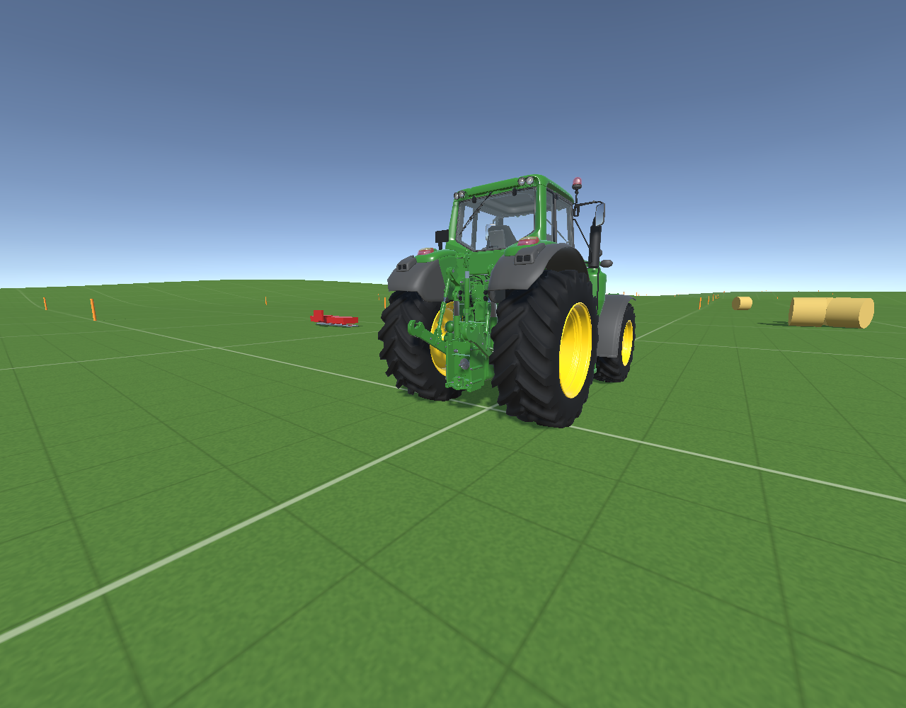 |

| Plough at work | Parked implements |
|---|---|
|  | 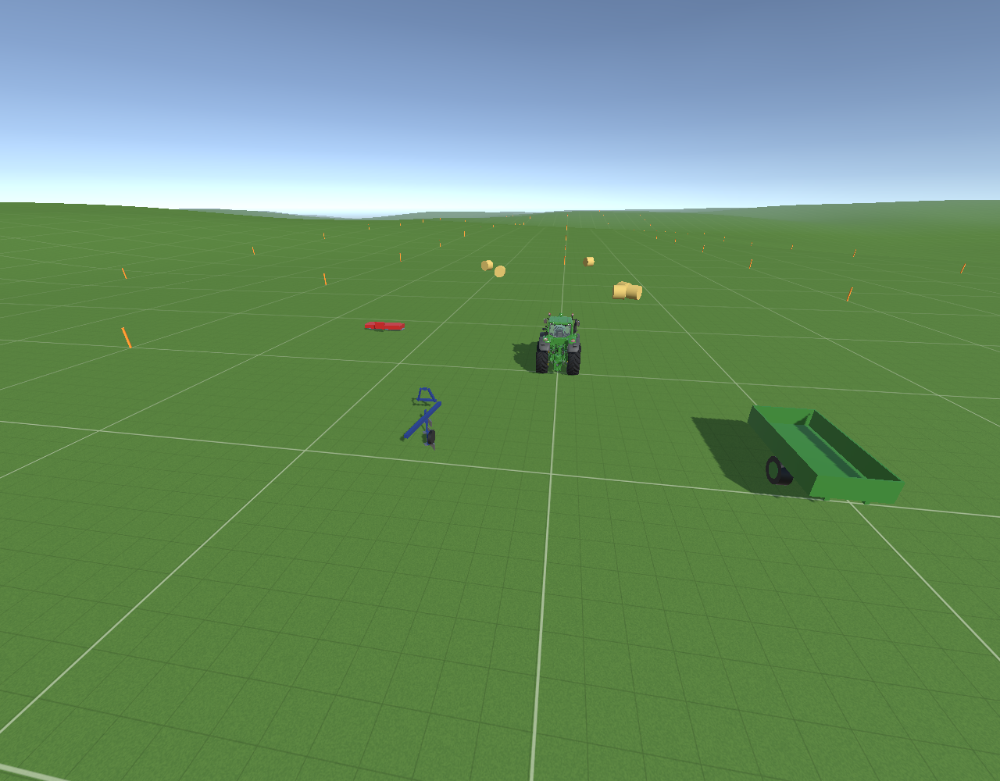 |

**Build**: setup + APK without errors, installed. The launch was blocked by the "controllers required" dialog, so it is **not headset-tested yet**.

## 2026-10-17: Block 2 headset check + trailer collision fix
Headset test of hydraulics + implements: linkage controls fine, attaching fine ("takes practice"), ploughing / mowing / towing fine.
**Bug: the tractor could drive into the trailer.**

Cause: while coupled, all collisions between implement and tractor were switched off (`IgnoreCollision`, so the two wouldn't fight at the
coupling), and the trailer's ball joint also had `enableCollision = false`. After detaching, collisions only came back at 8 m apart.

Fix:
- The trailer keeps colliding while coupled. After detaching (any implement), collisions come back as soon as nothing overlaps.
- New test scenario **M** (jackknife in reverse, then reverse into the parked trailer) measures the overlap with `Physics.ComputePenetration`.
  It found two more problems:
  1. The trailer could only swing ~12°: the tractor had **one full-width box out to the hitch**, and the trailer body started only 0.6 m behind its eye.
     Now the tractor has a main block + a narrow rear block + wheel blocks, and the trailer has a realistic 1.6 m drawbar. It now swings to the joint limit (70°) with no overlap.
  2. Detaching at 70° brought the jack down inside the tractor, and the push-out **rolled the tractor 48°**. Detaching now needs the trailer within 25°
     ("STRAIGHTEN UP TO DETACH"), and collisions stay off until nothing overlaps.
- Final scenario M: jackknife deepest overlap 0.0 cm. Reversing into the parked trailer pushes it 1 m, deepest overlap 0.0 cm. All other scenarios unchanged.
- Headset re-check of the fix: the tractor and trailer collide as intended (jackknife and reversing into it).

## 2026-10-17: Phase 2 block 3, VR interaction
**Finding the controls.** A temporary script split the right console of the cab interior into colour-coded pieces. Found: the shift lever in an
H-gate at the front of the armrest (one piece), three hydraulic remote levers, and a small lever at the right rear.
The shift lever becomes a **speed lever** (like an IVT tractor's): cut out of the mesh with the steering wheel code, pivot at the bottom of the stalk.

**Hands** (`VRHands`): each side is either a tracked hand or a controller, whichever is active.
- Controller: grab point = OpenXR *grip* pose (new trackers, separate from the aim pose the controller models use), grabbing = grip button, poke tip = front of the controller.
- Hand tracking (XR Hands 1.9.0, bundled with the editor, works offline): grab point = palm, grabbing = a fist (average index/middle/ring tip–palm distance
  < 6.5 cm, open again > 8.5 cm), poke tip = index fingertip. The hand meshes come from the XR Hands *HandVisualizer* sample, driven by `XRHandSkeletonDriver` (all 26 joints mapped).
- The Quest needs `com.oculus.permission.HAND_TRACKING` + `oculus.software.handtracking` in the manifest. The OpenXR package only adds them for
  its Meta hand-mesh feature, so `QuestManifest` (Gradle post-process) adds them. Checked in the built APK with `aapt dump permissions`.

**Cab controls** (`CabControls`)
- Steering wheel: grab within 7 cm of the rim. The hand's angle around the column (in `SteeringColumn` space) turns the wheel, averaged over both hands,
  each hand tracked separately so hand over hand works. Wheel angle / 13 = steering angle, still clamped by the speed-dependent comfort lock (the wheel slips in the hand beyond it).
  Let go: the wheel stays (like real hydrostatic steering) until the left stick is moved.
- Speed lever: grab the knob, tilt ±25° → the same speed command as the right stick. A neutral detent of ±8 %. It stays where it was let go (cruise), so both hands
  can be on the wheel. Moving the right stick puts it back to neutral.

**Cab panel** (`CabPanel`): 14 touch buttons at the right front of the cab (where the 6M's CommandCenter display is), riding with the rig.
They cover view, recenter, comfort, gearbox, hitch up/down, front up/down, PTO, attach/detach, seat adjust on/off, seat reset, km/h ↔ mph, and reset tractor.
Open with the left menu button (M) or the MENU tab. Buttons highlight while touched and click. Seat adjust moved here because the grips now grab.

**Offline check** (new `PhysicsTest` scenario N, simulated hands):

| Check | Result |
|---|---|
| Grab the rim at 12 o'clock, turn 60° clockwise | steer +4.62° (expected 60/13 = 4.62) |
| Let go, wait 1 s | stays at 4.62° |
| Use the stick | back to stick control (0.00°) |
| Grab the lever knob, push 15° forward | lever throttle 0.60 (expected 0.60), knob 4.5 cm forward |
| Let go | stays at 0.60 |

All earlier scenarios unchanged. **Build**: setup + APK without errors, installed. **Not headset-tested yet** (controllers and hand tracking).

## 2026-10-17: Block 3 headset check + hand-tracking grab fix
Headset test: controllers on the wheel and lever fine, cab panel fine (controllers and fingertips). **With hand tracking the wheel and the lever
shook (looked doubled) and the grab kept dropping.**

Cause: a fist hides the fingers from the Quest's cameras. The palm position then jitters by millimetres every frame, the fist measurement
flickers between closed and open, and tracking drops out for a few frames. The first version used all three raw: every jitter moved the wheel,
and every flicker or dropout counted as letting go.

Fix (`VRHands.HandSignal`, hand tracking only; controllers unchanged):
- Grab point = midpoint of palm and middle knuckle (steadier in a fist), through a **one-euro filter** (1 Hz cutoff while still, +4 Hz per m/s of hand speed).
- **Pinch** (thumb to index tip, < 2.5 cm / > 4.5 cm) grabs too, as well as the fist. It is much more reliable on Quest.
- **Release debounce**: let go only after 0.2 s open. The point is frozen meanwhile, so opening the hand doesn't drag the wheel or lever.
- **Tracking grace**: a dropout under 0.4 s while holding keeps the grab.

Replay test (`PhysicsTest` N: 60° wheel turn with 4 mm noise, 12 % grab flicker, two 5-frame dropouts):

| | Grab drops | Wheel shake (2nd difference, °/frame²) | Final steer (expected 4.62°) |
|---|---|---|---|
| Raw (before) | 24 | 1.54 | 3.62° |
| Filtered (after) | **0** | **0.28** | **4.68°** |

APK built and installed. ⏳ Re-check in the headset.

## 2026-10-17: Speed lever knob fix
Headset: with the steadier hand tracking, it was visible that **only the stalk and the knob shell moved, while the knob's button block stayed in place**.
The knob is several pieces in the cab mesh. The first rule ("every vertex within 7.5 cm of the knob") took two tiny buttons but missed the
8 × 10 × 7 cm button block, whose corners reach further. The setup now logs every piece still left near the knob. With "bounds centre within 8 cm"
it takes 4 knob pieces (801 vertices with the stalk), and nothing is left near the knob. New preview `lever.png` (lever fully forward) shows the
whole handle tilting together. Tests unchanged, APK installed, ⏳ re-check.

## 2026-10-18: Speed lever stem fix + how the hand controls work
- Headset: the lever **looked like it broke off its stem**. The thin rod that goes down into the gate is another separate piece, just below the stalk.
  The lever pivoted at the top of that rod, so the stalk bent away from a rod that stayed put. The rod is now part of the lever, and the pivot is its
  bottom, inside the gate (6 cm lower). Side renders at rest / fully forward (`lever_side_rest.png`, `lever_side_fwd.png`) show the whole lever
  swinging in the gate slot. With the longer lever, 15° moves the knob 6.2 cm (was 4.5 cm).
- The user asked how the hand controls work exactly. Wheel: palm on the rim (within 7 cm), fist or pinch, move the hand *around* the wheel's centre
  (wrist twist and in/out movement do nothing); open the hand to let go, and the wheel stays. Lever: palm on the knob, fist or pinch, move forward/back; it stays set.
- Still open: hand-tracking grabs feel fussy. Proposed: (1) highlight the rim/knob when in reach and while held, (2) gear the lever down so ~20 cm of
  hand travel covers the full range, (3) snap the visible hand to the rim/knob while holding.

| Lever at rest | Fully forward |
|---|---|
| 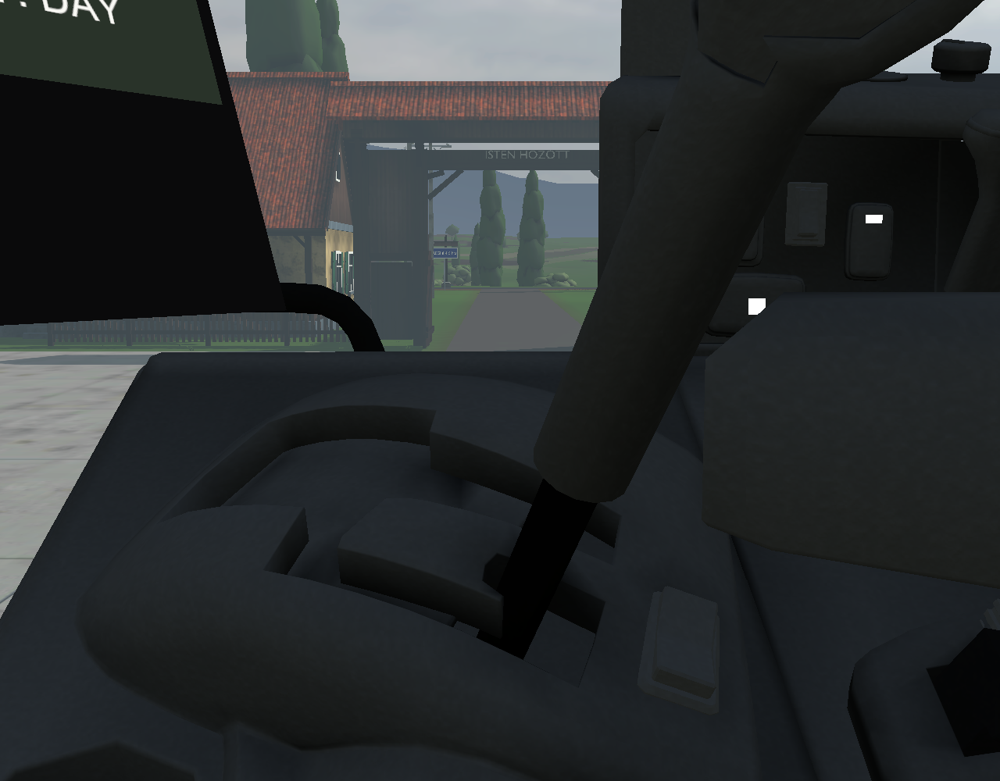 | 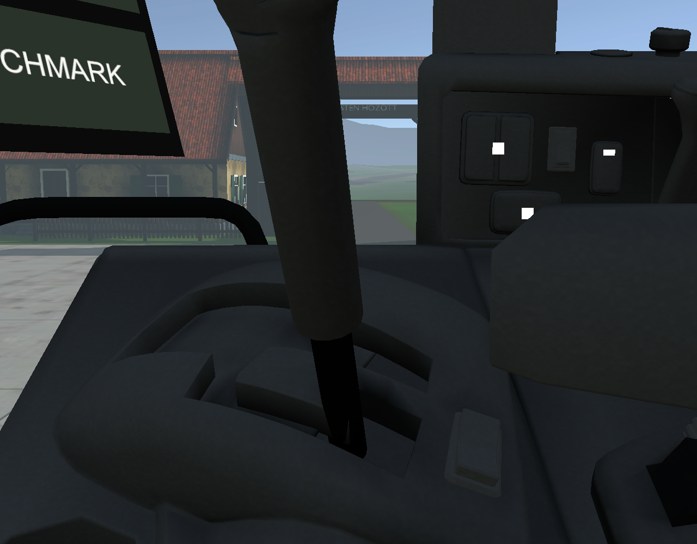 |
- Neutral with hand controls: only by bringing the speed lever back into its ±8 % neutral zone (about ±2°, under 1 cm at the knob), which is fiddly with
  hand tracking. A wider notchy neutral and a NEUTRAL/STOP panel button were added to the ROADMAP as possible improvements, together with the three grab proposals.

## 2026-10-18: Interior textures + baked ambient occlusion
The model's textures are missing, so the cab was plain grey. A UV check per material showed why simple tiling textures can't fix that:
the plastics and dashboard (most of the cab) have **degenerate UVs** (median 0.04–0.09 UV units per metre, thousands of zero-area triangles). They were
made for plain colours. Only the seat cloth, pedals and floor are properly mapped.

- **`TractorVR/TriplanarLit`** (new shader): URP lighting (`UniversalFragmentPBR`, main-light shadows, SH ambient, fog, stereo) with a detail texture and
  normal map projected from three directions in the object's own space, scaled to metres, so nothing slides when the tractor moves.
  Normal blending: whiteout. Shadow and depth passes are reused from URP Lit (`UsePass`).
- **Generated tiling textures** (512², PNG + normal map, by the setup script): fine leather-like plastic grain (6 cm tile, kept subtle after a first
  version looked like plaster), plain-weave seat fabric (40 threads per 6 cm), ribbed rubber floor mat (16 ribs per 24 cm, floor darkened),
  pedal tread blocks. 12 materials (plastics, dashboard, rubber, seat cloth, floor, pedals; `_ao` variants inside the cab).
- **Baked ambient occlusion** on the cab interior, steering wheel and speed lever (37,177 vertices): 32 rays per vertex, up to 35 cm, against the tractor's
  opaque geometry (glass left out), stored in the vertex colours. Corners, gaps, the cup holder, the footwell and under the dash now have depth. It costs nothing at runtime.
- APK 61.4 MB (+2 MB). All `PhysicsTest` scenarios unchanged. ⏳ Headset check.

| Interior | Console and lever |
|---|---|
|  |  |

## 2026-10-18: Interior checked, roadmap tidy-up
- Interior textures + AO approved in the headset. ROADMAP: everything built so far ticked off. Mirrors moved to a new "Future ideas / reference" section
  with the plan and its expected cost. Next focus chosen: more physics, the terrain, and working buttons in the cab.
- Phase 3 scope chosen: soil + wheel slip, brakes + diff lock + 4WD; fields + crop rows, roads + farmyard, varied ground; hydraulic levers,
  pressable switches, lights, keep the panel. Order: ground + layout → traction → fields + crops → cab buttons.

## 2026-10-18: Phase 3 step 1, ground + layout
**World layout** (`WorldLayout`): the start became a farmyard. A 52 × 64 m concrete yard has a barn (14 × 24 m, gable roof, doors to the yard) on the west side
and an open machine shed along the south side. Gravel tracks lead to three fields on the hills (north field = crop, south-east and west = bare soil).
An asphalt road runs north–south at x = 80. There's mud at every field gate and in hollows of the pasture (noise). The phase 1 grid floor and marker posts are gone.

**Ground map** (`GroundMap`): one surface type per square metre (2000 × 2000 bytes), built at start-up from the layout + noise
(≈ 90 % grass, 6 % fields, 4 % mud). Each surface has a tyre grip, a rolling resistance and a plough draft factor:

| Surface | Grip | Rolling | Plough draft |
|---|---|---|---|
| Asphalt | 0.90 | 0.015 | hard (can't plough) |
| Concrete | 0.85 | 0.015 | hard |
| Gravel | 0.65 | 0.030 | hard |
| Grass | 0.70 | 0.050 | × 1.25 (sod) |
| Soil / crop | 0.65 | 0.070 | × 1.0 |
| Ploughed | 0.50 | 0.120 | × 0.6 |
| Mud | 0.35 | 0.150 | × 0.8 |

**Look**: `TractorVR/GroundLit` blends grass / soil / mud textures from a 1024² control texture (2 m per texel, soft edges), with a 64 m
variation texture against visible tiling. Roads and the yard are thin meshes 3–7 cm above the actual terrain triangles (a new `SurfaceHeight`
follows the 5 m triangles, which differ from the smooth height function by up to ~4 cm), drawn with `TriplanarLit`. All ground textures are generated
(grass blades and dry patches, soil clods, wet mud, gravel stones, asphalt aggregate, concrete slabs with joints). First version: the yard looked like a bright quilt and the mud
like grey water, so both were toned down.

**Physics**: every wheel takes its grip from the surface under it, rolling resistance is load-weighted over the wheels (tractor and trailer), the plough's draft
depends on the soil, the plough can't go into concrete, asphalt or gravel (it rests on top, no draft), and ploughing turns the ground to "ploughed".

**Test findings** (new scenario O + fixes):
- The plough test had been ploughing the yard concrete (98 kN); now it's refused on hard ground, and the test carries the plough to the field (7.1 km/h at 30.4 kN).
- **The trailer stayed coupled in the editor tests**: `Destroy` does nothing outside play mode, so its joint survived detaching and dragged the trailer along with
  every teleport (35° pitch, flying tractor). It's now `DestroyImmediate` in edit mode. The game itself was never affected.
- Teleports now reset the suspension history and straighten a hand-latched steering wheel (it had sent the test tractor in circles).
- Preview rendering skips a PNG that is open in an image viewer instead of aborting the setup.

Scenario O (6.5 km/h, drive force minus the slope share = rolling resistance):

| Surface | Measured | Expected (73.6 kN × coefficient) |
|---|---|---|
| Asphalt (uphill) | 1.1 kN | 1.1 |
| Concrete | 1.1 kN | 1.1 |
| Gravel | 2.2 kN | 2.2 |
| Grass | 3.7 kN | 3.7 |
| Field soil | 5.1 kN | 5.2 |
| Mud | 11.0 kN | 11.0 |

APK 62.2 MB, installed. ⏳ Headset check.

| Farmyard | Field gate (mud, gravel, soil) |
|---|---|
|  | 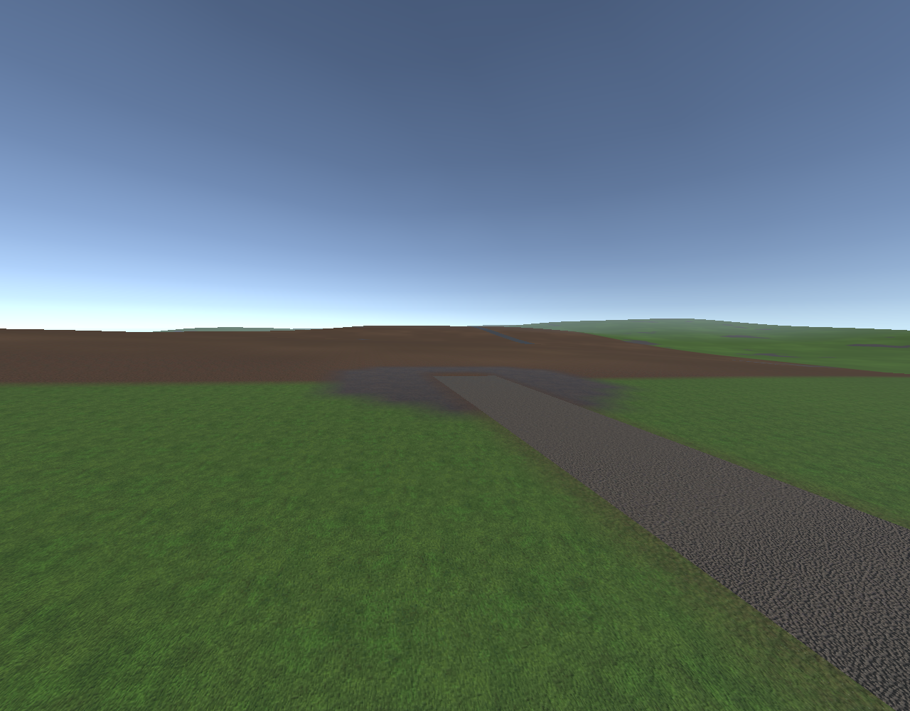 |

| Main road | Hills |
|---|---|
| 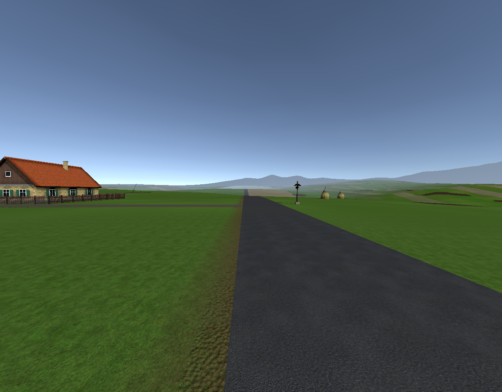 |  |

## 2026-10-18: Step 1 checked, README gallery
- Ground + layout approved in the headset.
- README reworked into a gallery (world, driving, implements, cab). New showcase renders from the setup script (`ShowcaseShots`: the tractor posed
  out in the world with the implements coupled): `hero.png`, `ploughing.png`, `trailer.png`, `mower.png`. All `docs/images` refreshed from the latest renders.

## 2026-10-18: Finishing phases 1 and 2, batch 1 (hand controls + testing)
Decision: finish every open item of phases 1 and 2 before continuing phase 3. Items already covered elsewhere were ticked or moved
(soil types / roads / farmyard done in phase 3 step 1; wheel slip → phase 3 step 2; crop rows → phase 3 step 3). The rest is split into three batches.

**Batch 1**
- **Grab feedback**: the steering wheel rim and the speed lever knob glow softly when a hand (or controller) is in reach, brighter while held
  (`_Highlight` in `TriplanarLit`, set per renderer with a MaterialPropertyBlock).
- **Speed lever geared down**: hand travel along the tractor's forward axis, 20 cm from neutral to full, relative to where it was grabbed. A **notchy neutral**
  (±20 %) snaps it upright with a click.
- **Hand snap**: a tracked hand that holds the wheel is drawn on the rim (at its own angle), and on the knob for the lever
  (`XRHandSkeletonDriver.ApplyRootPoseOffset`). Tracking jitter no longer shows on the hand.
- **STOP / NEUTRAL** panel button: lever to neutral and brake at 2.5 m/s² to a standstill (coasting would take 3× longer), then hold. **FRAME TIME** button:
  fps, frame time and the worst frame of the last second on the HUD (for the frame-rate check in the headset).
- **Play-mode test** (phase 1's open "play test in the editor"): `PlayModeTest` plays the real scene for 25 s with scripted input (drive, steer, STOP,
  every panel button twice, hitch down/up) and fails on any runtime error. It runs in batch mode and exits by itself. First run: OK
  (21.6 km/h on the yard concrete in gear D4, stopped from 22.8 km/h, 15 buttons).
- PhysicsTest: lever notch (3 cm → 0.00) and gearing (12 cm → 0.60) checked; new scenario P: STOP from 20.1 km/h → standstill in 2.2 s (expected 2.2), then holds.

APK installed, ⏳ headset check.

## 2026-10-18: Batch 1 headset check: frame rate + hand-control fixes
Headset: **41–43 fps in the cab, 53 in third person** (target 72), and the hand controls jittered, the lever only went forward, and the steering
wheel couldn't be grabbed. The Quest's own log (`adb logcat -s VrApi`) showed `FPS=41/72, App=18.2 ms, GPU%=0.99, CPU%=0.13`: completely
**GPU-bound** (budget 13.9 ms). The low frame rate also makes everything (hands included) judder through reprojection.

GPU savings:
- **Fixed foveated rendering** (OpenXR Foveated Rendering feature, SRP foveation API, no eye tracking, subsampled layout): new `Foveation` component,
  FOVEATION Off / Low / Medium / High on the cab panel (default High).
- **Terrain shader**: samples only the layers present (most pixels are pure grass: ~4 texture reads instead of 8), one normal map (the dominant layer),
  Blinn-Phong instead of PBR.
- **Interior shader**: projects from the dominant axis only (2 texture reads instead of 6), Blinn-Phong.
- Terrain no longer casts shadows (gentle hills shadow nothing within the 40 m shadow distance); shadow map 2048 → 1024.

Hand-control fixes:
- Lever travel 20 → 12 cm from neutral to full: reverse needed the hand ~24 cm back, behind the body. The neutral notch is ±25 % (3 cm).
- A pinch now grabs at the pinch point (between thumb and index tips), not the palm, which is 5–8 cm from a pinched rim. The gesture is chosen when the grab starts,
  so switching mid-grab can't jump. Grab reach for tracked hands 7 → 9 cm.

Tests: PhysicsTest + PlayModeTest OK. APK installed; ⏳ frame rate to be measured in the headset (the Quest only renders while worn).

## 2026-10-18: Speed lever rebuilt
Headset: frame rate better, but the speed lever "either won't move, or moves but not in the right direction". The geared, straight-line mapping
(hand forward/back → lever) with a dead 3 cm notch felt wrong: small movements did nothing, the lever then jumped out of the notch, and the knob
didn't stay under the hand because a lever swings in an arc.

New behaviour (`CabControls`):
- **The lever follows the hand around its pivot** (side view): the knob stays in the hand. It's relative to where it was grabbed (no jump).
- **Neutral is in the speed, not the lever**: the lever moves freely; the speed command is 0 in the middle ±25 % of the swing and rises smoothly beyond it.
  It clicks when passing the edge of neutral, and snaps upright if let go there.
- **HUD while held**: "LEVER: N", "LEVER: F 47%", "LEVER: R 20%".
- **Diagnostics**: wheel / lever grabs and releases are logged (`[Cab]` in `adb logcat -s Unity`), with the hand type (controller, hand fist, hand pinch).

Test (`PhysicsTest` N): swings of 5° / 15° / 25° / 0° / -15° give speed commands 0 / 0.47 / 1.00 / 0 / -0.47 exactly, with the knob 0.0 cm from the hand;
re-grab doesn't jump; let go at -3° snaps to neutral. Noisy hand-tracking replay (+20° → -20°): never the wrong direction. PlayModeTest OK. APK installed.

## 2026-10-18: Lever confirmed; frame rate, round 2 (tractor triangles)
Session log (`adb logcat -s Unity VrApi` recorded in the background):
- **Lever and wheel work**: lever grabbed by pinch (into reverse, -0.65), by fist (no jump, back to forward), by controller (full forward 1.00, full reverse -1.00);
  wheel grabbed by pinch.
- **Frame rate**: average 58 fps (48–71). Two clear states: ~13.5 ms GPU (65–70 fps) and ~17 ms (48–54 fps); the budget is 13.9 ms.

Where the GPU goes: the **tractor model is 749k triangles** (~70 % of the scene), and **all of it cast shadows**, so it was drawn a second time
for the shadow map. The steps alone are 41k + 37k triangles, and the engine under the hood 47k.
- **Shadow stand-in**: a 416-triangle shadows-only mesh (cab roof + pillars so light still falls through the windows, cab body, hood, rear frame,
  wheels) casts the tractor's shadow. The 66 model renderers no longer cast shadows, so the second 750k-triangle pass is gone.
- **Mesh LODs** (Unity 6 mesh LOD generation on import, up to 4 levels): LOD0 625k, LOD1 355k, LOD2 233k, LOD3 151k triangles.
  `QualitySettings.meshLodThreshold` 1.5. Forced-LOD renders (`lod1/2/3.png`): LOD2 at ~8 m looks the same as LOD0; LOD3 shows defects (rims, exhaust).
  Close-up views keep full detail.
- PlayModeTest OK. APK installed, log recording again for the next session.

## 2026-10-18: End of day
Last session (log recorded over USB): **72 fps most of the time** (GPU ~11.3 ms), stretches at ~15 ms (59–60 fps) and one short drop to 20–23 ms (30–39 fps).
Average 61 fps, up from 41–53 at the start of the day. Accepted for now; a context logger for slow frames was started and then left for later (not committed).

Summary of the day:
1. ROADMAP tidy-up, phase 3 planned (physics, terrain, cab buttons); step 1 built: ground map, natural terrain, farmyard, roads, fields, per-surface physics.
2. README turned into a gallery with new showcase renders; the phases section restored.
3. Decision: finish phases 1 and 2 first. Batch 1 done: hand-control improvements (highlight, rebuilt speed lever, hand snap, STOP), play-mode test.
4. Frame rate on the Quest: foveated rendering, cheaper terrain and interior shaders, no terrain shadows, a shadow stand-in instead of the
   750k-triangle model, mesh LODs.

Next: batch 2 (cab), then batch 3 (implements), then phase 3 step 2 (traction).

## 2026-10-21: Finishing phases 1 and 2, batch 2 (cab)
All four batch 2 items, built and tested in the editor. APK (62.2 MB) installed, ⏳ headset check.

**Hydraulic remote levers** (`CabControls.Swing`, cut out in `ProjectSetup.SplitSteeringWheel`): a probe of the cab mesh's connected pieces showed
each of the three levers behind the speed lever is three pieces: a knob (2 cm tall), a handle (8 cm) and a stem (10 cm) going into the console.
Setup finds each kind by its height, sorts by x and zips them; the pivot is the bottom of the stem (y 2.155–2.199). Spring-centred, ±20°,
15 % dead band. Pull back = raise, push forward = lower, speed proportional to the deflection: 1 = rear hitch, 2 = front linkage
(through `Hitch.MenuLift`), 3 = trailer tipping (batch 3). The HUD shows e.g. "REMOTE 1 HITCH: RAISE 60%".

**Doors**: the model's `Door_L/R` pivots already sit on the hinge line at the rear edge (JD cabs have rear-hinged doors). Each door gets a
tractor-aligned `Hinge_Door_*` and opens outward up to 65°; more would swing the lower door panel into the rear fender (checked with
`doors_side.png` / `doors_top.png`). Grab anywhere on the door: it follows the hand around the hinge, relative to the grab point, and stays where
it is let go. The panel's DOORS button opens / closes both. They clunk when they shut. Doors and remote levers share one class (`Swing`):
grab box in hinge space, angle of the hand around the hinge axis, limits, optional spring return. A grab goes to the nearest swing in
reach, or to the speed lever if its knob is closer.

**Torque curve** (`Drivetrain`): 520 Nm at 800 rpm, 880 Nm at 1500–1600 (34 % torque rise), 659 Nm at 2100 (145 kW rated), governor down to 0
at 2250; peak power 151 kW at 1800. `TractorController` now limits the drive force with the power at the current engine speed
(it used a flat 145 kW). Three follow-ups the physics test showed:
- RPM stayed at idle in the test: `SmoothDamp` and the shift timer used Unity's clock. Both now use the `dt` passed to `Drivetrain.FrameUpdate`,
  which the test steps (before, the test never ran the drivetrain, so the engine had no influence on it).
- In the low gears the 0.5 s between shifts let the engine run into the governor (76 kW at 2174 rpm). AUTO now skip-shifts straight to the
  first gear below the upshift speed.
- Pulling away with the plough already in the ground stalled at 0.4 km/h: at idle the engine has 49 kW, not enough for 30 kN of draft.
  When the drive force is power-limited, the engine is now brought up to peak torque (1550 rpm, the clutch slips) for at least a second,
  and AUTO shifts down when it lugs. The plough run is back to 7.1 km/h with 30.4 kN of draft, ending where it did before.

**Hand throttle**: THROTTLE − / + on the cab panel and the CommandCenter (hold; 400 rpm/s), `[` / `]` on the keyboard. It sets the engine speed:
AUTO holds the engine there (shift band hand rpm −200 / +150, as with the PTO), and in manual the tractor drives at the selected gear's speed
for that engine speed as soon as the lever or stick asks for motion. Test: C1 at 1500 rpm, lever at 0.15 → 6.2 km/h (expected 6.2).

**Fuel and coolant**: 340 L tank (85 % at the start and after RESET TRACTOR), use = 2.5 L/h × rpm/850 + 0.24 L/kWh × engine output
→ 2.5 L/h idling, 41 L/h at full power (the 6195M's real figure is about 40). Kept in a double: one 90 Hz step of idle use is below float
precision at 289 L, so the first version never used any fuel at idle. Coolant from 35 °C to the thermostat's 85 °C (+8 under load)
in ~6 min at idle, faster under load.

**CommandCenter display** (`CommandCenter.cs`, built at runtime like the cab panel): a 24 × 15 cm screen on a short arm at the right front
corner post (0.50, 2.40, 1.00), facing the eye point. It shows engine speed, hand throttle, fuel (bar, %, litres), coolant (bar, blue when cold),
fuel use, power used / available and torque, hitch / front linkage / PTO and engine hours, with two touch buttons. Fuel and temperature
are on this display, not the cluster: from the seat the hub and the column shroud hide everything but the top of the dials.
The play-mode test caught a bug: its quads were built with `CreatePrimitive`, whose MeshCollider sat on the tractor's Rigidbody until the
deferred `Destroy` ("Concave Mesh Colliders are not supported..."). They're plain MeshFilter quads now.

Tests: PhysicsTest Q (torque table, hand throttle manual + auto, fuel, coolant warm-up) and N (remote levers 1 and 2 move the hitch /
front linkage and spring back, door swung by hand to 40° stays, DOORS button closes / opens both). The older scenarios match the previous
run (climb, parking, bale, plough, mower, trailer, surfaces). PlayModeTest OK (19 panel buttons, CommandCenter hand throttle).

| CommandCenter | Remote levers (1 raised, 2 lowered) | Door open |
|---|---|---|
| 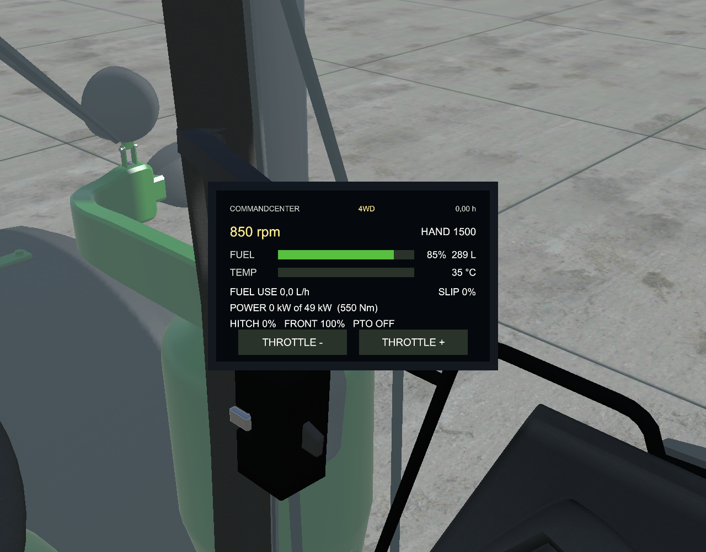 |  | 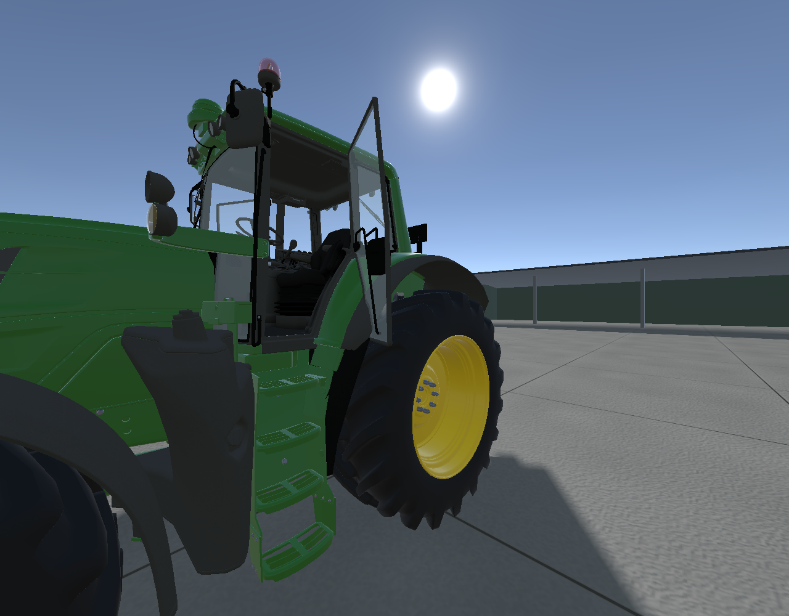 |

## 2026-10-21: Finishing phases 1 and 2, batch 3 (implements)
All five batch 3 items, built and tested in the editor. APK (62.3 MB) installed, ⏳ headset check. With this, every phase 1 and 2 item
is built; phase 2 closes after the headset check of batches 2 and 3.

**Probe first**: a temporary editor script printed the pivots and extents of the top link and the front cylinders, and rendered tinted
close-ups. The top link `Rear_Holder_01` has its pivot on the tractor bracket at (0, 1.179, −0.511) and stands 0.94 m tall. The front
cylinder barrels pivot on their frame pin at the top (1.162, 3.337), but the model pins the rods *on the lower link's own pivot*, where a
cylinder couldn't move anything. The renders show a lug below each link's pivot, so the rods ride on that lug (centroid of the link's
vertices more than 4 cm below the pivot, (0.773, 3.588)).

**Top link with three-point pitch** (`Hitch`): when a three-point implement with a `topPin` is coupled, the top link is set to the length that
fits at that moment (plough: 92 cm) and stays that long, like a turnbuckle. Each frame `SolvePitch` finds the implement pitch about the
lower-link pins that puts the top pin at that distance from the bracket (bisection, root nearest level), and turns `RearMount` by it. The
implement follows because it takes the mount's rotation. The top link mesh is turned onto the pin and stretched along its axis.
PhysicsTest J: plough level when coupled (0.6°), −1.2° at working depth, +14.6° fully raised (tail up), with the same draft (30.4 kN)
and track as before.

**Front linkage cylinders**: the barrel turns on its frame pin towards the lug pin. The rod is turned by the same angle and slides along
the barrel by the change in length (`front_cyl_up/mid/down.png`).

**Tipping trailer** (`Tipper.cs`): the body (floor, sides, stakes, headboard with ladder, body collider) is a child hinged at the rear of the
chassis. A seven-stage telescopic ram runs from the drawbar to the top of the headboard; its stages spread evenly between base and pin,
from 0.7 m closed to 4.1 m at the 45° limit. The tailgate hangs from its top edge and stays plumb, so it swings open. The trailer
starts with 3 t of soil: above 20° it pours (full rate at 40°) into a mound behind the tailgate, sized by volume (1500 kg/m³, repose ~25°).
A new mound starts when the trailer has moved on 1.5 m. Mass and centre of mass follow the load and the body angle, and the tractor's towed
mass follows too. It's worked by remote lever 3, the panel's TIP UP / DOWN, or I / K, only while coupled.
PhysicsTest S: 3000 kg poured in ~5 s at 45°, CoM 1.23 → 2.14 m high at the peak, one mound of 1.41 m radius 7 m behind the eye, then
lowered in 4 s and driven off at 12 km/h.

**Front weight**: 900 kg of cast slabs on a carrier, coupled to the front linkage like the mower. PhysicsTest R: front axle 29.4 → 42.0 kN,
rear 44.2 → 40.4 kN (lever rule: +12.3 / −3.5). Two bugs showed up here:
- The weight couldn't be uncoupled ("LOWER FRONT LINKAGE FIRST"): the lowered check uses ground points and the weight has none. Now an
  implement without working parts measures its depth by its coupling point against its parked height.
- That left everything after it coupled. The trailer stayed on the drawbar, and the next scenario's teleport dragged it along and made
  the physics explode (6100 km/h). The tipping scenario now uncouples at the end, and reports it.
- The centre of mass was only computed when coupling, so lifting an implement didn't move it. `Hitch` now updates mass and CoM every
  frame while anything is coupled (the plough raised shifts the front axle 0.2 kN more than before).

**Better implement models** (all generated in `ProjectSetup.BuildImplements`):
- Procedural meshes: lugged tractor tyres (two staggered rows, a castellated profile swept across each half, flat-shaded) and a twisted
  mouldboard surface.
- Plough: cross shaft with yellow pins, A-frame headstock and top pin, braces, beam, raked legs, frogs, shares and points, mouldboards,
  landsides, disc coulters, depth wheel on an arm, parking stand.
- Mower: A-frame headstock with hooks, gearbox, PTO shaft guard, knives on the discs, sloping hood, side shields, rubber curtain, skids.
- Trailer: A-frame drawbar with eye ring, jack with crank, rails and cross members, leaf springs, mudguards, light bar with lamps and plate,
  stakes and top rails, headboard ladder, tailgate with bar.

Tests: PhysicsTest R and S are new and J logs the pitch. All other scenarios match the batch 2 run. PlayModeTest OK: 21 panel buttons, and
the parked trailer's body raised in play mode pours its whole load into one heap.

| Top link at work / raised | Tipping | Front weight |
|---|---|---|
|  | 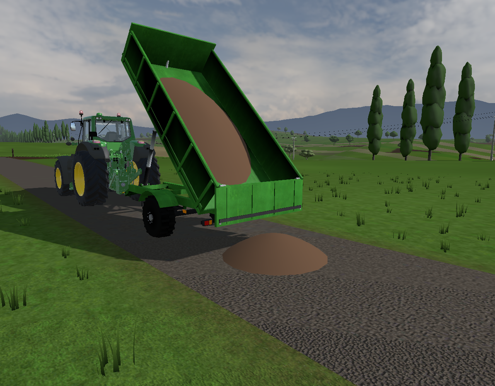 |  |

## 2026-10-21: Headset test of batches 2 and 3, phases 1 and 2 closed
Tested in the headset by the user: everything in batches 2 and 3 works, and **phases 1 and 2 are complete**.
One bug, to fix next session (in the ROADMAP under "Known bug"): RESET TRACTOR with the trailer coupled makes the trailer disappear, and
it stays coupled and can't be detached. The optional original-textures item of phase 1 moved to "Future ideas".
Next: fix that bug, then phase 3 step 2 (traction).

## 2026-10-30: Reset-with-trailer bug fixed; phase 3 step 2 (traction)
Both built and tested in the editor, APK (66 MB) installed on the headset, ✅ headset-checked 2026-10-30 ("looks good").

**RESET TRACTOR with the trailer coupled.** The reset moved only the tractor's Rigidbody. The trailer stayed on its joint ~120 m away;
the joint yanked it across the map, and it ended up out of sight and too far round for "STRAIGHTEN UP TO DETACH". Now the reset also sets
the tractor's transform (so the mounts are in their new place at once) and calls `Hitch.AfterTeleport`, which puts a coupled trailer
straight back on the drawbar, at rest, with its suspension history cleared (`Implement.SnapToMount`, `SimpleWheels.ResetSuspension`).
Mounted implements are children of their mounts and follow by themselves. PhysicsTest T resets while driving with the trailer coupled:
it comes along (gap 0.0 cm, straight), still tows at 6.5 km/h, and detaches.

A second teleport bug turned up while testing traction: `ResetSuspension` didn't clear the **parking-brake anchor**. When the tractor stood
still before and after a teleport, the hold kept pulling it towards the old spot; the sideways part (capped at full grip) rocked it up to 20°.
It's why PhysicsTest R measured wrong "before" axle loads in this run and why the hay bale in H didn't move. Both are right again
(R: 29.4 → 42.0 / 44.2 → 40.4 kN as in batch 3; bale pushed 9 m). This also hit RESET TRACTOR in the game when standing still.

**Traction** (`TractorController`):
- The drive / brake force goes to the wheels that take it: rear always; front with 4WD; all four while parked (park lock + front axle).
  Braking: all wheels with all-wheel brakes or 4WD engaged, otherwise rear only.
- Lateral grip comes first now (a tractor sliding sideways is the worst for comfort); the drive force gets the rest of the friction circle.
- Differentials: an **open** diff gives both wheels the same force, so the wheel with less grip limits the axle to twice its grip and spins.
  The **diff lock** lets each wheel use its own grip; it lets go above 12° steering or 15 km/h, like the real one. With 4WD the axles are
  coupled rigidly (no centre diff), so what one axle can't put down goes to the other. Brakes act per wheel.
- **Slip** per tyre from a traction curve μ(s) = μmax·(1 − e^(−k·s)) with k per surface (`GroundMap.Surface.slipK`: asphalt 35 … mud 6).
  A wheel the ground can't hold spins up (an open diff's wheel twice as fast); a braked wheel locks. Each tyre has its own speed, which
  drives the wheel animation, and the **engine RPM follows the rear wheels' speed** (with slip the engine runs faster than the ground speed).
- Readouts: CommandCenter `SLIP %` (red above 20 %) and drive state (4WD / 2WD, DIFF LOCK, REAR BRAKES); HUD shows slip above 5 %.
- **Clods**: one small particle system per wheel (mesh cubes, lit, ≤ 40 particles, no shadows), tinted per surface; emits when the wheel
  slips more than 20 % on soft ground. Material `Generated/WheelDirt.mat` (URP Particles/Simple Lit) from setup.
- Controls: panel buttons 4WD, DIFF LOCK, BRAKES (24 buttons now), keyboard F / L / B.

PhysicsTest U (plough at work, 30 kN draft on the crop field, 7 km/h): slip 16 % with 4WD, 18 % 2WD, 17 % 2WD + diff lock
(ploughing slip is 10–15 % in practice). Split grip (left wheels in the mud at the north gate, right on grass/crop, plough in):
2WD open diff: the left rear wheel spins at 14 km/h, the right one stands, the tractor stalls; 2WD + diff lock: both rear wheels spin, slow
crawl; 4WD open diffs: both left wheels spin, stuck; 4WD + diff lock: pulls away (4 km/h) but bogs down: half the tractor in mud can't
pull 30+ kN. V (STOP at 18.5 km/h entering mud): all-wheel brakes ~5 % brake slip, rear only ~20 %; no lock-up at the comfort rate
(2.5 m/s²), both stop in 5.2 m. All other scenarios unchanged. PlayModeTest OK (24 buttons pressed twice).

**Plan change (2026-10-30, after the headset check).** The user will do the environment work with Blender, so phase 3 step 3
(standing crops cut by the mower, the ploughed-ground look) is moved to a new ROADMAP section "Environment art (with Blender, later)",
together with phase 2's "field with crop rows". Ploughed ground already has its own grip, draft and slip since steps 1–2. Next: step 4
(cab buttons + lights).

## 2026-10-30 (later): Phase 3 step 4, cab buttons + lights
Built and tested in the editor, APK installed on the headset, ⏳ headset check.

**Switches from the model.** The right-hand side console of the cab interior has real switch pieces: rockers (1 × 3.5 × 2 cm), a
double rocker, a flat round button and a small knob on its top, next to three big HVAC knobs. Setup cuts eight of them out of the
interior mesh like the levers (found by their centres, within 8 mm) and gives each a hinge: rockers tip ±7° around a hinge behind their
face, push buttons sink 3 mm, the knob turns 45° per step. `CabSwitches` pokes them like the cab panel buttons (fingertip or controller
tip; each hand only the switch its tip is deepest in, and it has to move 3 cm clear before the next push). Each switch shows its state
and has a small lamp (green / amber / red). Functions: road-light knob (OFF / SIDE / HEAD), hazards (round button), front work lights, rear
work lights, beacon, 4WD, diff lock, PTO. The corner post has no switches in the model (the CommandCenter is there).

**Indicator stalk.** Left of the column at hub height, five pieces (the ribbed end included) out to x −0.29; the column's switch
housing stays. It is a `CabControls.Swing` (axis −Z, ±12°, + = up = right) with a small grab reach (2.5 cm), and the rim wins when the hand
is closer to it (they are ~5 cm apart). `TractorLights` reads it while held and moves it to match the indicator otherwise (cancel, keys,
panel). The indicator cancels when the wheels come back below 3° after being turned more than 10° its way.

**Lamps.** The lamp glass of the model shares a few materials across all lamps (`headlights_cap01` is the grille lights *and* the
roof work lights), so no lamp can light up on its own. Setup measures each lamp from the lamp materials, then lays a lens disc on its
glass (a ray from in front against temporary colliders of the lamp parts; 22 of 22 found) and adds a halo: a camera-facing quad
(`TractorVR/Halo`, billboarded per eye in the vertex shader, additive, computed falloff) that shows at dusk / night and only from the
front of the lamp (it glared into the cab from the cab-front lamps). Beacons are spheres over the domes, pulsing as a rotating reflector.
Real light only where it matters (Quest per-object light budget): one spot for the headlights, one for each work-light set, a dim cab
light at dusk / night. The work-light spots start beyond the bonnet / hitch: from the roof they lit the bonnet 1–2 m away so brightly
that the whole view from the cab was washed out.

**Day / dusk / night.** `TractorLights` keeps the day settings and scales sun (dusk: 6° high, orange; night: weak bluish moonlight),
ambient colours and the ambient probe, fog colour, reflection intensity and the skybox exposure. The cab glass is unlit, so it stayed
day-bright and laid a grey veil over the night view: it is now dimmed per material slot with the ambient light. The skybox is a shared
asset, so it is put back to day when the component goes away (editor play mode).

Also: brake lights from `TractorController.Braking` (braking harder than coasting); indicator tell-tales `<<` / `>>` on the CommandCenter;
cab panel 31 buttons in three columns (LIGHTS, WORK, BEACON, HAZARDS, < INDICATOR, INDICATOR >, SKY); keys G / N / O / Y / , / . / U.
PlayModeTest presses all 31 panel buttons and the 8 console switches, then drives on at night with lights, beacon and indicator: OK.
PhysicsTest unchanged.

**Fix after the first headset try (same day): levers grabbed while pressing switches.** The user: "the levers and the wheel are
getting in the way sometimes". The headset log (hand tracking) showed remote levers 2 / 3 grabbed and let go within half a second,
over and over, while reaching for the console. Cause: a fist was the average of the index, middle and ring tips' distance to the palm
(< 6.5 cm); a pointing hand (index out, the others curled) averages under that, so pressing a switch was a fist grab, and a hand's swing
reach (9 cm around the lever) covered the switches 5–7 cm away. Fixes: a fist only starts with the index curled too (index tip < 8 cm from
the palm, `VRHands`); no grab at all while the fingertip is on a switch (`CabSwitches.Touching`, `CabControls.TryGrab`); the remote
levers' grab reach is 4 cm (`Swing.reach`). The pointing rule also keeps the wheel from being grabbed while pressing something behind it.
APK reinstalled, ✅ headset-checked ("looks good"). **Phase 3 closed 2026-10-30** (step 3 moved to the Blender section).

## 2026-10-30 (evening): Labelled cab guide in the README
The user asked for cab images with arrows and text boxes for every control. `CabGuide.Run` (editor, menu Tractor VR > Render Cab
Guide) renders four views from the seat with a soft fill light: the driver's view, the right-hand console, a close-up of the switch
panel (from the front: seen from the seat, the 4WD rocker hides behind remote lever 3) and the open cab panel. It writes where each
control lands in the picture (`WorldToScreenPoint`, flagged when outside). `tools/annotate_guide.py` puts the render between two label
columns, stacks the boxes near their control's height without overlaps and draws the arrows. The panel buttons carry their own
labels, so the README explains them in a table instead.

## 2026-10-30 (evening): Plan for phases 4–6; blender-mcp installed
The user wants two modes (free roam + tutorial), a better environment made with Blender, and, because the Quest GPU is weak, a
version where the laptop renders (PC VR over Link) plus a PC desktop version. Agreed order: **phase 4 versions → phase 5 environment →
phase 6 tutorial**. The versions first, because they set each version's graphics budget before any art is made (every Blender asset gets a
full and a light version) and editor play through Link speeds up the testing; the environment before the tutorial, whose lessons
are tied to places. The old "PC VR build" and "Environment art" sections of the ROADMAP became phases 4 and 5.

blender-mcp (github.com/ahujasid/blender-mcp, add-on v1.8): Blender 5.2 and uv were already installed. The MCP server is registered
with Claude Code (`claude mcp add blender -- uvx blender-mcp`, local config for `Irum_proj`; connects). The add-on was read before
installing: socket server on localhost:9876 that runs what the MCP client sends, telemetry off by default, optional online asset
sources (Poly Haven, Sketchfab, generators) off unless switched on. Copied to `%APPDATA%\Blender Foundation\Blender\5.2\scripts\addons\blender_mcp_addon.py`; it still has to be enabled once in Blender (Preferences → Add-ons), the command-line enable was blocked.

## 2026-10-30 (night): Phase 4 started: quality tiers, PC build
Checked first: phases 1–3 have no open items (the crop-row items are moved to phase 5). On the laptop, the Meta Horizon Link app is
already installed and is the active OpenXR runtime (`HKLM\SOFTWARE\Khronos\OpenXR\1\ActiveRuntime` → `oculus_openxr_64.json`), and the
Unity Windows module is there (Mono only, no IL2CPP variation).

**Two quality levels instead of Unity's six defaults** (`ProjectSetup.ConfigureRenderPipeline`, edited through the QualitySettings asset):
- **Quest** (Android default): `QuestURP` as before: MSAA 4×, render scale 1.0, hard shadows, 1024 shadow map, 40 m, 1 cascade, mesh LOD threshold 1.5.
- **PC** (Windows default): `PCURP`: MSAA 4×, render scale 1.2, soft shadows, 4096 shadow map, 80 m, 2 cascades, mesh LOD threshold 0.5
  (full model up close).
- `QualityTier` (on the tractor, filled by `BuildShadowProxy`) applies the scene side at start: on PC the 78 model renderers cast their own
  shadows and the 416-triangle `ShadowProxy` is switched off; on Quest nothing changes. It also holds the **budget** the phase 5
  environment assets will read (`QualityTier.CurrentBudget`: detail distance 120 / 400 m, vegetation density 0.35 / 1, terrain shadows off / on).
- The Quest-only optimisations stay on Android without per-build switches: foveation is an Android OpenXR feature only, the URP asset
  and LOD threshold come from the per-platform default level.
- The editor plays at **PC** quality (for play through Link); menu *Tractor VR → Quality: Quest / PC* switches it.

**Windows player settings** (setup): Mono, Direct3D 11 only (the most reliable API for OpenXR over Link), windowed 1600×900, resizable,
runs in the background. `BuildPC.Build` (menu *Tractor VR → Build PC (Windows)*) → `Builds/PC/TractorVR.exe` (153 MB).

**Tests**: `PlayModeTest` now logs the tier; OK at both levels (PC: stand-in off, 78 renderers cast; Quest: stand-in on, 0 cast).
Windows build: succeeded. Quest APK rebuilt after the change: 66.8 MB, same as before.

**NVIDIA driver warning in the Link app**: the laptop has driver 621.01; Meta Horizon Link asks to roll back to **591.86** (it reports a
known NVIDIA bug that freezes Link during play). The Meta community forums say the rollback fixes the freezes for many, some still
see them on newer drivers, and Air Link with sliced encoding off is reported to work regardless. No official advisory was found.

Waiting on the user: the cable / Air Link and a first run through Link (editor play mode and the exe), 90 Hz in the Link app, and
what "standalone PC version" means for the desktop part.

## 2026-10-30 (night): Black PC window; desktop version
**Black window.** The user started `TractorVR.exe` and saw a black window. Player.log: OpenXR connected to the Link runtime and the
session went IDLE → READY → SYNCHRONIZED but never VISIBLE / FOCUSED: no headset in use through Link, so the app rendered for nobody
and the window (the headset mirror) stayed black. Not a crash, but a black screen without a headset is bad, and the user confirmed what
"standalone PC version" means: **on the monitor, mouse and keyboard, no headset**. So the same exe now does both.

**`DesktopMode`** (on the rig, wired by setup):
- Start-up on Windows / in the editor: VR if the OpenXR session is focused within 6 s (`OpenXRUtility.IsSessionFocused`), with a
  "waiting for the headset, D = monitor" hint meanwhile; otherwise the XR loader is stopped and deinitialised and the camera renders
  to the window. `-desktop` / `-vr` force a mode; F9 / TRY VR re-initialises XR later. Android never uses it.
- Camera: the head's `TrackedPoseDriver` is off. Cab: right mouse = look (±160° / ±75°, starts 12° down), wheel = zoom (FOV 30–90°).
  Third person: right mouse orbits a pivot 1.8 m above the tractor, wheel = distance (5–30 m). R = look ahead again. vSync on.
- **Mouse hand**: instead of new mouse code for every control, the mouse is fed into `VRHands` as the right hand, so `CabControls`,
  `CabSwitches` and `CommandCenter` work unchanged. The ray hits **pick proxies**: static `MeshCollider`s on layer 30 for the 34 readable
  (generated) meshes within 1.3 m of the seat, moved onto their parts every frame. They can't be colliders on the parts themselves (the tractor
  is a dynamic Rigidbody). Layer 30 ignores all collisions, and the wheel rays (`TractorController.GroundRay`, `SimpleWheels`) now leave it out.
  Grab = left button (the drag stays at the depth where it started); the poke tip exists only while the button is down and stays on the part
  first clicked, so sweeping the mouse doesn't press every switch on the way.
- **Screen menu**: the cab panel's 31 buttons as an IMGUI menu (M or the MENU button, top right; `CabPanel.Entry / PressEntry`, the
  in-cab panel hidden with `SetHidden`), plus FULLSCREEN / WINDOW (F11) and TRY VR (F9). Key help at the bottom left; the HUD moves onto
  the camera (bottom centre); the comfort vignette is off.

Tests: `PlayModeTest` (batch mode has no XR, so it now runs in desktop mode: 34 pick proxies) OK; `PhysicsTest` OK; Windows build OK.
The exe started with `-desktop` renders the cab on the monitor (`docs/images/desktop_cab.png`). Mouse interaction still needs the user's test.

## 2026-10-30 (night): First Link try: grey / stuck on the loading screen
After the driver rollback (591.86) the user reports: desktop version works flawlessly; in VR the headset stays black / grey and hangs
on the Link loading screen. Player.log: three sessions, each READY → SYNCHRONIZED and never VISIBLE / FOCUSED, then STOPPING after
6–10 s. The stop was `DesktopMode`'s own fallback: it shut XR down while Link was still loading, which leaves the headset stuck there.
Changes: the wait is now 20 s, and the waiting hint names the likely cause. A Link session that stays SYNCHRONIZED for a self-built app
usually means **Unknown Sources** is off in the Meta Horizon Link app (Settings → General), the open laptop-setup item. ⏳ user check.

## 2026-10-30 (late): Link grey screen: the Link dashboard can't start Vulkan (laptop GPU)
After a restart, Link still showed only grey and the game's session stayed SYNCHRONIZED for 24 s. Meta's own logs
(`%LOCALAPPDATA%\Oculus\`): `OculusDash.exe` (the Link dashboard, app 1438194916201007) restarts about once a second, each time with
`ovrError_InitializeVulkan` (VK_INCOMPLETE) in the Client log and "Missing entitlement for 1438194916201007" in the Service log as it is
closed. The laptop has two GPUs (Ryzen's AMD Radeon iGPU, AMD Radeon Software installed, plus the RTX 3060), and no Windows GPU
preference was set for any Link program. Likely cause: Link starting on the AMD chip. With no dashboard, nothing becomes visible, our app included.
Fix (the ROADMAP "force onto the NVIDIA GPU" item): Windows per-app GPU preference **High performance** (`HKCU\Software\Microsoft\DirectX\
UserGpuPreferences`, `GpuPreference=2;`, the same as Settings → System → Display → Graphics) for `OVRServer_x64.exe`, `OVRRedir.exe`,
`OculusDash.exe`, `OculusClient.exe`, `Builds\PC\TractorVR.exe` and `Unity.exe`. Needs a Link restart. ⏳ user check.
Also from the Link app: the headset is on a USB 2 connection ("USB 3 recommended").
**Cause found (same evening):** the GPU preference alone didn't help (49 more dashboard crashes after a restart). The full error is
`vkEnumeratePhysicalDevices failed` (VK_INCOMPLETE). `vulkaninfo --summary` listed **only the AMD iGPU**: the AMD driver's
`VK_LAYER_AMD_switchable_graphics` (driver 27.20.14032, Vulkan 1.2.150, from 2020) hides the RTX 3060 from Vulkan apps. With the layer's
own off switch (`DISABLE_LAYER_AMD_SWITCHABLE_GRAPHICS_1=1`, from its manifest `amd-vulkan64.json`) vulkaninfo lists GPU0 = RTX 3060,
GPU1 = AMD. Set as a **user environment variable** (OVRServer runs as the user). Needs a sign-out or restart to reach the Link processes. ⏳ user check.
(Also present: a "SudoMaker Virtual Display Adapter" virtual display driver; not touched, a suspect if Link still fails.)
**Result:** after the restart the Link dashboard starts (no Vulkan errors), and `TractorVR.exe` runs in the headset over Link (USB 2 cable).
User: "works beautifully". ✅ PC VR over Link working, 2026-10-30.
Refresh rate: the old menu path (Link app → Devices → Quest 2 → Graphics preferences) was given to the user; afterwards: "all works
amazing". Desktop version: "works flawlessly" (earlier the same evening).

## 2026-10-31: Version comparison (benchmark + quality stills); phase 4 closed
**`PerfBenchmark`** (cab panel / screen menu BENCHMARK, F8, `-benchmark`): resets the tractor (automatic gearbox, hand throttle idle,
PTO off, day), 3 s settle, 30 s cab view driving straight out of the yard at 0.55 throttle (25.5 km/h), 30 s third person with a gentle
left turn. Every frame: frame time, Unity `FrameTimingManager` CPU / GPU (`enableFrameTimingStats` on), and in VR the runtime's
`XR_META_performance_metrics` through `XRStats` (`perfmetrics.appgputime`, `perfmetrics.compositorgputime`,
`appstats.compositordroppedframes`; units checked: the XR app GPU time equals the FrameTimingManager GPU time in ms). Output in
`persistentDataPath/Benchmark/<version>_<time>/` (summary.txt, frames.csv, two stills); runs kept in `docs/benchmark/`.
Fixes found on the way: the gearbox mode is remembered between sessions, and manual mode held the first desktop run at 3 km/h in B2, so
the benchmark now sets a fixed machine state. Reading a still back stalls the next frame (one 120 ms frame on the PC, ~20 dropped frames
on the Quest), so the stills are now taken outside the timed drive. A still read from a multisampled target came out black on the Quest
(Vulkan), so it now renders to a single-sampled one (URP still applies MSAA). The first Quest run (`QuestStandalone_..._first`) is
kept for reference: its third-person phase also had a 3 s GPU peak of 19 ms in the turn, which the second run didn't repeat.

| | Quest standalone | PC VR (Link, USB 2) | PC desktop |
|---|---|---|---|
| Hardware | Quest 2 (Adreno 650, Vulkan) | RTX 3060 Laptop (D3D11), streamed | RTX 3060 Laptop, monitor |
| Quality level | Quest | PC | PC |
| Refresh / frame budget | 72 Hz / 13.9 ms | 90 Hz / 11.1 ms | 144 Hz (vSync) / 6.9 ms |
| Render target | 1440×1584 per eye, scale 1.0, foveation MEDIUM | 1998×2036 per eye (scale 1.2) | 1920×1080 (scale 1.2) |
| fps cab / third person | 71.8 / 71.8 | 89.7 / 89.7 | 143.9 / 144.0 |
| Frame time p99 | 13.9 ms | 11.2 ms | 7.0 ms |
| Frames over budget (>110 %) | 0.0 % | 0.1 % | 0.0 % |
| GPU time avg (p95) | 9.6 ms (10.4) | 2.1 ms (2.6) | 2.0 ms (3.5) |
| GPU share of the budget | 69 % | 18 % | 29 % |
| Compositor GPU | 1.4 ms | 0.8 ms | – |
| Dropped frames (60 s) | 5 | 0 | – |

Latency: not measured. Motion-to-photon isn't reported through this path, and the Link encoding / USB stream happens outside the app.
Reading: every version holds its refresh rate. The Quest uses 70 % of its GPU budget, so phase 5's environment has about 4 ms there
(light versions of every asset). PC VR uses under a fifth of its GPU budget: the picture over Link is limited by the USB 2 stream, not by
the laptop, and the PC level has room for a higher render scale and the full environment assets.

**Quality stills** (`VersionStills`, menu *Tractor VR → Render Quality Comparison*, + `tools/compare_stills.py`): the benchmark stills
from the headset follow the head (the PC VR one looked up at the open cab panel), so the image comparison renders fixed viewpoints in the
editor at both quality levels (PC VR and desktop share the PC level): `docs/images/quality_compare.png`, `quality_detail.png`.
Visible differences: on PC the tractor shadows itself (exhaust and cab on the bonnet) and its ground shadow has the real outline instead
of the stand-in's blocks; full-detail meshes up close; soft shadows reaching 80 m (the machine shed's shadow shows in the far view).

**Phase 4 closed (2026-10-31).**

**Charts** (same day): `tools/benchmark_charts.py` (matplotlib, installed with `pip --user`) draws two charts in a light and a dark variant
for the README (`<picture>` picks the one matching the GitHub theme): GPU time against each frame budget, and frame / GPU time over the
drive as one panel per version on a shared axis. Colours from the dataviz reference palette (its first two categorical slots, documented as
validated in both modes; the validator itself needs Node.js, which isn't installed). Found while drawing: on the Quest, Unity's
`FrameTimingManager` repeats its previous GPU reading (the still rendered just before the timer) for the first 38 frames (21.3 ms while the frame
time is a steady 13.9 ms). The charts drop that leading run; without it the Quest GPU average is 9.55 ms (69 %), not 9.65 (70 %), and the table
above is corrected. The summary.txt files keep the raw values.

## 2026-10-31: Phase 5 kick-off (environment with Blender)
Brainstorm with the user, decisions:
- **Look**: Transylvanian countryside (rolling hills, wooden fences, a village with a church spire on the horizon).
- **Sources**: Poly Haven (CC0: textures, HDRI sky, plants) + models scripted in Blender through blender-mcp (Blender 5.2.3 LTS,
  addon 1.8). Sketchfab / Poly Pizza (mixed licences) and the AI generators (credits, rough machinery shapes) stay off.
- **Implements**: remake the four existing ones (plough, mower, trailer, front weight) with the same sizes and coupling points; no new ones.
- **Order**: pipeline (step 0) → farmyard → implements → fields + crops → landscape → tutorial places.
- **New items** (user): speed bumps, to see the suspension and hydraulics working (the front axle cylinders are still static), and
  steep parts to practise driving up and down (the generated hills stop at ~11°).
- Noted: the mower is a grass mower, so the cuttable crop is a meadow; a maize / wheat field stands next to it for the look.
- Budget from phase 4: ~4 ms of Quest GPU left. Every asset gets a full (PC) and a light (Quest) version.

**Desktop menu fix** (same day, user: "in the menu the texts are cut off, we need bigger buttons"): the on-screen menu's buttons had a
fixed width (6.4 rows), so long labels (WORK: FRONT+REAR, STOP / NEUTRAL, FULLSCREEN (F11)) were cut. Now the buttons are as wide as
the widest label seen (measured with `GUIStyle.CalcSize`, kept until the window is resized so the menu doesn't jump when a label
changes), rows are taller (screen / 32) and the font a bit bigger. Checked on a 1920×1080 screenshot of the exe; `PlayModeTest` passes.
(Screenshots of the exe from a script need `SetProcessDPIAware`, or Windows' 125 % scaling crops the right and bottom of the window.)

## 2026-10-31: Phase 5 step 0 — Blender → Unity pipeline, first asset (barn)
**Pipeline** (all scripted, so assets can be rebuilt like the scene):
- `tools/fetch_polyhaven.py`: downloads the listed Poly Haven textures (CC0) at 1k into `Assets/Textures/Env/` (albedo + OpenGL normal
  map), writes `sizes.json` (real-world size from the API) and `LICENSE.txt`. First set: `weathered_plank_siding` (boards, timber),
  `clay_roof_tiles_02` (roof), `white_rough_plaster` (flaking whitewash on the plinth). `white_plaster_rough_02` was tried first: despite
  its name it is green with moss, so it was swapped.
- `tools/blender/tvr.py`: shared library. Assets are described in **Unity coordinates**; `U()` converts to Blender. Measured with a test
  export (forward −Z, up Y, *bake space transform*): Unity (x, y, z) = Blender (−x, z, −y), identity transform, scale 1, so the importer
  keeps the file as it is. Solids (`box`, `gable`) are built as grids of ~1 m (Full) / 3 m (Light) cells, because the **AO is baked into the
  vertex colour** (Cycles AO bake to a corner colour attribute, 2.5 m, with a temporary ground plane as occluder) and needs vertices to
  live on. UVs are planar per face in metres ÷ texture size, so every texture repeats at its real size; `rot` turns a texture on the
  face (vertical boards), and `grain` materials run along each box's long axis (stored per face in a bmesh layer: the cells don't know it).
  Each asset has a **Full** variant (PC tier, every part) and a **Light** one (Quest tier, `detail=True` parts left out, coarse grid),
  exported together as `Assets/Models/Env/<Asset>.fbx` + `<Asset>.json` (triangles, size) + `env_materials.json`.
- `tools/blender/build.py`: `blender -b --factory-startup -P tools/blender/build.py -- barn` (3 s) or exec'd in the running Blender
  through blender-mcp (then it works in a scene of its own, `TVR_Build`).
- Unity: `ProjectSetup.ImportEnvAssets` sets the texture importers (1024, normal maps, aniso 4), makes one `TractorVR/EnvLit` material per
  `env_materials.json` entry (`Generated/Env_*.mat`) and remaps the FBX materials onto them by name; `PlaceEnv` puts an asset in the scene
  with a `TierVariant` on each variant. `QualityTier.ApplyEnvironment` keeps the current tier's variant and switches the global keyword
  `ENV_NORMALS`.
- `TractorVR/EnvLit`: Blinn-Phong like the other shaders; on Quest one texture read (albedo × tint × baked AO), on PC + normal map.

**Barn** (`tools/blender/barn.py`, replaces the grey block barn at the same place, 14 × 24 m): whitewashed plinth, vertical boards
on a dark timber frame (sill, wall plate, corner posts, studs), 40° clay-tile roof with ridge 11.9 m (the old one was 9 m with a flat
look), double doors with Z braces facing the yard, louvred vents in the gables. Full 11 148 triangles, Light 1 636 (no studs, braces,
fascia / barge boards or vents); 5 materials each = 5 draw calls. Mean AO 0.43 / 0.41. Collider: one box on the wall block.
`PlayModeTest` at both levels: PC → `Barn_Full`, normal maps on; Quest → `Barn_Light`, off (the test now fails if a variant of the
wrong tier is active). Previews `barn_pc / barn_quest / barn_close_*` (`docs/images/phase5_barn.png`).

Found on the way:
- The Light variant first baked to a mean AO of 0.07: it was baked while standing inside the Full one (both at the origin). The bake
  now hides the other meshes.
- The first preview of the PC variant came out black: the first render with a newly needed shader variant (`ENV_NORMALS`) is black in
  batch mode (like the grey first render). The barn previews render twice.

**Quest run 1 with the barn** (`docs/benchmark/QuestStandalone_2026-10-31_01-43-30`): drive GPU 9.48 ms (cab 9.76, third 9.20) against
9.55 ms (9.96 / 9.15) before, both without the leading repeated readings (38 frames before, 9 now). Every frame within budget, 1 dropped
frame. No regression, but it doesn't measure the barn: the drive leaves the yard northwards and the barn stands west of it, in neither still.
So `PerfBenchmark` got a **barn phase** after the drive: the tractor is parked in the yard 16 m from the barn doors, facing them, third
person (`TractorController.TeleportTo`, which `ResetTractor` now uses too; `VRCameraRig.SnapFollow`), 10 s with the environment assets
(`env`) and 10 s with every `TierVariant` hidden (`noenv`); still `env.png`. The difference is the assets' GPU cost. `all` stays the drive
only, so new runs compare with the phase 4 ones, and `benchmark_charts.py` plots the drive only. Desktop check: env 1.4 / noenv 1.3 ms.
`PhysicsTest` and `PlayModeTest` pass.

Phase 4's last open item closed: the user checked the desktop screen UI (after the wider-buttons fix).

**Quest run 2** (`docs/benchmark/QuestStandalone_2026-10-31_01-58-07`, user, headset on): standing 16 m from the barn doors, GPU
**9.59 ms with the environment assets, 9.96 ms without** (p95 9.69 / 11.89). Hidden, the barn uncovers hills and sky further away, which cost
more than the barn's 1.6k triangles and 5 draw calls, so its net cost is below zero, and with it on screen ~4.3 ms of the 13.9 ms frame are
left. The Light variant + EnvLit (one texture read) are cheap enough; **step 0 is done**, and the same recipe goes on for the farmyard.
Drive: GPU 9.72 ms (cab 9.90, third 9.54). The third-person part had three short stalls (33, 35–36 and 55 s: frames held 2–3 vsyncs, CPU
frame time up to 32 ms while the GPU stayed at ~9 ms, 56 dropped frames). Not the barn (it is off screen there and the barn phase right after
was smooth) and not in run 1 of the same build (only the barn phase was added); the first phase 4 run had a similar one-off (CPU 169 ms).
Probably the headset doing something in the background; noted, to be checked if it shows up again.

## 2026-10-31: Phase 5 step 1 — machine shed with parking bays
`tools/blender/shed.py` replaces the grey block shed (same place, `WorldLayout.Shed`, 36 × 10 m, open to the yard): board walls on a
whitewashed plinth, timber posts with knee braces and a header along the open front, back-wall posts and wall plate, rafters, a lean-to
roof of weathered corrugated sheets (Poly Haven `corrugated_iron_02`; eaves 5.4 m at the front, 4.4 m at the back, so it drains behind
and the bays get daylight). Full 8 600 triangles, Light 2 888 (no braces, rafters or fascia). Colliders: back and side walls, five front posts.

**Bays** (the tutorial's implement spots): four 9 m bays west → east FRONT WEIGHT, MOWER, PLOUGH, TRAILER, yellow lines between them, a
white line along the entrance, a name board above each on the back wall (3D letters from Blender's built-in font). `WorldLayout.ShedBays`
holds each bay's coupling point and yaw; `ProjectSetup.NewImplement` now puts every implement in its bay (before: scattered in the yard).
Rear implements face the yard (reverse in), the front mower and weight face the back wall (drive in nose first). The trailer bay is the
eastern one: its lane north is clear of the hay bales.

New in the library (`tvr.py`): `wall` (straight wall with a sloping top, for the lean-to's side walls), `text` (sign lettering), plain
paint materials without a texture (`tex: None`), and the `Env_Corrugated` material.

Tests: `PhysicsTest` K (mower) and R (front weight) now line up in the shed bay with the tractor heading south (`PlaceAt(..., 180)`),
couple there, and are carried out to their old test spots; J (plough) and L/M (trailer) couple in the bays as before. Same results as
before the move except where the start changed: the trailer's drive north from the bay (speed dips similar, no overlap), and the mower
rests at front linkage 0.06 instead of 0.01 after being carried (still WORK, PTO 30 kW). `PlayModeTest` passes (`Shed_Full, Barn_Full`).

Found on the way: some sign letters were missing in Unity (more in the Light variant). The final normal recalculation turned letters
with font-fill triangles inside out; text faces now keep the font's winding (the mapping is two mirrorings = a rotation). And the knee
braces first leaned the wrong way (an X at each post).

**End of day 2026-10-31.** README: phases 4 ✅ / 5 in progress, a farmyard section (barn, machine shed, how a Blender asset is made)
with new images (`yard_barn.png` = the desktop benchmark's barn still, `phase5_pipeline.png` = mesh grid / baked AO / textured in
Blender, `phase5_barn.png`, `phase5_shed.png`, updated `farmyard.png`), the barn budget check under the version comparison, new files
in the project layout. User question: "did the menu button get further away?" No code change moved it (the cab panel sits at the same
rig-local spot since phase 2, 0.30 / −0.17 / 0.40 m from the eye point); the head position relative to the seat comes from the recenter
and the saved seat offset (kept across APK installs). Suggested: RECENTER while sitting normally, then SEAT RESET; can move it 5 cm closer.

## 2026-11-01: Phase 5 step 1 — farmhouse
`tools/blender/farmhouse.py`: a Transylvanian village house east of the yard (`WorldLayout.Farmhouse`, x 31–40, z 6–21, 5 m from the
yard edge, north of the yard road). Long and narrow (9 × 15 m), gable end to the road (south) like the village houses, a covered porch
(tornác, 2 m) along the long side facing the yard under the same 45° clay-tile roof (ridge 7.9 m): board deck on a plinth, two steps at
the front door, six posts with knee braces, a board parapet. Ochre plaster (`white_rough_plaster`, warm tint) on a grey-blue plinth,
boarded gable with an attic window to the road and a vent to the north, eight windows (white frames, glazing bars on PC, green shutters
folded back), a chimney. No new textures: four new materials in `tvr.MATERIALS` (`Env_PlasterHouse`, `Env_PlasterBase`, `Env_PaintGreen`,
`Env_Glass`) reuse the plaster texture or are plain colours.

Full 6 496 triangles, Light 1 660 (no braces, glazing bars, rails, cornice, barge boards); mean AO 0.36 / 0.29. Both variants use 9
materials (barn 5): fine for 1.7k triangles, to be checked with a Quest benchmark once the yard details are in (merging the plain
paints into one material with vertex colours is the fix if needed). Collider: one box over the whole footprint up to the eaves, so the
tractor can't drive onto the porch. Previews `house_pc / house_quest / house_porch_*` (`docs/images/phase5_house.png`).
`PlayModeTest` passes at both levels (`Farmhouse_Full` / `Farmhouse_Light` active).

Found on the way: the attic window showed as a white patch: its frame stood in front of the glass. Frame now behind.

PC exe rebuilt with the house; the user checked it in PC VR over Link: "got the house, love it".

## 2026-11-01: Phase 5 step 1 — yard details
Five more Blender assets, all placed from `WorldLayout` (Light variants of the small props cast no shadows):

| Asset | Where | Full / Light triangles | Light materials | Colliders |
|---|---|---|---|---|
| `Silos` (`silos.py`) | east of the shed (25, −38), row along X, hopper to the north | 4 360 / 708 | 3 | 3 |
| `FuelTank` (`fueltank.py`) | (22.5, −22), DIESEL facing the yard | 788 / 208 | 4 | 1 |
| `MuckPad` (`muckpad.py`) | `WorldLayout.TipPad` x −24…−14, z 12…21, open to the south | 2 536 / 772 | 6 | 3 |
| `BaleStack` (`balestack.py`) | north of the barn (−37, 16.5) | 4 800 / 1 920 | 2 | 3 |
| `Fences` (`fences.py`) | world coordinates: gate at x 28 on the yard road, garden x 28–44 / z 4.2–25, rail fence x 28, z −3…−22 | 10 640 / 1 736 | 4 | 12 |

- **Silos**: two galvanised corrugated bins (Ø 4.5 m, eaves 7.8 m, apex 9.65 m) on concrete footings, cone roofs, ladders with a
  hoop cage on the yard side, a filling auger from a hopper in the yard to a spout head over both roofs. The corrugated texture is
  dark (mean sRGB 89), so `Env_SiloSteel` has a tint of 2.0 to read as galvanised steel.
- **Diesel tank**: red horizontal tank on two saddles over a concrete bund, pump with hose and nozzle, DIESEL lettering.
- **Tipping pad**: concrete slab (3 cm above the yard) with 1.8 m walls on three sides, yellow guards at the wall ends, a muck heap
  (height field) against the back wall, a TIPPING PAD board. The trailer reverses in from the south. The heap has no collider.
- **Bale stack**: 30 round bales (6 / 5 / 4, two rows), static; the six loose bales stay the ones to push.
- **Yard gate**: a Székely-style carved gate (székelykapu) where the yard road leaves for the main road: big opening 5.1 m wide,
  4.5 m clear (tractor with beacons 3.3 m), braces in the corners, an "ISTEN HOZOTT" (welcome) board on both sides, a pigeon-hole
  frieze and a small tiled roof, a pedestrian door on the north side; the big leaves stand open against the yard side.
- **Fences**: a picket fence round the farmhouse garden with an opening in front of the porch steps (Light: one board panel per
  section instead of pickets), a three-rail fence from the gate south along the east edge of the yard.

Pipeline additions (`tvr.py`): `revolve` (solids of revolution with their own around / along UVs, half the segments in Light),
`tube` (a round bar between two points), `heap` (height field), and `collider`: an asset script lists its BoxColliders, `build_asset`
writes them to `<Asset>.json`, and `ProjectSetup.PlaceEnv` adds them (child `Collider_i`, turned by its yaw). The barn, shed and house
keep their colliders in `ProjectSetup`. An asset script can set `NAME` (CamelCase FBX name). `PlaceEnv(..., prop: true)` = no shadow
from the Light variant.

**PhysicsTest**: the trailer test (L) ran into the front weight. Test R leaves the weight at (14, −20), the lane the trailer is pulled
north in from its bay (x 13.5): the tractor scooped it up and pushed it ~90 m, until it jammed under the front at the start of the hills
(20 → 4 km/h). It had pushed it yesterday too: those were the "speed dips" noted with the shed (the weight only jammed this time, after
test I moved). Test R now uses (6, −20); the trailer holds 29.4 km/h on the straight and turns as before. Test I moved from (30, 0) to
(14, −20) (the garden fence runs along z 4.2 east of the gate). The trailer test logs the tractor position now. Other results unchanged.
`PlayModeTest` passes at both levels (8 / 16 environment variants active). PC exe rebuilt.

**Gate fix** (user in PC VR: "the gate has no connection, its top is floating"): the pigeon-hole frieze (0.7 m) and the roof (2.4 m wide)
sat on 0.4 m posts with nothing across them, so from the side the top looked like a hat on a stick. Now each post carries a 1.5 m cross
beam on two braces, the frieze is 1.3 m wide on the cross beams, and the roof sits flush on it (gable as wide as the frieze, 0.55 m eaves).

**Benchmark**: a second farmyard view, `yard` / `noyard` (10 s each, from the west side of the yard looking east: shed, silos, tank, house,
gate), after the barn view (`env` / `noenv`, unchanged, comparable with step 0). Still `yard.png`. Checked on the PC (over Link, the headset
was connected): env 3.8 / noenv 2.7 ms GPU, yard 3.2 / noyard 2.6 ms. New APK installed on the Quest for the Quest run.

**Gate fix, second try** (user's desktop screenshot, camera above the yard): the first fix stood the frieze on the cross beams, which
are only on the posts, so along the opening a 20 cm slot between the top beam and the frieze showed the fields behind: the top still
floated. The frieze (now 0.72 m) stands directly on the top beam; the cross beam ends stick out of its sides as brackets. Checked from
the user's viewpoint in Blender; APK reinstalled, PC exe rebuilt.

**Quest run with the full yard** (`docs/benchmark/QuestStandalone_2026-11-01_00-54-52`, user, headset on; APK with the first gate fix,
the second only moves the frieze):

| Phase | GPU ms avg / p95 | Dropped | Before (2026-10-31 run 2) |
|---|---|---|---|
| drive (all) | 9.6 / 10.6 | 0 | 9.7 / 10.9 (62 dropped, the stalls) |
| env (facing the barn) | 9.3 / 9.4 | 0 | 9.6 / 9.7 |
| noenv | 9.2 / 9.3 | 0 | 10.0 / 11.9 |
| yard (looking east across the yard) | 10.1 / 10.2 | 4 | new |
| noyard | 10.1 / 10.2 | 0 | new |

Every frame at 72 fps (one 27.8 ms frame in the yard phase). With all eight environment assets on screen the GPU needs the same as
without them (yard 10.1 = noyard 10.1; at the barn +0.1 ms): the Light variants cost about what the terrain and sky they hide cost, so
static batching keeps the ~40 materials cheap. Worst case 10.1 ms of the 13.9 ms budget, **3.8 ms left** for the rest of phase 5.
No stalls in the drive this time (the third-person stalls of run 2 did not come back).

## 2026-11-01: Phase 5 step 1 — yard surface, speed bumps, front axle, steep slopes
User question: "is the tractor suspension implemented?" Yes, since phase 2: per wheel a raycast spring-damper (±15 cm), the wheels
move with it. Not animated were the front axle and its suspension cylinders. Now they are:

- **Front axle** (`ProjectSetup.BuildFrontAxle`, `TractorController.frontAxle`): `Front_Axle`, the steering cylinder
  `Front_Main_Forcer_01` and the suspension cylinder rods `Front_Small_Forcer_02_L/R` go under `Hinge_FrontAxle` (0, 0.757, 2.917:
  the axle's centre line at wheel-centre height). Each frame it rises by the front wheels' average spring travel and swings by their
  difference over the track (`FrontAxleRise`, `FrontAxleRoll`); the barrels `…_01_*` stay on the frame, so the rods slide in and out.
- **Speed bumps** (`speedbump.py`, `WorldLayout.SpeedBumps`): two 10 cm, 1.3 m long rubber humps (yellow / black) across the west
  track, 10 m and 24 m past the yard corner, away from every test and benchmark drive. Colliders: two boxes whose top faces lie on the
  slopes (`Builder.collider` takes a roll now). `PhysicsTest` W: at ~8 km/h the front axle rises 4.8 cm, the body pitches 2.6°, the
  springs work 10–17 cm (static 15); at 20 km/h the front axle rises 12.5 cm and the wheels nearly leave the ground (2 cm).
- **Yard surface**: Poly Haven `dirty_concrete` (CC0, added to `fetch_polyhaven.py`) with the 4 m slab joints baked in by
  `tools/make_yard_concrete.py` (dark sealant + a groove in the normal map) replaces the generated slabs on `Ground_Concrete`.
- **Steep slopes**: a silage clamp behind the barn (`clamp.py`, `WorldLayout.SilageClamp`: walls 32 × 2.2 m, 8 m apart, a 2.4 m heap
  under a black sheet with tyres, 1:3 = 18° ramps at both ends) and an earth ramp on the pasture north-west of the yard (`earthramp.py`,
  `WorldLayout.EarthRamp`: 3 m high, 6 m track, 15° side west, 22° side east, 35° banks, signs "15°" / "22°"; Poly Haven
  `brown_mud_dry`). New in `tvr.py`: `prism`, `heightfield` (+ `lines`: grid lines on every crease so slopes stay exact),
  `slope_collider`.

**The tractor couldn't climb them at first** (`PhysicsTest` X: stuck at the foot of the clamp, slip 75 %, power 46 %; X3: stuck at
the foot of the 22° side; X2: up the 15° side but stuck at the top). Its collision boxes, not the engine: the four wheel blocks were
tyre-sized boxes 10 cm above the ground, whose front corners reach a slope before the tyre does above ~8° (with the slippery body
material they slid up 15°, not 18°); and the body block hung 0.45 m above the ground out to the front, 1.5 m ahead of the front axle:
approach angle ~17°. Now each wheel has a convex cylinder collider at 85 % of the tyre radius (child `WheelCollider_*`, layer 2, off
slopes up to ~30°), and the body block ends 0.35 m ahead of the front axle, with a front block from 0.65 m up (approach ~38°). Results:
clamp at 8 km/h (pitch ±18°), ramp up 16° / down 24°, the 22° side from standstill, slip ≤ 11 %, power ≤ 51 %. The rest of `PhysicsTest`
is unchanged (bale pushed 8.9 m instead of 9.0, trailer contact the same). (First try: the built-in cylinder mesh is twice the size
its documentation suggests, so the colliders held the tractor 0.66 m up; they are scaled from the mesh's bounds now.)

`PlayModeTest` passes at both levels (12 / 24 environment variants). Previews `bump_* / clamp_* / ramp_*`, `docs/images/phase5_slopes.png`.
Comfort: the cab pitches up to 23° on the ramp. That is the vehicle's own motion (the rig adds none), but steeper than anything so far:
to be judged in the headset.

## 2026-11-01: Phase 5 step 2 — implements remade in Blender
The plough, the front disc mower, the front weight and the tipping trailer were built from ~150 Unity primitives (each its own
renderer). Now they are Blender meshes: `tools/blender/plough.py`, `mower.py`, `frontweight.py`, `trailer.py`. Every point, pivot,
collider, mass and component in `ProjectSetup.BuildImplements` is the same as before; only the visuals changed, so `Hitch`,
`Implement`, `SimpleWheels` and `Tipper` are untouched and `PhysicsTest` gives the same numbers (bale push 8.83 vs 8.88 m: noise).

How: an implement script defines `PARTS` = {part: describe}, each modelled in the space of the pivot it hangs on in Unity:

| Implement | Parts (Full / Light triangles) |
|---|---|
| Plough | Main 2 248 / 968 (headstock, beam, 3 bodies with twisted polished mouldboards, shares, landsides, coulters, depth-wheel fork and spindle, stand, red / white warning panel), Wheel 728 / 200 (depth wheel, spins) |
| Mower | Main 824 / 276 (A-frame, gearbox, PTO guard, arm, hoses, cutter bar, hood with ribs, shields with warning stripes and reflectors, slit rubber curtain), Disc 228 / 108 (on all six hubs, spins) |
| Front weight | Main 1 148 / 288 (carrier with gussets and pins, five cast slabs, sloping top, lifting and tow eyes, badge "900 kg") |
| Trailer | Main 1 632 / 640 (drawbar, jack, chassis, leaf springs, curved mudguards, light bar with lamps / indicators / number plate, tipping hose and air lines), Wheel 1 408 / 276, Body 1 012 / 392 (hinge space), Gate 192 / 72, Stage0–6 (ram tubes, each in its stage's space) |

`tvr.build_parts` builds every part × variant into one FBX (`<Asset>_<Part>_Full / _Light`), baking AO per part (parts that don't
stand on the ground in their own space bake without the ground plane). `ProjectSetup.ImplVisual(pivot, asset, part)` instantiates the
FBX under the pivot and keeps that part's two objects (TierVariant per tier). New library pieces: `bar` (a box between two points),
`sheet` (a curved plate from a point grid: mouldboards, mudguards), `tyre` (rounded carcass + staggered bar lugs; Light: carcass only,
at the full radius so it doesn't sink). Materials: `Impl_*` EnvLit; the painted ones share `impl_paint`, made by
`tools/make_impl_paint.py` from Poly Haven `green_metal_rust` (divided by its mean colour: near-white paint whose drips, rust spots and
scratches stay, tinted blue / red / green / yellow per material). The old Lit `Impl_*` materials and the `TyreMesh` / `MouldboardMesh`
generators are gone (their names clashed with the new materials).

Draw calls: about 150 primitive renderers before, now ~20 meshes (each 2–8 materials). `PlayModeTest` passes at both levels (34 / 68
variants active). Note for the benchmark: `noenv` / `noyard` now also hide the implements (they are TierVariants too); they stand in
the shed, which only the yard view shows.

Also: the yard concrete's stains repeated visibly every 4 m slab from above: `make_yard_concrete.py` halves their contrast.

User's look at the remade implements (and the new yard parts): "looks good to me".

## 2026-11-01: Phase 5 step 3, part 1 — worked ground (FieldMap), meadow + wheat field
Until now ploughing changed the physics (`GroundMap` → PLOUGHED) but the look only through flat `TrailRenderer` ribbons, and the
mower laid a green ribbon. Now **`FieldMap`**: one `RenderTexture` over the bounding box of the fields (850 × 800 m, 0.5 m per texel,
1700 × 1600 RGBA8 ≈ 11 MB): R = cut, G = swath, B = ploughed, A = furrow direction (heading mod 180°). `Implement` paints a strip from
its `workPoint` (`workWidth` wide) every 0.3 m of travel (each paint is a small GPU pass: `GL` quads with `FieldBrush`, blend op Max for
R/G/B, overwrite for A). The plough paints ploughed + direction; the mower paints cut over 2.8 m and a 1.2 m swath down its middle.
`GroundLit` samples it inside the fields' box: ploughed ground gets the soil layer, darker, with furrows 0.35 m apart across the
plough's heading (albedo trough / crest and a tilted normal; faded where a furrow gets smaller than ~2 pixels, they shimmered);
cut grass becomes pale stubble, the swath a darker, lumpier row. The trail ribbons and their materials are gone.

**Layout**: the north field became a **meadow** (x −160…80, grass: the mower is a grass mower) and a **wheat field** (x 80…160, east of the
main road; Ground.Crop). Standing grass and wheat come in part 2.

`PhysicsTest`: the plough and traction runs (J, U) were on the north field's soil, now meadow grass, so they moved to the west field.
The first spot there ran into one of the field's wet patches after 14 s (4WD 53 % slip at 0.4 km/h); the test now picks a 100 m strip
with no mud and < 8 m of climb (found at (−400, −50)): 4WD 12.1 % slip, 2WD 15.8 %, 2WD + diff lock 16.7 % at 7.1 km/h (north field
soil before: 16.2 / 17.6 / 16.7 %). New: after ploughing and mowing it reads the FieldMap back from the GPU (ploughed 1.00, furrows
173°; cut 1.00, swath 1.00). Surface test O got the meadow (grass) and the west field (soil). Previews `field_mown` / `field_ploughed`
paint a few passes first. `PlayModeTest` passes at both levels.

## 2026-11-01: Phase 5 step 3, part 2 — standing grass and wheat
`Vegetation` + `TractorVR/Vegetation`: grass clumps on the meadow and wheat clumps on the wheat field, placed once in 8 m tiles (only on
the field's own ground type, so not on tracks, gates or mud), drawn each frame for the tiles near the camera and in view with
`Graphics.RenderMeshInstanced`. The shader is opaque, two-sided, lit per vertex, without textures; per clump it reads the FieldMap at
its root: cut → stubble (18 % of its height), swath → lying hay (laid flat, dry colour), ploughed → gone. Towards the draw distance the
clumps sink into the ground (no popping). Clump meshes are made in `ProjectSetup` (`GrassClump`, `WheatClump`; vertex colour = height
along the blade, tint, ear). Beyond the clumps the wheat field's ground is straw gold (control texture A = standing crop). The
benchmark got a **meadow / nomeadow** phase (in the meadow facing the wheat, vegetation on / off).

Quest runs:

| Run | Clumps | meadow / nomeadow GPU | |
|---|---|---|---|
| 02-28 | full (9 blades × 3 segments), 22 m | 13.5 / 10.1 ms | 64.5 fps, 80 dropped: too expensive (+3.4 ms) |
| 02-39 | light, 18 m | 18.2 / 19.5 ms | invalid: see below |
| 02-47 | light (5 blades × 2 segments; wheat 4 stalks, one ear quad), 18 m | **10.8 / 10.2 ms** | 71.7 fps: **+0.6 ms** |

Run 02-39 was slow at the meadow spot with or without the grass (no throttling: 35.5 °C, steady clocks). The benchmark teleported the
tractor to each spot at the yard's height, and the meadow lies 0.89 m higher: the tractor started 0.7 m inside the hill and the
physics pushing it out decided the frame time (by luck not in run 02-28). The teleport now puts it on the ground there. Run 02-47:
drive 10.3 ms (cab 11.0, it ends in the meadow), yard 9.9 / 9.7, barn 9.4 / 9.4; worst case 10.8 ms of 13.9, **3.1 ms left**.
PC keeps the full clumps, 70 m (desktop run: +0.7 ms).

## 2026-11-01: Phase 5 step 3, part 3a — the land around Reghin: Mezőség hills, Görgényi mountains
User: "can you make the place to look like the land around Reghin? or mezőség?" Reghin (Szászrégen) lies where the Mezőség
(Transylvanian Plain: rolling, mostly treeless hills, slopes cut into narrow strip parcels with grass balks, old landslide hummocks)
meets the Maros valley, with the Görgényi (Gurghiu) mountains to the north-east and the Kelemen (Călimani) to the north. So the farm
is "near Reghin" and gets both. Instead of hedges (not a Transylvanian thing), the field edges get balks, haystacks and gates (part 3b).

- **Terrain** (`TerrainGenerator.Height` + `Countryside`): the farm (within 170 m of the yard) and the fields (+ 30 m) keep exactly the
  old gentle hills, so driving there and the tests are unchanged. Outside, blended in over ~120 m: hills of up to +28 / −12 m on a
  450 m wavelength and landslide hummocks (±1.2 m, 14–30 m). Steepest slope now 22.8° at (400, −460) (was 10.6°): `PhysicsTest` F
  climbs it at ~18 km/h on full power and parks on 4.3° without creep. Surface test O's pasture spot is now on a 5° slope.
- **Strip parcels** (`GroundLit`, terrain vertex colour R = countryside): the hillsides are cut into long strips 12–30 m wide in
  230 m blocks, each block its own direction, with 1.4 m grass balks between strips and along the blocks: dry pasture, stubble, ploughland,
  a green crop or hay meadow per strip. Visual only (physics: grass), no extra texture reads.
- **Horizon** (`Horizon.cs`, `TractorVR/Horizon`): two silhouette rings that travel with the camera like a skybox, inside the far
  clip plane, hazed towards the fog colour by their own shader (so dusk and night follow; the scene fog would hide them at 1.3 km):
  the Görgényi ridge in the north-east and the Kelemen to the north (about twice their real 2–3° above the horizon: at true size
  the nearby hills hid them), Mezőség hills all round in front, which also hide the end of the 2 km terrain. First try: the vertex
  colours were written as sRGB but used as linear, so they came out washed out (`Color.linear` now).

Previews `landscape_ne`, `landscape_w`, `hills`. `PlayModeTest` passes at both levels.

## 2026-11-01: Phase 5 step 3, part 3b — haystacks, pole gates, a wayside cross
Blender assets placed from `WorldLayout`:
- **Haystack** (`haystack.py`, 7 on the pastures west of the meadow and two by the main road): the Mezőség boglya, hay stacked around
  a pole into a pointed cone 3.15 m high, olive-brown with a weathered grey top, the pole to 3.75 m, three props (Full). First made
  bright yellow and round: they looked like beehives.
- **Pole gate** (`polegate.py`, at the three field entries where the tracks end): a forked oak post with a long swing pole and a log
  as counterweight, shown open (65° up), a rest post 5 m across. Placed so the brake and split-grip tests through the meadow gate pass
  between the posts (results unchanged).
- **Wayside cross** (`wayside.py`) at the corner of the yard road and the main road: oak cross with a small shingled roof, stone base.
New materials `Env_HayStack`, `Env_HayGrey`, `Env_Rope`. The meadow grass is a little less bright (it stood out against the terrain).
Previews `country_gate / country_haystacks / country_cross`. `PhysicsTest` and `PlayModeTest` (both levels) pass.

**End of day 2026-11-01.** README updated: intro (a farm near Reghin), phase 5 status (steps 1–3 ✅), new sections for the farm's
other buildings, the practice bumps and slopes, the fields and the land around Reghin, the implements made in Blender, the Quest
numbers of phase 5 so far; 39 pictures re-rendered from today's scene (the ploughing shot moved to the west field, with furrows,
since the north field is a meadow now) and new sheets `phase5_fields.png`, `phase5_reghin.png`. Next session: ROADMAP "Next session".

## 2026-11-01 (evening): Phase 5 steps 4 + 5, phase 6 — a playable game
The user's goal for the evening: a working game. Done in order (finish phases in order): the landscape (step 4), the practice area
(step 5), then phase 6 (start menu + tutorial). The headset checks from the morning list are still open (no headset connected).

### Trees (step 4)
- `tools/blender/trees.py`: walnut (12 m), wild pear (10 m), black locust / acacia (13 m), Lombardy poplar (22 m), white willow
  (9 m). New `Builder.blob`: a lumpy, smooth-shaded icosphere (noise-displaced, flat underside). A crown = a core blob + 11-14 smaller
  lumps on its surface + limbs into the lowest ones; AO baked over 3 m, so the inner and lower leaf masses go dark like a real crown.
  First try was one big blob + a few: it looked like smooth plastic; the "cauliflower" crown reads as a tree from the cab.
  Near: Full 1.3-2.7k triangles (PC), Light 370-760 (Quest). Far: 44-68 triangles (both tiers).
- **Far trees are low-poly meshes, not billboards** (the roadmap said impostors): no alpha test (expensive on the Quest's tile GPU),
  no turning towards the camera, and beyond 120 m the difference is a few pixels.
- `Trees.cs`: every frame each tree in view goes on its species' near list (within `detailDistance`: Quest 120 m, PC 400 m) or far
  list (to 1.4 km), then one `RenderMeshInstanced` per species x list x sub-mesh (~20 draw calls). Shadows only on PC (`terrainShadows`).
  Static capsule colliders on the trunks.
- `TreeLayout` (in `Trees.cs`) places them by rule, deterministic, nothing stored: walnuts and pears on the balks of the strip parcels
  (the same strip formula as `GroundLit`), acacia groves on the steepest countryside slopes and a row along the west track, poplars
  along both sides of the main road (first all rejected: 7.5 m from the centre line is inside the 4 m road clearance; now 9 m),
  willows along the new stream and in wet hollows, a walnut and a pear in the farmhouse garden, a walnut by the barn. 1036 trees.
- **Stream** (`WorldLayout.Stream`): a flat-bottomed channel cut into `TerrainGenerator.Height` along 11 points east of the main road,
  bed = smoothed ground - 1.6 m, a dark glossy water ribbon (EnvLit; first black: the ribbon had no vertex colours and EnvLit reads its
  AO from them), mud on its banks. `PhysicsTest` F (steepest slope in the world) found **34.4 degrees** on its bank where the hills
  are high: the bank width now grows with the cut depth (16 m + 4.5 x depth).
- **Village on the horizon** (`village.py`, `WorldLayout.Village` ~700 m NW): ~30 white houses with red roofs along a winding street,
  barns, and a Reformed church with a slate spire and four corner turrets (fiatornyos). First at 1 km: hidden behind the hills, and its
  houses sank into / floated over the slopes (one mesh), so it now stands on a **plateau** in `Height` (blend widening with the height
  difference: the first 90 m blend made a 27.5 degree slope, `PhysicsTest` F; now back to 22.8). The roofs first came out as a V
  (sign of the roll). The spire is visible from the yard.
- Sky HDRI (Poly Haven): not done; the procedural sky stays (it is what `TractorLights` animates for dusk / night).

### Practice area (step 5)
- `WorldLayout.PracticeArea`: a flat concrete pad 42 x 66 m east of the yard, beyond the rail fence (terrain flattened under it, 12 m
  blend). `practice.py` (world coordinates): slalom start / finish lines, a reversing bay for the trailer (yellow lines, concrete kerb at
  its end with a collider), a coupling spot, a PRACTICE AREA sign. `cone.py`: 12 traffic cones, pushable (Rigidbody 4 kg).

### Phase 6: start menu + tutorial
- `Tutorial.cs`: a board at the cab's left front (on the rig, mirroring the panel), built at runtime, buttons poked like the panel's.
  At start: **FREE ROAM / TUTORIAL**. The panel's new TUTORIAL button brings back the lesson list.
- **9 lessons, 45 steps**: driving and the cab; gearbox and hand throttle; slalom at the practice area; coupling the plough; ploughing;
  mowing; trailer, reversing into the bay and tipping; traction (4WD, diff lock, the 22 degree earth ramp); lights and road driving
  (dusk, headlights, beacon, indicate left onto the main road, 150 m on the road).
- Each step's check reads the real state (speed, gear, hand throttle, `Hitch.Rear / Front / Towed / Nearest`, `Implement.Working`,
  PTO, tipper angle, lights, position), so a lesson can start in any state: steps already done pass at once. Counting steps measure
  metres driven (reversing, ploughing, mowing, road). The slalom checks alternate sides, speed and knocked cones (fail = cones reset,
  back to the start line). SKIP STEP / REPEAT LESSON / LESSONS on every step; completed lessons are remembered (PlayerPrefs).
- A pulsing glow (`TractorVR/Halo`) on the control to use (speed lever, wheel, panel button or the MENU tab if the panel is closed,
  console switch, remote lever, indicator stalk) and a large one over the place to drive to (constant angular size).
- Desktop version: the same title / text / buttons on screen, top left (`DesktopMode.OnGUI`); clicks there don't reach the cab.
- `PlayModeTest` now also walks every step of every lesson (SKIP each frame for 2 s): passes at **both quality levels**.
  `PhysicsTest`: unchanged results apart from F (see the stream). Previews `tutorial_start / tutorial_step / tutorial_goal`.

Builds: Quest APK and PC exe rebuilt (both 0 errors). Not yet seen in the headset; not yet benchmarked on the Quest (trees!).

| Start menu | A lesson step |
|---|---|
| 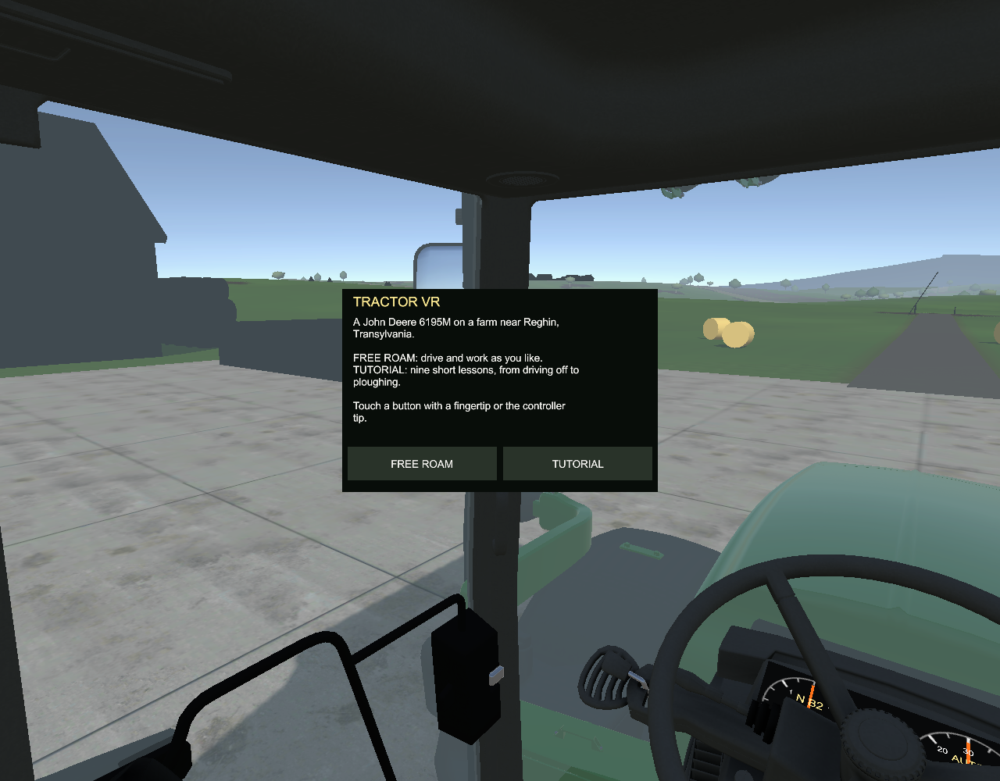 | 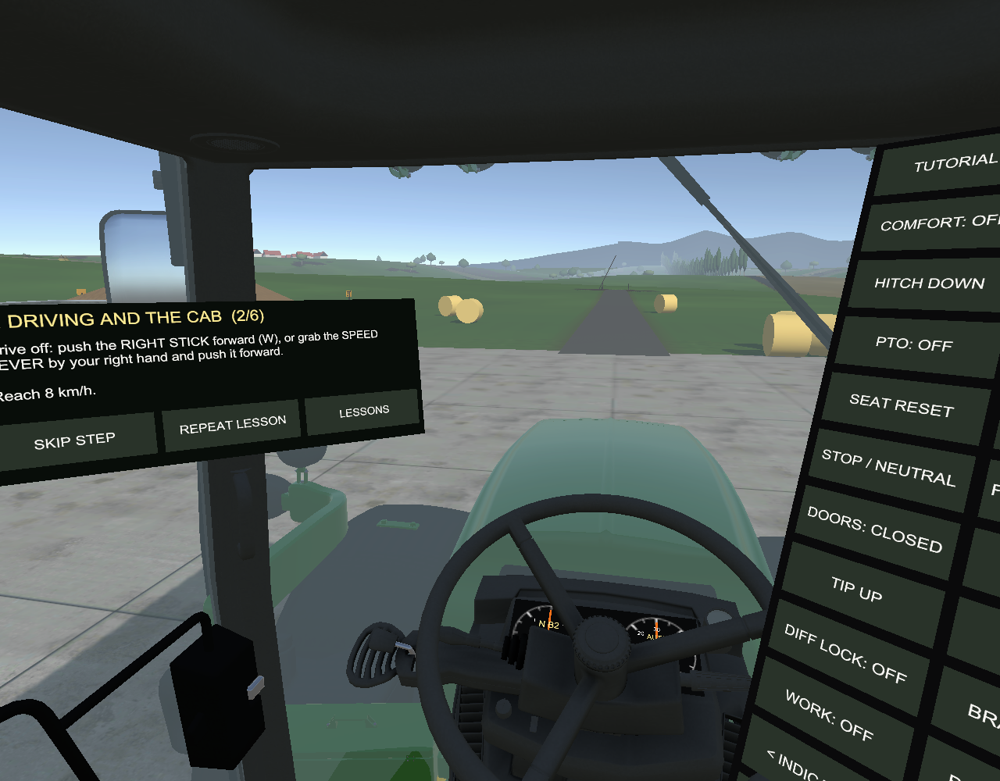 |

| Trees and the stream | Practice area, poplars along the road |
|---|---|
| 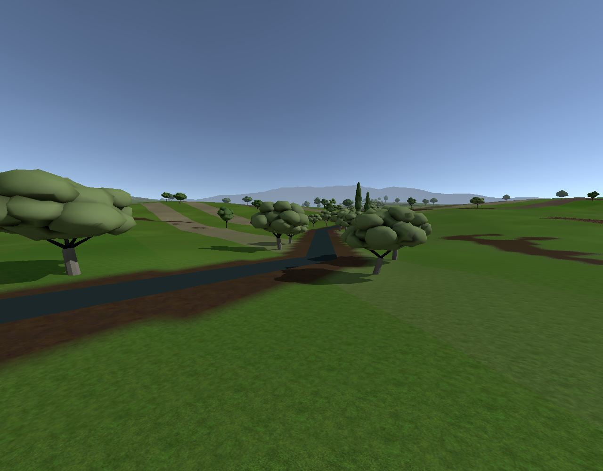 | 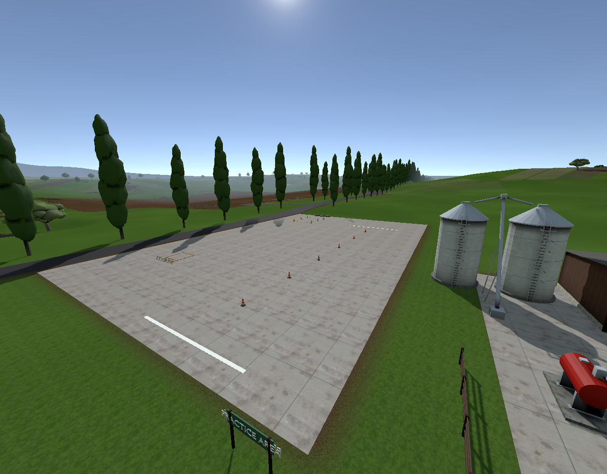 |

| The village on its plateau | The goal glow over the plough's bay |
|---|---|
| 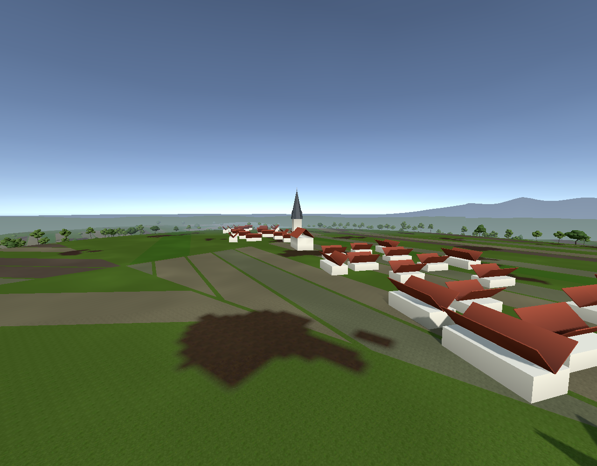 | 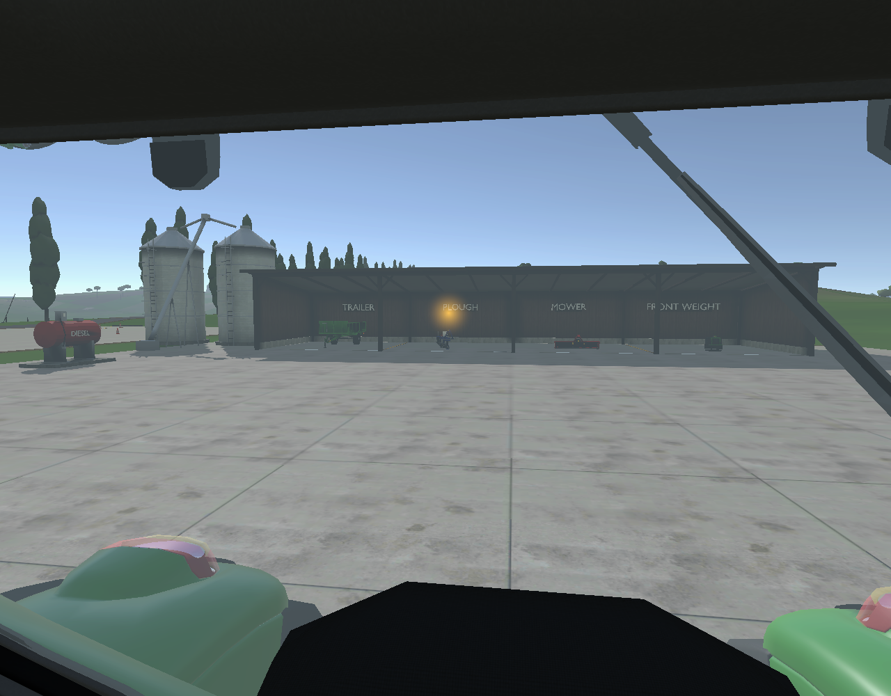 |

**Fix (user, same evening): text ran out of the tutorial boxes in both versions.** The board wrapped at a fixed 50 characters,
but the letters are wider than that assumed. Now the line breaks come from the font's real glyph widths, the title shrinks to fit, button labels
wrap onto two lines (or shrink), and the board height follows the measured line pitch (the font's `lineHeight` is at its own size,
not the TextMesh size: first try overlapped). Board 36 cm wide. Desktop: the box, title, body and buttons are sized with
`GUIStyle.CalcHeight / CalcSize`; buttons drop to one column when their labels are long and wrap if needed. New preview `tutorial_lessons`.

**First headset session with the trees + tutorial (Quest, 2026-11-01 19:28-19:33, logcat VrApi):** 297 one-second samples, mean
69 fps, 72 fps in 70 %, below 70 fps in 21 % (dips to 51-65 fps around 19:30-19:32), App GPU mostly 9-11 ms (GPU 80-98 % busy), one
20 ms second. No errors from the game in the log. Next: BENCHMARK run to see where the dips are (trees near 120 m on the Quest are
the first suspect).

**Fix (user, after playing): the PRACTICE AREA sign was too small and its letters floated in the air; the village roofs were
see-through.** The lettering was wider than the 2.6 m board, so the ends of the words hung in the air: now a 4.6 x 1.3 m board on 3 m
posts with a white border and the letters on its faces (`Builder.text` comes out ~1.5x the asked cap height: 0.22 m asked).
The village houses had only two roof slabs, open at the gable ends: now walls + a solid gable (`Builder.gable`) under every roof,
the church nave too (turned along Z for that). Preview `practice_sign`.

## 2026-11-01 (night): sky, roadside, grass tufts (the rest of phase 5 step 4)
The user asked for the two "Future ideas" lines to be done now, before the tutorial fixes and a real start menu.

### Skies from Poly Haven
- `tools/fetch_sky.py` downloads three **pure-sky** HDRIs (sky only, no ground in the picture: it would clash with the terrain) at
  2k and **measures each picture** from the 1k file (a small RGBE decoder in numpy): where the sun / moon is (centroid of the
  brightest 0.02 % of the upper half), the horizon colour (0-6 degrees up), and an exposure from the median sky brightness
  (sun excluded) → `Assets/Textures/Sky/sky.json` (+ LICENSE.txt, CC0).
- Picked: DAY `kloofendal_38d_partly_cloudy` (sun 38 degrees up: the scene was lit at 35 on purpose, so the slopes show light and
  shade; first tries `farm_field` was pale and hazy, `kloppenheim_05` had the sun at 75 degrees), DUSK `kloppenheim_06` (sun 9.4),
  NIGHT `kloppenheim_02` (moon 17).
- `ProjectSetup.BuildSkies`: cubemaps (Quest: 1024 per face, ASTC HDR), one `Skybox/Cubemap` material per sky; each sun light keeps
  the scene's azimuth at the picture's elevation, and the skybox `_Rotation` puts the picture's sun exactly there. The latlong
  convention was found by measurement, not guessed: the dusk sky rendered every 15 degrees around, brightest direction found by
  script (first 225 degrees off, then 90 → `SkyRotationOffset` 225; the night moon, at another azimuth, landed right too).
  Fog colour = the picture's horizon (scaled below white), so the haze and the far hills blend into the sky.
  Day exposure: the median rule blew the day sky out to white (bright clouds), target lowered to 0.2.
- `TractorLights`: DAY / DUSK / NIGHT now swap the skybox material and use the measured sun directions and fog colours (the old
  procedural sky + exposure dimming stays as the fallback without the files).

### Roadside
- `roadside.py` (parts): a precast concrete power pole (9 m, steel crossarm, three insulators), a white delineator post, a blue
  REGHIN 6 km direction sign, a 50 limit, a warning triangle. `WorldLayout.PowerLines / RoadPosts / RoadSigns`.
- Power line along the main road's west side every 50 m (broken over the practice pad) and a feeder along the yard road to the
  farmhouse; the **wires are generated** (`ProjectSetup.WireMesh`: sagging three-sided tubes between the insulators of neighbouring
  poles, crossarms turned across the line). `PlacePart` places one part of a multi-part Env asset; box colliders on poles, posts, signs.

### Grass tufts
- `GrassTufts.cs`: 3 m cells around the camera, a few tufts per pasture cell at hashed positions (the same spot always has the same
  tufts, nothing stored), rebuilt every 2 m of camera movement, one instanced draw; the meadow's clump mesh and shader, smaller and
  darker, sinking into the ground at the edge of the range (Quest 14 m / 2 per cell, PC 30 m / 4 per cell).

`PhysicsTest` unchanged (cm-level noise), `PlayModeTest` passes at both levels. Previews `sky_day / sky_dusk / sky_night`,
`roadside_junction / roadside_road / roadside_tufts`.

| Day sky | Dusk sky (the sun where the light comes from) |
|---|---|
| 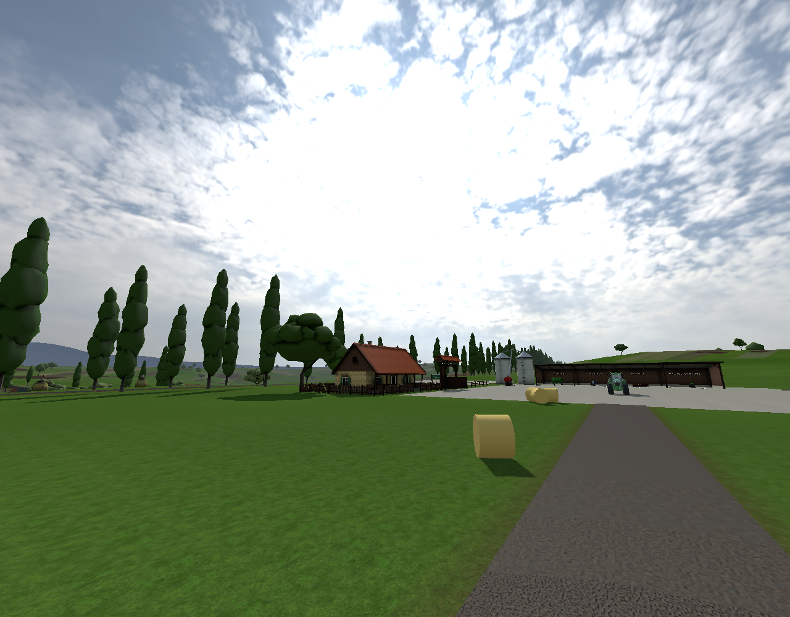 | 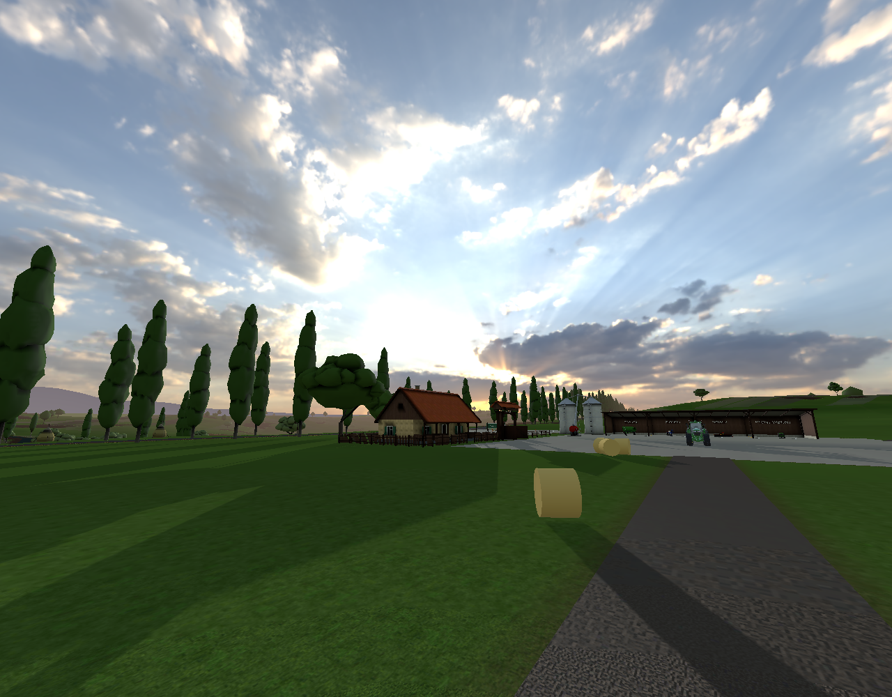 |

| Power line, sign, posts | Grass tufts |
|---|---|
| 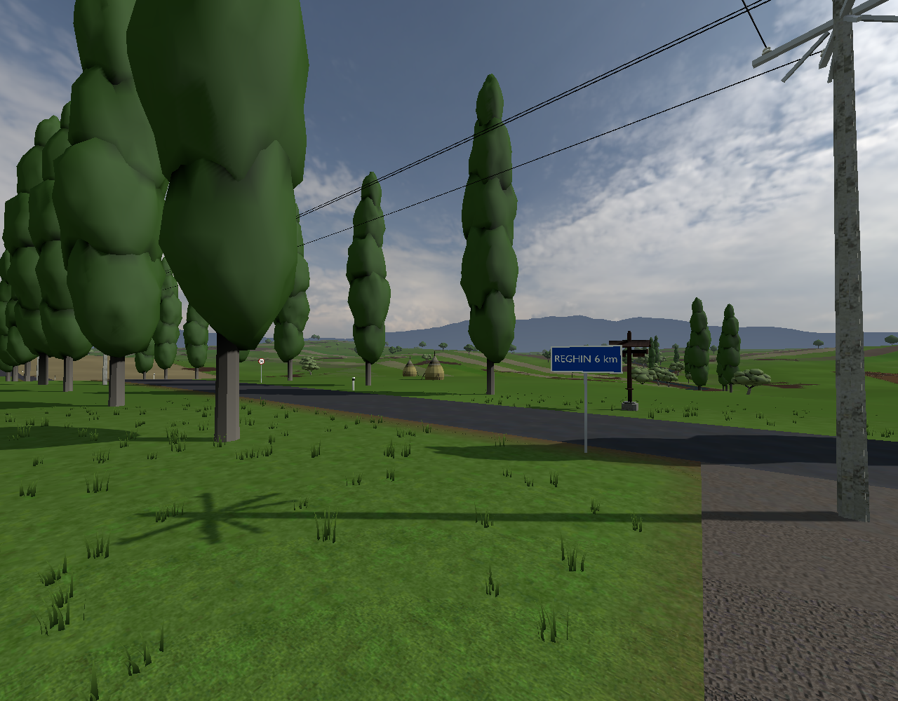 | 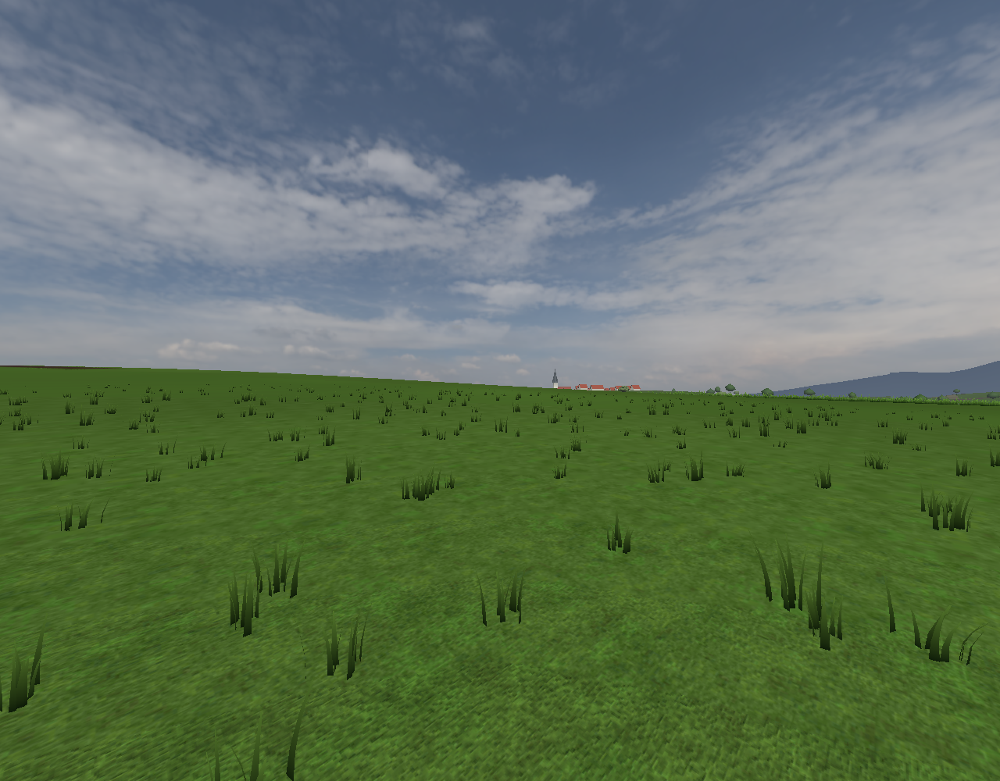 |

## 2026-11-01 (late night): a real start screen, lessons with set-ups and stars
User, after playing: a power pole stood in the road by the REGHIN sign; the tutorial should take the tractor to where each lesson
happens and rate it with up to five stars; a separate start screen; the tutorial text hid the view in VR.

- **Pole in the road**: the main line's poles were on a z grid of 50 m from 0, so one stood in the yard road's mouth. Now at
  z = 25 + 50 k, the feeder's corner pole 8 m north of the yard road.
- **`TouchBoard.cs`** (new, shared): title, measured wrapped text, an optional star row, buttons (optionally with stars), fingertip /
  controller-tip pokes; `DrawGUI` draws the same on the desktop (`screenCentered` for the menu, top left otherwise). The text
  measuring from the earlier fix moved here.
- **`StartMenu.cs`** (new): at launch and from the cab panel's MAIN MENU button the player stands in the farmyard (or wherever the
  tractor is), 6 m off its front-left corner, a 62 cm board at arm's length: TUTORIAL / FREE ROAM (CONTINUE later) / CONTROLS / QUIT;
  the lesson list with each lesson's best stars; CONTROLS has four information pages (Quest controllers, hand tracking, in the cab,
  keyboard and mouse). `VRCameraRig.InMenu` / `menuAnchor`: the rig stands there; the tractor's sticks are off (scripted, zero) and
  the cab panel hidden while the menu is open. Desktop: the board in the middle of the screen, the cab menu and key help hidden.
- **Tutorial**: each lesson first **sets its scene up** (`ResetScene`: everything uncoupled and back in its shed bay, cones back,
  day, lights off, 4WD on, AUTO), then teleports the tractor: slalom → at the start line; coupling lessons → 7-8 m in front of the
  implement's bay (rear / drawbar: facing away, to reverse in; front: nose to the shed); ploughing → in the west field with the plough
  already coupled (`Hitch.ForceAttach`: linkage at the pin height, top link set); traction → in front of the earth ramp's 22° side;
  road → in the yard facing the gate. `Hitch.ForceAttach / ForceDetach` (no checks) are only for these set-ups.
- **Stars**: 5, minus 1 per skipped step, 1 per two mistakes (slalom: cone down, missed gate, too fast), 1 / 2 for more than 1.5 / 2.5
  times the lesson's par time (75 s .. 5 min); at least 1. Shown on the lesson's end board (with time, par, skips, mistakes) and in
  the lesson list (best per lesson, PlayerPrefs). End board: NEXT LESSON / TRY AGAIN / MENU / FREE ROAM.
- **Tutorial board moved** low on the left (left of the steering wheel, 33 cm below the eye, tilted up), below the window line.
- `PlayModeTest`: checks the start menu at launch, opens the CONTROLS pages, FREE ROAM, later starts the lessons from the menu's
  list and walks all nine (set-ups and teleports included); deletes the scores it made. Passes at both levels; `PhysicsTest` unchanged
  (noise; the plough parked at the end of J now stays upright, 5° instead of 115°: run-to-run, the coupling code is unchanged).

| Start screen | Lesson list with stars | The tutorial board, low left |
|---|---|---|
| 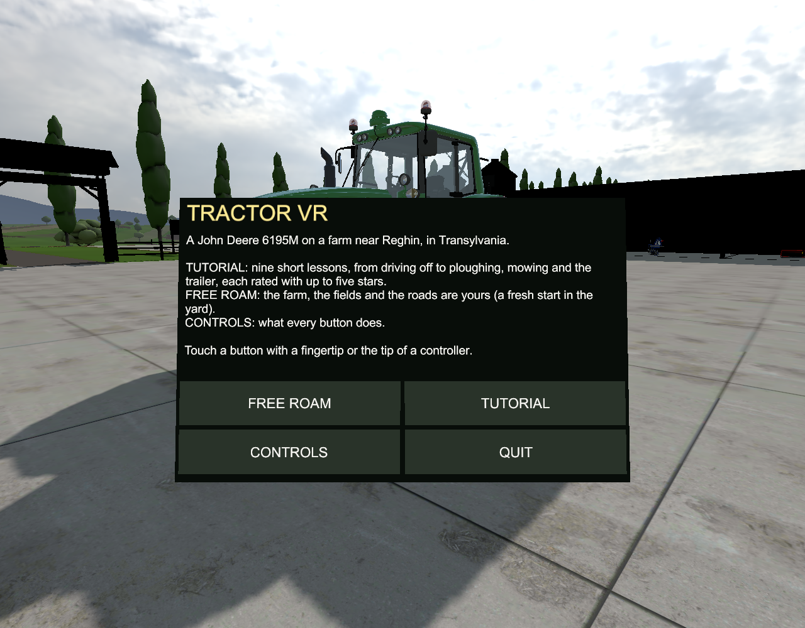 | 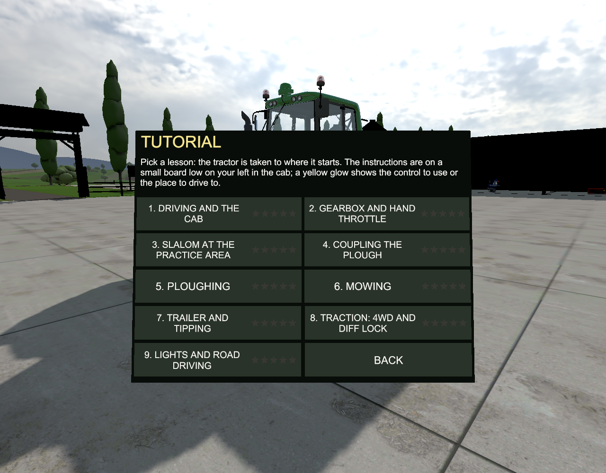 | 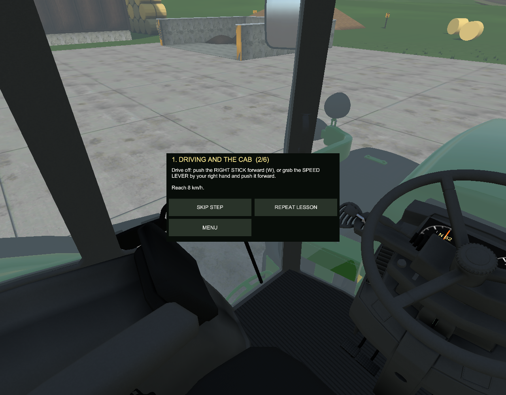 |

## 2026-11-01 (late night): FREE ROAM always in the menu, CONTROLS as pictures with arrows
User: "I miss the free roam from the menu" (after the first drive the main page only offered CONTINUE), and the CONTROLS pages
should be pictures with arrows and text, not plain text.

- **Main page**: before playing FREE ROAM / TUTORIAL / CONTROLS / QUIT; once playing CONTINUE (back to where you were) /
  FREE ROAM (a fresh start: `Tutorial.FreshStart` = implements back in the shed, the tractor in the yard) / TUTORIAL / CONTROLS /
  QUIT. The lesson list has a FREE ROAM button too.
- **CONTROLS = six annotated pictures**: the Quest controllers, the cab from the seat, the speed lever and remote levers, the switch
  panel, the cab panel, keyboard and mouse. `TouchBoard` got a picture slot (between title and text; on the desktop
  `GUI.DrawTexture`); picture pages make the menu board 1 m wide, the page buttons in four columns.
- **Controller picture** (`CabGuide`, `guide_controllers`): both Quest 2 models high above the farm on their own layer (camera
  culling only that layer, plain background), tipped back 30 degrees and seen from above so every face button shows; a label on
  each stick, button, trigger and grip. It took six renders to get the view: from in front the ring hid the buttons, a look point
  behind the camera turned the picture upside down, the first tilt went the wrong way; the grip bone sits inside the ring, so the
  grip arrows point at the ring's inner side (3.6 cm from X / A).
- **Keyboard picture** (`tools/keyboard_guide.py`): a keyboard with the used keys coloured by group (driving, hitch and implements,
  lights and sky, tractor and view), a legend with every key, the mouse buttons below.
- **In-game versions**: `tools/annotate_guide.py --game` draws the same labels 1.45x larger into `Assets/Textures/Guide/` (read on
  a board in VR; imported at 2048 px, ASTC 4x4 on the Quest for sharp letters). The README pictures stay in `docs/images/`.
- `PlayModeTest`: opens all six CONTROLS pages (checks they have a picture), then FREE ROAM. Passes at both levels.

| Main page | CONTROLS: the controllers |
|---|---|
|  | 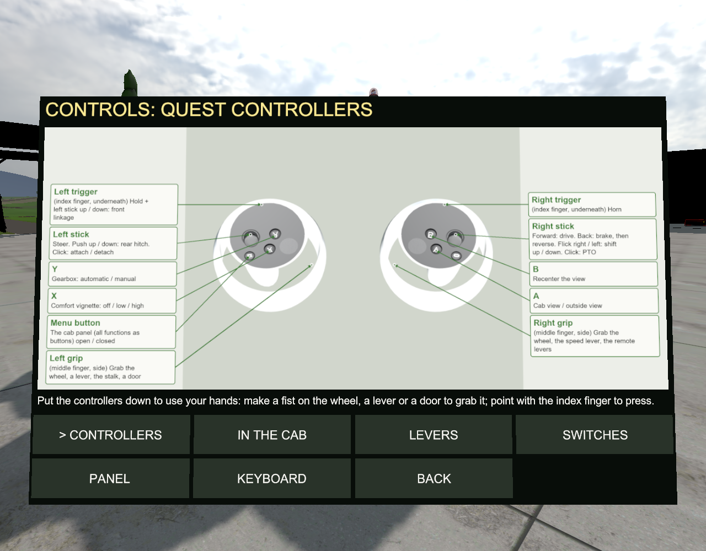 |

**Fix (user): the km/h readout overlapped the start menu board** (it is fixed to the view, and the menu board is in front of
the eye): `TractorHud` shows nothing while `StartMenu.IsOpen`.

**Hand tracking in PC VR (user: "no luck with hand tracking in the PC VR version").** `Player.log` showed the cause: the Oculus PC
OpenXR runtime listed 36 extensions, none of them `XR_EXT_hand_tracking`, and Unity logged "Requested feature extensions not
supported by runtime: XR_EXT_hand_tracking". Meta exposes hand tracking over Link only with *Developer Runtime Features* (Meta Horizon
Link app → Settings → Beta). The user switched it on; after a restart of TractorVR.exe the runtime offers `XR_EXT_hand_tracking`
(version 4) and `XR_EXT_hand_tracking_data_source`, and no requested extension is missing. No code change.
