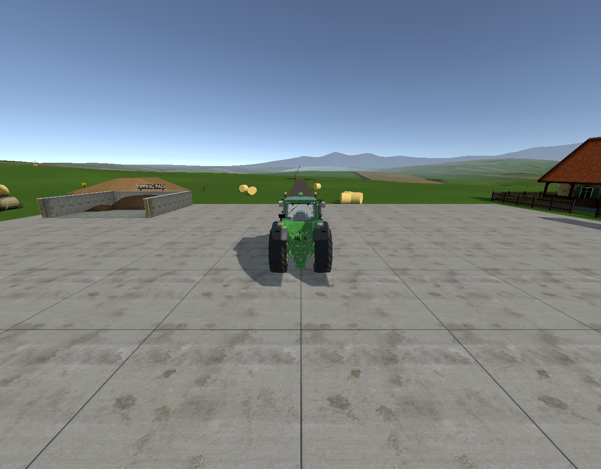
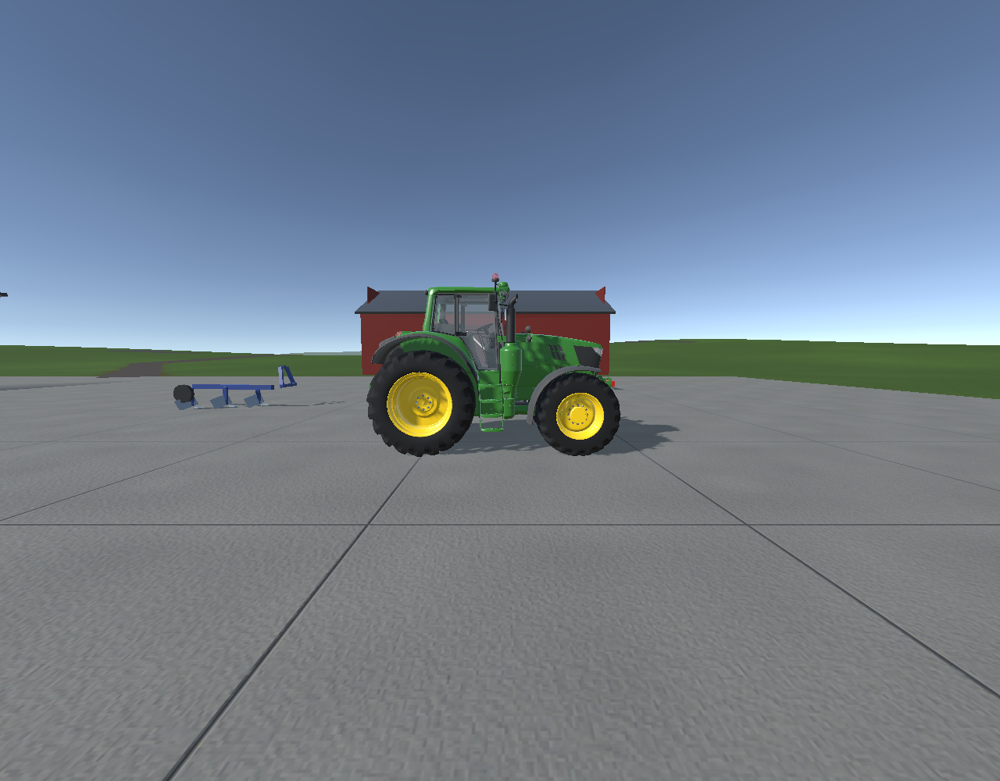
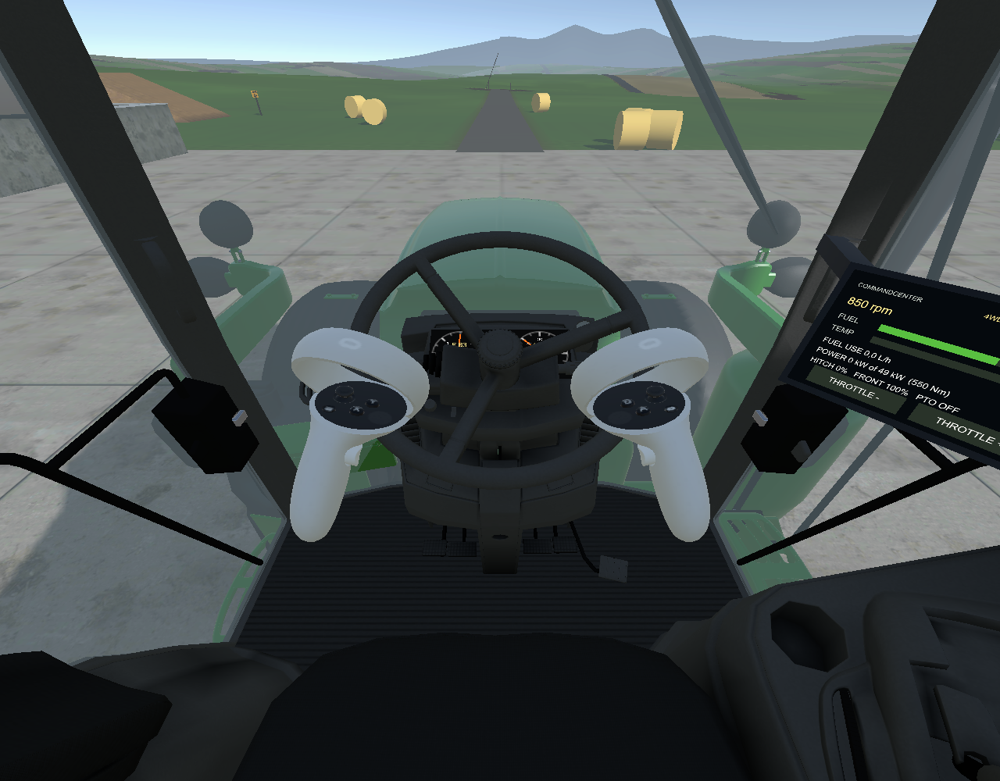
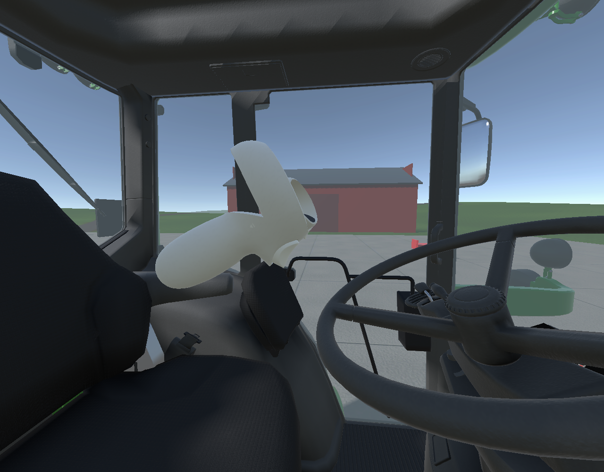
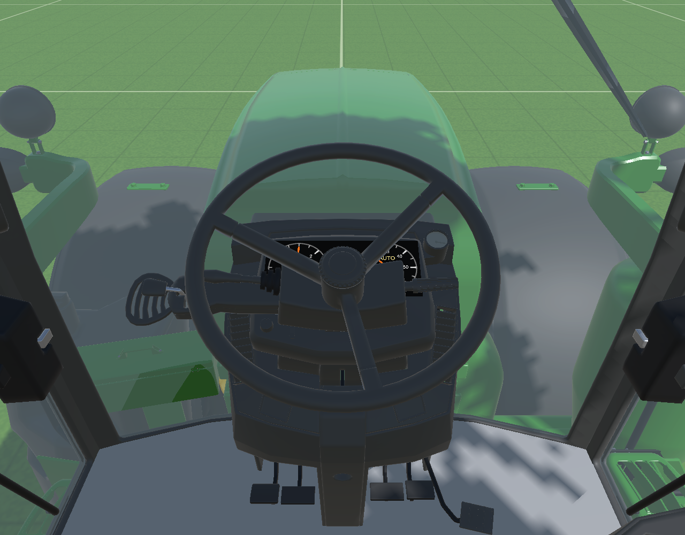

# Development log

## 2026-10-16: Phase 1 setup

**Starting point.** The folder `Irum_proj/IRUMSim/` contained a *compiled* Unity 2022.3.4f1 Windows build
("IRUMSim", Sapientia Hungarian University of Transylvania), with no sources, plus the model
`John_Deere_6195M.FBX`. A new Unity project was created: `Irum_proj/TractorVR/`.

**Engine choice.** Unity 6000.6.3f1 was already installed with Android support, which suits the Quest 2.
URP (recommended for Quest) + OpenXR with the Meta Quest feature (the vendor-neutral standard) + Input System.
All package versions are the ones bundled with the editor, so the project resolves offline.

**Automation.** All project configuration and scene construction lives in `Assets/Scripts/Editor/ProjectSetup.cs`
and runs in batch mode. That makes the setup reproducible and reviewable: the scene can be regenerated at any time.

### Model analysis
- Binary FBX 7.x, 65 model nodes, 31 materials, 34 texture references.
- Already metric and +Z forward in Unity. Measured wheelbase 2.809 m vs. spec 2.800 m, so scale ×0.997.
- Wheels and tires are separate objects. `rotater_*` nodes sit exactly at the front wheel centres (hubs/knuckles).
- The steering wheel is baked into the cab interior mesh (not separately animatable yet).
- **Textures are missing**: the references point to `..\tex\*.tif` / `D:\Turbosquid_2017\...`. They are not embedded and not on this PC.
  Fix: materials are rebuilt from their names (`Body_paint` → JD green, and yellow on wheel parts; glass → near-clear unlit).

### Driving model (phase 1)
- Kinematic bicycle model around the rear axle (the tractor origin is placed there), Ackermann angles per front wheel,
  wheel spin from distance / radius, steering lock reduced at speed.
- Speed governor: stick position = target speed. Moving the stick against the motion brakes; releasing it coasts.
- Runs in `Update` so the VR camera riding on the tractor never judders (no physics interpolation issues).
- No collisions yet. That is fine for a flat world, and the move to real physics is planned for phase 2.

### VR camera
- Rig > Camera Offset > Main Camera (TrackedPoseDriver). Recentering moves the Camera Offset so the eye lands exactly on
  the anchor (seat or third-person point), independent of the tracking origin.
- Cab view: the rig is locked to `Tractor/DriverEye`. Third person: 9.5 m behind, 4.2 m up, yaw-only with smoothing (comfort).
- The seat position was estimated from the cab geometry and checked with preview renders. It can be fine-tuned in the headset.

### Issues hit
| Problem | Cause | Fix |
|---|---|---|
| Tractor rendered white | FBX textures missing | Name-based URP materials |
| Cab view looked milky/grey | Batch-mode async shader compilation drew placeholder shaders | `ShaderUtil.allowAsyncCompilation = false` for previews (not an issue in builds) |
| Editor opened an empty scene | `-openfile` doesn't load scenes | Open the scene from the Project window |
| Couldn't open the editor during the batch build | Unity locks a project to one instance | Stopped the batch build; build from the editor menu |

### Preview renders

| Cab | Cab (looking down) |
|---|---|
|  |  |

| Third person | Side | Front |
|---|---|---|
|  |  |  |

## 2026-10-16 — First deploy to Quest 2
- Built `Builds/TractorVR.apk` in batch mode (`BuildQuest.Build`, 57.8 MB, 0 errors) and installed it over USB with the
  adb bundled in Unity's Android SDK (`...\PlaybackEngines\AndroidPlayer\SDK\platform-tools\adb.exe`). The app launches; it is under *Unknown Sources*.
- Closing the editor also kills its adb server. The fresh server had to be re-authorized on the headset ("Allow USB debugging").
- Logcat shows `ClassNotFoundException: com.google.android.play.core.assetpacks.AssetPackManager`. This is harmless: Unity probes for
  Play Asset Delivery, which Quest doesn't have.
- Headset test: everything works (controls, views, seat position, wheel spin/steer look great). The tester got **motion sickness**,
  so comfort (vignette, gentler acceleration and steering, a comfort setting) is now the next item on the ROADMAP.

## 2026-10-16: Comfort pass + visible controllers
The first headset session caused motion sickness, so this pass reduces the motion the inner ear notices.

**Gentler motion** (`TractorController`)
- Acceleration 1.8 → 1.0 m/s², braking 5 → 2.5, coast 1.0 → 0.8, steer rate 70 → 35°/s.
- Squared stick response for steering: fine control near centre.
- New steering limit instead of the old `steerAtMaxSpeed` factor: the lock angle is capped so the yaw rate stays ≤ 25°/s
  and v·ω ≤ 2.5 m/s². At 10 km/h this allows ~24° (radius ~6 m), at 40 km/h ~3° (radius ~50 m), which is also more realistic
  than before (the old model allowed ~74°/s yaw and ~14 m/s² lateral at full speed).

**Comfort vignette** (`ComfortVignette.cs`, `TractorVR/ComfortVignette` shader)
- Darkens the edge of the view in proportion to the rig's yaw rate and the tractor's speed change. It fades in fast and out slowly.
- Head-locked quad 1 m ahead (an eye offset of 32 mm then shifts it by only ~2°; at 0.1 m it would be off-centre by ~18° per eye).
- Shader works in view angles: clear inside `_InnerDeg`, black beyond `_OuterDeg`. Low: 38°/52°, High: 24°/40° at full strength.
- **X** cycles Off / Low / High (PlayerPrefs, default High). The HUD shows the level for 2.5 s.

**Controllers** (`ControllerVisual.cs`, `ProjectSetup.BuildController`)
- Stand-in Quest Touch models from primitives + a generated torus ring, under `Camera Offset`, posed with TrackedPoseDriver on the
  grip pose. The stick tilts, buttons sink and turn yellow when pressed, and the trigger and grip move. Hidden while not tracked.
- The official Meta controller models would need the Meta XR SDK. That can come later with hands/grab interaction.

**Previews**: `controller.png` and `vignette_high.png` were added. The first render of a batch session came out grey, so a warm-up
shot is now thrown away.

| Controller (stand-in) | Vignette, High, full strength |
|---|---|
|  |  |

## 2026-10-16: Real Quest 2 controller models
The stand-in primitive controllers looked wrong in the headset (the tracking ring sat between the buttons). They are replaced by
the official **Quest 2 Touch models**, copied from the Meta XR Core SDK 207.0.1 (downloaded from Meta's npm registry; only
the two FBX files and the texture were taken, the SDK itself is not installed). They're under the Oculus SDK License, which is fine for a Quest app in a private repo.

- **Pose:** the bone positions showed that the models are authored in Meta's pointer frame (face plate at the origin, stick
  and buttons at y≈0, the laser along +Z), not the OpenXR grip frame. So the TrackedPoseDriver now uses the **aim pose**
  (`pointerPosition/pointerRotation`), and the model is offset so its `*_laser_begin` node coincides with that pose.
- **Animation:** the FBX is rigged. `ControllerVisual` drives the bones directly with the ranges read from Meta's animation curves:
  stick ±22°, A/B (X/Y) 1.78 mm, trigger 20°, grip (1.3°, 7.4°, 4.1°). No Animator is needed.
- Imported with Animation Type None and no materials. One URP Lit material uses the albedo texture.

| Controllers, front | Side |
|---|---|
|  |  |

## 2026-10-16: Headset check
- Real controller models, comfort vignette and the gentler driving were tested on the Quest 2: all good.

## 2026-10-16: Session summary
What happened today, in order:
1. First APK build (batch mode) and install over adb. The app ran first time, and the wheels and steering looked right.
2. Headset test: controls, views and seat were fine, but the tester got **motion sick**.
3. Comfort pass: gentler acceleration/braking, yaw-rate and lateral-acceleration limits, squared steering response, edge vignette with
   off/low/high on X.
4. Visible controllers: first primitive stand-ins (wrong ring placement), then the official Quest 2 models from the Meta XR Core SDK on the aim pose.
5. Headset re-test: all good.

Workflow lessons (also in CLAUDE.md): the editor must be closed for batch builds; closing it resets adb authorization unless
*Always allow* is ticked; a launch via adb is blocked while the headset sleeps; preview PNGs open in a viewer get locked by Windows.

## 2026-10-17: Phase 1 closed, phase 2 started (steering wheel + drivetrain)
Phase 1 was accepted after the headset tests. For phase 2 the first block chosen was **steering wheel + drivetrain**, because those
make the biggest difference to how the tractor feels in the headset.

**Steering wheel, without Blender** (`ProjectSetup.SplitSteeringWheel`)
- The wheel is baked into `Cab_Interier_01` (37 177 vertices, 11 submeshes). A temporary analysis split that mesh into connected pieces
  (union-find over triangles, with vertices welded by position so UV seams don't break pieces apart). The largest piece turned out to be the rim:
  centred at x = 0, 0.40 m across.
- The setup script now does this automatically. Rim = largest centred piece 0.3–0.5 m wide. Its best-fit plane (PCA via power iteration)
  gives the column axis (rim 23° from horizontal). Every piece lying flat inside the rim (the hub cap) goes with it. The interior is rebuilt
  without those triangles, and the wheel becomes its own mesh in a pivot frame (`SteeringColumn` > `SteeringWheel` > `WheelMesh`).
- `TractorController` turns it by `SteerAngle × 13` (40° lock → ±520°, ~2.9 turns lock to lock). Right turn = clockwise as seen by the driver.

**Instrument cluster** (`Dashboard.cs`)
- Placed on the glass piece nearest the wheel (0.257 × 0.109 m): a generated face texture with two tick rings (0–3000 rpm with a red zone
  above 2250, 0–60 km/h), needles, scale numbers, direction + gear, AUTO/MAN.
- The built-in TextMesh font shader ignores depth, so the text showed through the wheel hub. A small `TractorVR/WorldText` shader fixes it
  (with stereo macros for Quest multiview).
- From the seat the hub hides the middle of the cluster and the column shroud hides the lower half, so the readouts were moved to the upper half of the dials.
  The HUD also shows speed, direction, gear and rpm now.

**Drivetrain** (`Drivetrain.cs`), loosely after the 6195M's AutoQuad Plus 20/20
- 20 forward / 20 reverse gears, named A1–E4 (5 ranges × 4 powershift steps), geometric from 2.4 to 50 km/h at the rated 2100 rpm.
  Engine idle 850, high idle 2250 rpm.
- **Auto**: pulls away in B2, shifts up above 1950 rpm and down below 1300 rpm, at least 0.5 s between shifts.
  **Manual**: right stick flick → / ← shifts. The gear caps the speed (stick = share of the gear's top speed), and downshifts that would over-rev are refused.
- RPM is locked to the wheels through the gear, with clutch slip (idle + up to 250 rpm) when pulling away. Load (for sound) = accelerating share + rolling resistance.
- Design decision: the drivetrain does **not** change the acceleration. The comfort limits from phase 1 stay in charge, and the drivetrain is derived from the motion.
  Top speed is raised from 40 to the real 50 km/h. The lateral/yaw limits still keep turns at speed gentle.

**Sounds** (`TractorAudio.cs`, all synthesised by `ProjectSetup`, no third-party samples)
- Engine: two loops at 1000 rpm (light/heavy load). Six-cylinder firing at 50 Hz excites exhaust/body/block resonances (85/240/700 Hz), plus a short
  3.2 kHz clatter burst and some breath noise per firing. The cylinders differ slightly in strength for the uneven diesel beat. Each loop is exactly 10 engine cycles
  (1.2 s), so it repeats seamlessly. The loops are pitched by RPM/1000 and cross-faded by load (equal power), and low-passed at 2.2 kHz in the cab view.
- Spectrum check of the first version: 93 % of the energy was below 300 Hz and only 1 % in the clatter band. Quest speakers barely reproduce that,
  so the clatter was boosted and the loops normalised separately.
- Shift clunk (thump + click + hydraulic hiss), 1 kHz reverse beeper (whenever the shuttle is in R), two-tone 400/500 Hz horn on the right trigger.

**New controls**: right stick flick → / ← = shift (switches to manual), Y = auto/manual (saved), right trigger = horn.
Keyboard: X / Z, T, H.

**Build**: setup + APK build in batch mode without errors (59.3 MB), installed over adb. The launch check was blocked by the
"controllers required" dialog (headset asleep), so a **headset test is still to do**.

| Cab | Cluster close-up (wheel turned 90° right) |
|---|---|
|  |  |
