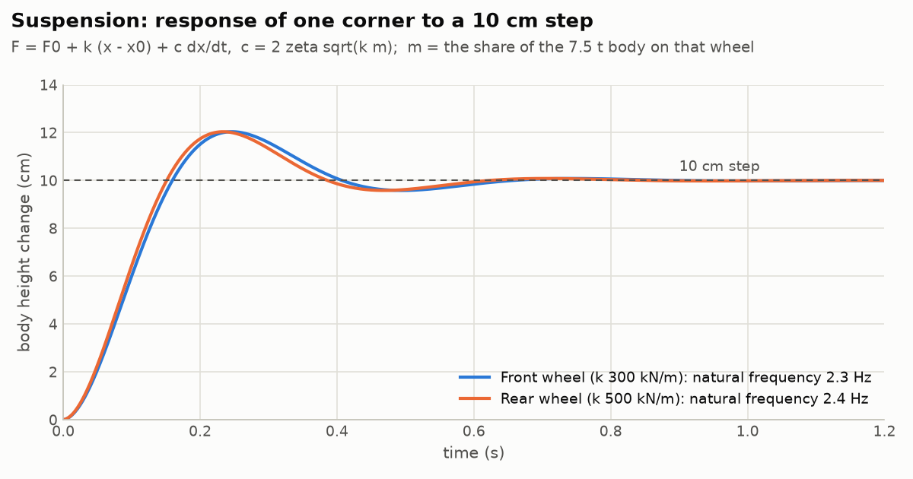
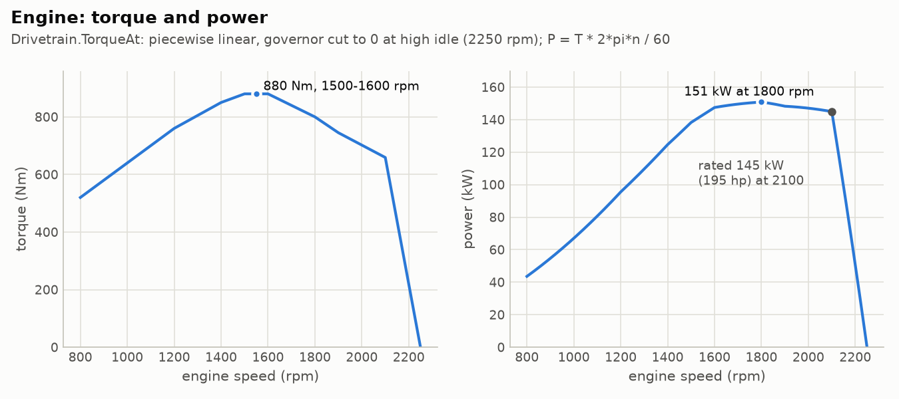
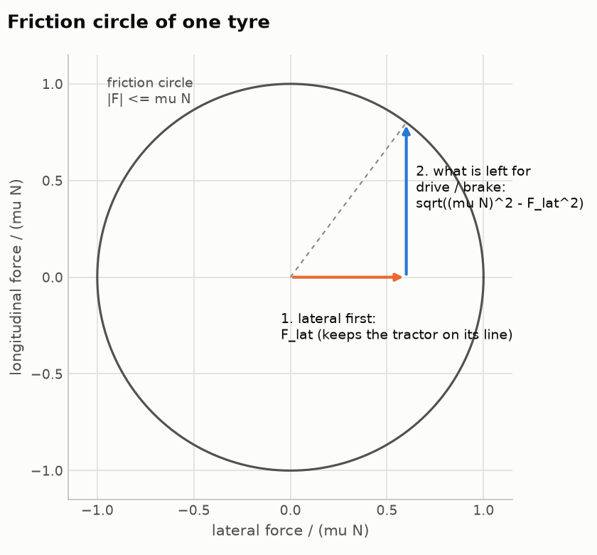
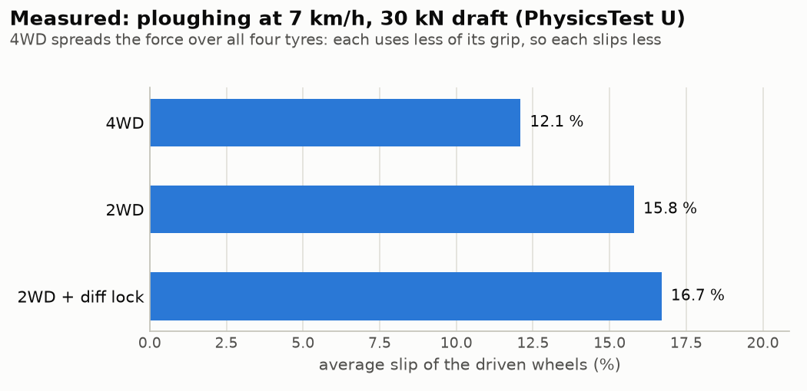
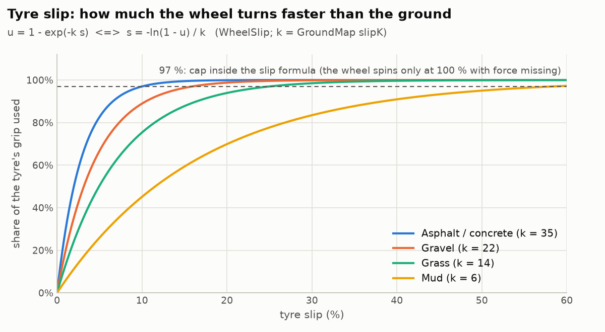
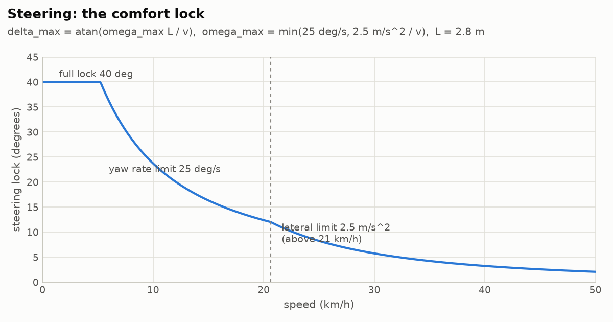
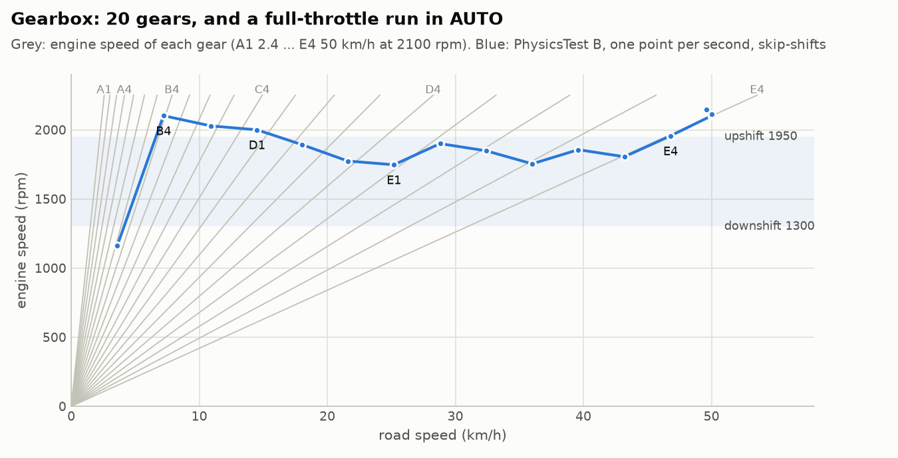
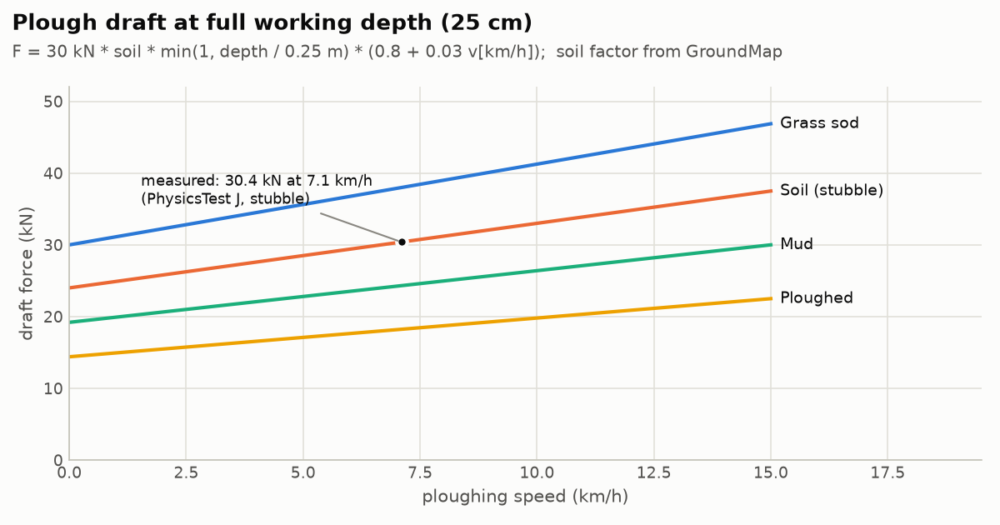
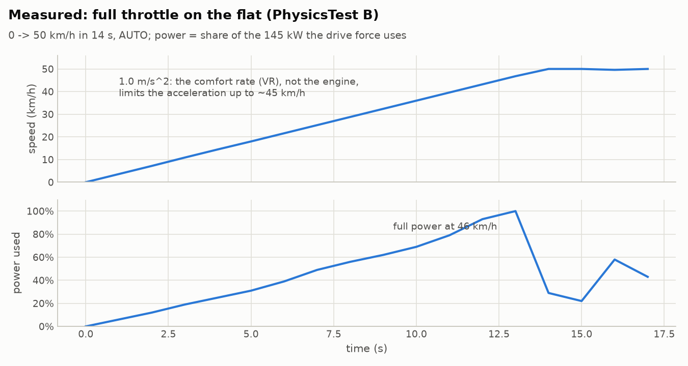
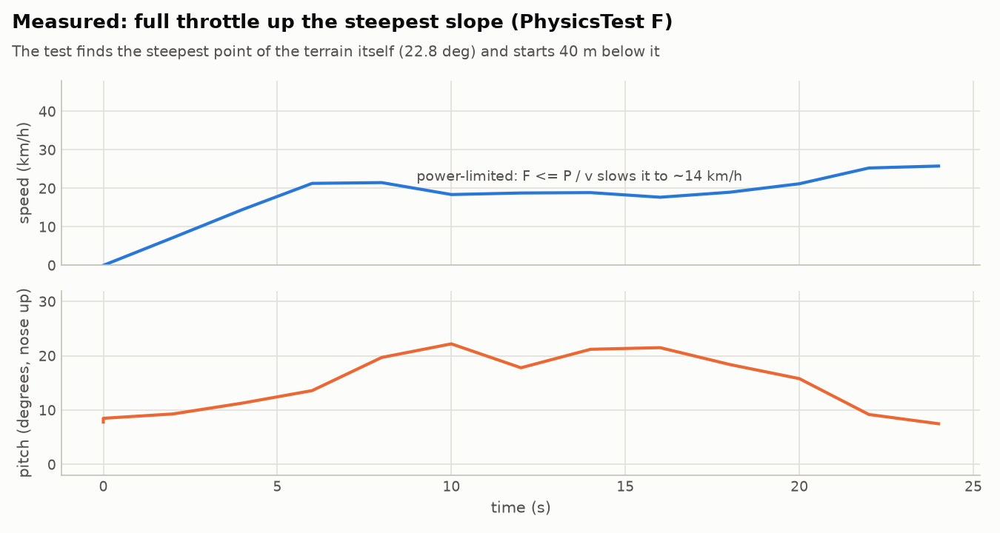

# Physics of Tractor VR

How the John Deere 6195M moves in the simulator: the model, its formulas with every symbol explained, the numbers it uses, and
how it was checked. Everything here is taken from the code (`TractorController.cs`, `Drivetrain.cs`, `Hitch.cs`, `Implement.cs`,
`Tipper.cs`, `Ground.cs`). The curves are drawn from the same numbers by `tools/physics_charts.py`, and the "measured" charts come
from the automatic driving test `PhysicsTest` (`Logs/PhysicsTest.txt`, run after every change to the vehicle).

Contents: [0. Symbols and notation](#0-symbols-and-notation) · [1. Overview](#1-overview) · [2. Mass](#2-mass-and-centre-of-mass) · [3. Suspension](#3-suspension) ·
[4. Speed command and comfort](#4-the-speed-command-and-comfort) · [5. Drive force and engine power](#5-drive-force-and-engine-power) ·
[6. Tyres](#6-tyres-the-friction-circle) · [7. Traction](#7-traction-4wd-and-differentials) · [8. Slip](#8-tyre-slip-and-wheel-speed) ·
[9. Ground](#9-the-ground) · [10. Steering](#10-steering) · [11. Engine and gearbox](#11-engine-and-gearbox) ·
[12. Implements](#12-implements) · [13. Parking brake](#13-parking-brake) · [14. Validation](#14-validation)

## 0. Symbols and notation

Every symbol used below, with how it is read aloud, what it stands for and its unit. Each formula also has a small "where" table
next to it with the values the code uses.

### Notation

| Mark | Read as | Meaning |
|---|---|---|
| $\Delta t$ | "delta t" | the physics time step: 1/90 s = 11.1 ms ($\Delta$ = "a small difference of") |
| $\dot x$ | "x dot" | how fast $x$ changes: its rate of change per second (time derivative) |
| $\vec c$ | "vector c" | a vector: a direction and a size in 3D (x, y, z) |
| $\hat f$ | "f hat" | a unit vector: a direction only, length 1 |
| $\vec a \cdot \vec b$ | "a dot b" | dot product: how much of $\vec a$ points along $\vec b$ (with unit vectors: the cosine of the angle between them) |
| $x \leftarrow y$ | "x becomes y" | assignment: each step, $x$ is replaced by the value on the right |
| $\sum_k$ | "sum over k" | add up the term for every $k$ (e.g. every coupled implement) |
| $\lVert \vec a \rVert$ | "length of a" | the length (magnitude) of a vector |
| $\min(a, b)$, $\max(a, b)$ | "minimum / maximum of" | the smaller / larger of the two |
| $\mathrm{clamp}(x, lo, hi)$ | "clamp" | $x$, but kept between $lo$ and $hi$ |
| $\Longleftrightarrow$ | "is equivalent to" | the two equations say the same thing, solved for different symbols |
| $\arctan$, $\tan$, $\sin$ | "arc tangent", "tangent", "sine" | angle functions; $\arctan$ gives back the angle whose tangent is the value |
| $e$, $\ln$ | "e", "natural log" | $e \approx 2.718$; $\ln$ is the inverse of $e^x$ |
| subscripts | e.g. $F_\text{lat}$ "F lateral" | which force, mass, speed ... it is: "zero" ($N_0$, $m_0$) at rest / without implements, "t" ($v_t$, $m_t$) target or total, "c" ($v_c$) command, "L" / "R" ($\delta_L$, $\delta_R$) left / right wheel |

### Symbols

| Symbol | Read as | Meaning | Unit | Section |
|---|---|---|---|---|
| $m$ | "m" | mass of the tractor (with any mounted implements) | kg | 2, 5 |
| $m_0$ | "m zero" | mass of the tractor alone, 7500 kg | kg | 2 |
| $m_k$ | "m k" | mass of implement number $k$ | kg | 2 |
| $m_t$ | "m t" | mass the drive force must move: tractor + towed trailer | kg | 5 |
| $\vec c$, $\vec c_0$ | "vector c (zero)" | centre of mass (with implements / tractor alone) | m | 2, 12 |
| $\vec x_k$ | "vector x k" | centre of mass of implement $k$, in the tractor's own coordinates | m | 2 |
| $g$ | "g" | gravitational acceleration, 9.81 | m/s² | all |
| $L$ | "L" | wheelbase: distance between front and rear axle, 2.80 | m | 2, 10 |
| $t$ | "t" | front track: distance between the two front wheels, 1.89 | m | 10 |
| $N$ | "N" | normal force: the load pressing one tyre onto the ground | N (newton) | 3, 6 |
| $N_0$ | "N zero" | that tyre's load at rest (front 14.7 kN, rear 22.1 kN) | N | 3 |
| $k$ (§3) | "k" | spring stiffness: force per metre of compression | N/m | 3 |
| $x$, $x_0$ | "x", "x zero" | spring compression now / at rest | m | 3 |
| $c$ | "c" | damping coefficient: force per m/s of compression speed | N·s/m | 3 |
| $\zeta$ | "zeta" | damping ratio: 0 = bounces forever, 1 = settles without overshoot; here 0.45 | - | 3 |
| $f$ | "f" | natural frequency of the suspension | Hz | 3 |
| $v$ | "v" | the tractor's real speed forwards | m/s | 4, 5 |
| $v_t$ | "v t" | target speed: what the stick / speed lever asks for | m/s | 4 |
| $v_c$ | "v c" | speed command: the target, reached at comfortable rates | m/s | 4, 5 |
| $a$ | "a" | acceleration (§4: the allowed rate of change of the command; §13: the holding acceleration) | m/s² | 4, 13 |
| $F$ | "F" | force; without a subscript: the drive / brake force along the tractor | N | 5, 7 |
| $K$ | "capital K" | speed tracking gain, 2.5: how strongly speed errors are corrected | 1/s | 5 |
| $\hat f$ | "f hat" | the tractor's forward direction | - | 5, 13 |
| $\hat g$ | "g hat" | the direction of gravity (straight down) | - | 5 |
| $\theta$ | "theta" | slope angle (§5); lift arm angle (§12) | ° | 5, 12 |
| $C_{rr}$ | "C r r" | coefficient of rolling resistance of the ground | - | 5, 9 |
| $F_\text{draft}$ | "F draft" | the plough's pull against the tractor | N | 5, 12 |
| $P(n)$ | "P of n" | engine power available at engine speed $n$ | W (kW) | 5, 11 |
| $P_\text{PTO}$ | "P P T O" | power taken by the power take-off (the mower) | W | 5 |
| $P_\text{out}$ | "P out" | power the engine actually gives | kW | 11 |
| $n$ | "n" | engine speed | rpm | 5, 11 |
| $T(n)$ | "T of n" | engine torque at engine speed $n$ | N·m | 11 |
| $\mu$ | "mu" | coefficient of friction: the ground's grip | - | 6, 9 |
| $F_\text{lat}$ | "F lateral" | sideways tyre force | N | 6, 13 |
| $v_\text{side}$ | "v side" | how fast a wheel slides sideways | m/s | 6 |
| $F_\text{room}$ | "F room" | the force a tyre can still give forwards / backwards after the lateral force | N | 6, 7 |
| $s$ | "s" | slip: how much faster (driving) or slower (braking) the wheel turns than the ground passes | - (%) | 8 |
| $u$ | "u" | utilisation: the share of a tyre's grip in use, $F / F_\text{room}$ | - (%) | 8 |
| $k$ (§8, §9) | "k" | the ground's slip constant: how sharply grip builds up with slip | - | 8, 9 |
| $v_\text{wheel}$, $v_\text{ground}$ | "v wheel", "v ground" | speed of the tyre's tread / of the ground under it | m/s | 8 |
| $\delta$ | "delta" | steering angle of a virtual wheel in the middle of the front axle | ° | 10 |
| $\delta_L$, $\delta_R$ | "delta left / right" | steering angle of the left / right front wheel | ° | 10 |
| $R$ | "capital R" | turning radius (from the turning centre to the middle of the rear axle) | m | 10 |
| $\omega$ | "omega" | yaw rate: how fast the tractor turns about the vertical | °/s | 10 |
| $v_i$ | "v i" | top speed of gear $i$ at rated engine speed | km/h | 11 |
| $r$ | "r" | ratio between two neighbouring gears, 1.173 | - | 11 |
| $\varphi$ | "phi" | lower link angle of the rear hitch | ° | 12 |
| $\ell$ | "script l" | length of the lift rod | m | 12 |
| $A(\theta)$, $B(\varphi)$ | "A of theta", "B of phi" | lift arm tip / lift rod's lower end, at those angles | m | 12 |
| $d$ | "d" | the plough's working depth below the ground | m | 12 |
| $f_\text{soil}$ | "f soil" | the ground's draft factor (how hard it is to plough) | - | 9, 12 |
| $v_\text{km/h}$ | "v in km per hour" | the plough's speed in km/h | km/h | 12 |
| $\alpha$ | "alpha" | tipping angle of the trailer body | ° | 12 |
| $p$, $p_0$ | "p", "p zero" | the tractor's position now / where the parking brake took hold | m | 13 |
| $\hat s$ | "s hat" | the tractor's sideways direction | - | 13 |

## 1. Overview

The tractor is one **rigid body** (Unity `Rigidbody`, 7.5 t) carried by **four raycast wheels**. A raycast wheel has no
collider of its own: every physics step a ray is cast down from above each wheel, and the wheel's forces are applied to the body
at the point where the ray hits the ground. This is the usual way vehicles are simulated in games, because it is stable at large
masses and lets the model decide exactly what each tyre does.

Physics runs at **90 Hz** (Δt = 11.1 ms), the Quest's display rate is 72 Hz; Unity interpolates the body between physics steps so
the camera, which rides on the body, moves smoothly every frame. One step (`TractorController.PhysicsStep`) does, in order:

1. **Speed command** (§4): the stick or speed lever becomes a target speed, changed only at comfortable rates.
2. **Suspension** (§3): ray per wheel, spring-damper force → the load $N_i$ on each tyre.
3. **Drive** (§5-8): the force needed to follow the command, limited by engine power, shared out over the tyres within their
   grip, lateral forces first; then each wheel's own speed (slip, spinning, locking).

Steering (§10) and the wheel animation run once per displayed frame.

## 2. Mass and centre of mass

| | |
|---|---|
| Mass | $m = 7500$ kg (6195M without ballast) |
| Centre of mass | 1.12 m ahead of the rear axle, 1.05 m up → **40 % of the weight on the front axle** (wheelbase $L = 2.80$ m) |
| Gravity | $g = 9.81$ m/s² |

A **mounted implement** (plough, mower, front weight) becomes part of the body: its mass is added and the centre of mass moves
(`Hitch.UpdateMass`):

$$m = m_0 + \sum_k m_k \qquad \vec c = \frac{m_0\,\vec c_0 + \sum_k m_k\,\vec x_k}{m}$$

| Symbol | Meaning | Value |
|---|---|---|
| $m$ | total mass with the implements | e.g. 8700 kg with the plough |
| $m_0$ | mass of the tractor alone | 7500 kg |
| $\vec c_0$ | the tractor's own centre of mass | 1.12 m ahead of the rear axle, 1.05 m up |
| $m_k$ | mass of implement $k$ | plough 1200 kg, mower 900 kg, front weight 900 kg |
| $\vec x_k$ | centre of mass of implement $k$, in the tractor's coordinates | from the implement's mount |
| $\vec c$ | the new centre of mass of tractor + implements | |

 Test R checks it: the 900 kg front weight 3.91 m ahead of the rear axle moves the front axle load
from 29.4 to 42.0 kN (expected +12.3 kN, simulated +12.6 kN).

A **trailer** stays a separate body on a joint (§12); the drive force also has to accelerate its mass ("towed mass").

## 3. Suspension

Each wheel is a spring and a damper between the body and the ground (the front axle suspension of the 6195M plus the tyre; at the
rear, the tyre alone). The ray gives the **compression** $x$ of the spring; the force pushing the body up along its own up axis is

$$N = N_0 + k\,(x - x_0) + c\,\dot x \qquad\text{with}\qquad c = 2\,\zeta\,\sqrt{k\,\frac{N_0}{g}}$$

| Symbol | Meaning | Value |
|---|---|---|
| $N$ | load on the tyre (N), also used for its grip (§6) | clamped to $0 \dots 6\,N_0$ |
| $N_0$ | static load of that wheel (preload, so the body sits at the model's height) | front 14.7 kN, rear 22.1 kN |
| $k$ | spring stiffness | front 300 kN/m, rear 500 kN/m |
| $x, x_0$ | spring compression now / at rest | travel ±0.15 m |
| $\dot x$ | compression speed, $(x - x_\text{last})/\Delta t$ | |
| $c$ | damping, from the damping ratio $\zeta$ and the mass $N_0/g$ the wheel carries | $\zeta = 0.45$ |

The damping ratio 0.45 is below 1 (critical damping) on purpose: a tractor rocks once after a bump and settles; much more damping
feels like a rigid cart. The natural frequency (how often the body would bounce per second) $f = \frac{1}{2\pi}\sqrt{k g / N_0}$ is about 2.3 Hz:
$k$ = spring stiffness, $N_0/g$ = the mass on that wheel, $2\pi$ turns radians per second into cycles per second. A **bump stop** stiffens the
spring tenfold in the last 20 % of its travel. Over the speed bumps (10 cm, test W) the front axle rose 4.8 cm at 8 km/h and 12.5 cm at
20 km/h, and the body pitched less than 3°.

<picture>
  <source media="(prefers-color-scheme: dark)" srcset="images/physics_suspension_dark.png">
  
</picture>

The front axle model (axle, steering cylinder, suspension cylinder rods) rises with the average compression of the two front
springs and swings with their difference: roll $= \arctan\frac{x_R - x_L}{\text{track}}$, the oscillating axle of the real tractor
($x_R$, $x_L$ = compression of the right / left front spring, track = 1.89 m between the front wheels).

## 4. The speed command and comfort

The first headset test caused motion sickness, so speed changes are **limited before any physics**: the stick (or the speed lever)
sets a target speed $v_t$, and a command $v_c$ moves towards it at a limited rate:

$$v_c \leftarrow v_c + \mathrm{clamp}\big(v_t - v_c,\; -a\,\Delta t,\; a\,\Delta t\big)$$

| Symbol | Meaning | Value |
|---|---|---|
| $v_c$ | speed command (what the drive force aims for) | m/s |
| $v_t$ | target speed from the stick or speed lever | up to 50 km/h forward, 15 km/h reverse |
| $a$ | the allowed rate of change of the command (table below) | 0.8 ... 2.5 m/s² |
| $\Delta t$ | the physics time step | 1/90 s |
| $\leftarrow$, clamp | each step the command moves towards the target, but by at most $a\,\Delta t$ | |

| Situation | Rate $a$ |
|---|---|
| speeding up | 1.0 m/s² |
| stick released (coasting) | 0.8 m/s² |
| stick against the motion (braking), STOP button | 2.5 m/s² |
| stick partly back | 1.25 m/s² |

$v_t$ = stick share × top speed (50 km/h forward, 15 km/h reverse; in manual, the selected gear's speed, §11). The command
is kept within ±1.5 m/s of the real speed $v$ (**anti wind-up**): on a climb the engine can't follow, and without this limit
the command would run far ahead and the tractor would surge when the slope ends.

The comfort rules are also why the tractor needs 14 s from 0 to 50 km/h (§14): it could do more, but the camera would accelerate the
player's head without the body feeling it.

## 5. Drive force and engine power

The longitudinal force the tyres must put down makes the tractor follow the command, with the known resistances compensated:

$$F = m_t\left(\dot v_c + K\,(v_c - v) - g\,\hat f\!\cdot\!\hat g\right) + m_t\,g\,C_{rr} + F_\text{draft}$$

| Symbol | Meaning |
|---|---|
| $m_t$ | tractor mass + towed trailer mass |
| $\dot v_c$ | the command's rate of change (feed-forward) |
| $K = 2.5$ 1/s | speed tracking gain (how hard the speed is pulled onto the command) |
| $g\,\hat f\cdot\hat g$ | gravity along the tractor's forward direction $\hat f$ (negative uphill: $= -g\sin\theta$ on a slope $\theta$) |
| $C_{rr}$ | rolling resistance of the ground under the wheels, load-weighted (§9) |
| $F_\text{draft}$ | the plough's pull (§12), fed forward because it is known (a pure speed controller left a 4 km/h error) |

The rolling resistance $m\,g\,C_{rr}$ is also applied to the body as a real force, so it acts even when the tractor coasts.

**Power limit.** An engine delivers power, not force: at speed $v$ the force it can give is

$$F \le \frac{P(n) - P_\text{PTO}}{\max(v,\; 2\text{ m/s})}$$

| Symbol | Meaning | Value |
|---|---|---|
| $F$ | the drive force (it may not be more than the right side) | N |
| $P(n)$ | engine power on the torque curve at the current engine speed $n$ (§11) | up to 151 kW |
| $P_\text{PTO}$ | power a running PTO takes | mower: 30 kW cutting, 6 kW idle |
| $v$ | the tractor's speed | m/s |
| $\max(v,\ 2\text{ m/s})$ | the speed, but at least 2 m/s | |

 The 2 m/s floor stands for the clutch and the low gears: at walking pace the force is limited by grip, not by
$P/v \to \infty$. This limit is what slows the tractor on a steep hill (chart in §14: 22.8° climbed at 14 km/h on full power).

<picture>
  <source media="(prefers-color-scheme: dark)" srcset="images/physics_torque_dark.png">
  
</picture>

## 6. Tyres: the friction circle

A tyre can transmit a total horizontal force up to $\mu N$ in **any** direction ($\mu$ = grip of the ground, §9; $N$ = its load,
§3). The model gives the **lateral** force priority, because a tractor sliding sideways is the worst case for comfort and
control:

1. **Lateral**: the force that cancels the wheel's sideways sliding within the step (half of it per step, for stability):
   $F_\text{lat} = -\,v_\text{side}\,\dfrac{N}{g}\,\dfrac{1}{\Delta t}\cdot 0.5$, clamped to $\pm\mu N$.
   This keeps the wheel rolling along its own direction, so the tractor follows its Ackermann geometry (§10).
2. **What is left** for driving or braking: $F_\text{room} = \sqrt{(\mu N)^2 - F_\text{lat}^2}$.

| Symbol | Meaning | Value |
|---|---|---|
| $\mu$ | the ground's grip (coefficient of friction) | 0.35 (mud) ... 0.90 (asphalt), §9 |
| $N$ | the tyre's load from the suspension | N |
| $\mu N$ | the largest force this tyre can transmit, in any direction (radius of the friction circle) | N |
| $F_\text{lat}$ | sideways force that stops the wheel sliding | N |
| $v_\text{side}$ | the wheel's sideways sliding speed | m/s |
| $N/g$ | the mass that wheel carries | kg |
| $\Delta t$ | the physics time step | 1/90 s |
| $F_\text{room}$ | what is left for the drive / brake force (Pythagoras inside the circle) | N |

<picture>
  <source media="(prefers-color-scheme: dark)" srcset="images/physics_friction_dark.png">
  
</picture>

## 7. Traction: 4WD and differentials

The drive force $F$ from §5 is shared over the driven wheels (`Distribute`): first in proportion to their loads, then each
**axle** decides what it can put down:

| Axle | Can put down | Why |
|---|---|---|
| open differential | $2\,\min(F_\text{room,L},\, F_\text{room,R})$ | an open diff gives both wheels the same force, so the wheel with less grip sets the limit and spins |
| diff lock (or brakes) | $F_\text{room,L} + F_\text{room,R}$ | each wheel up to its own grip |

$F_\text{room,L}$ / $F_\text{room,R}$ = what the left / right tyre of that axle can still give after its lateral force (§6).

With **4WD** the two axles are coupled rigidly (the 6195M has no centre differential), so what one axle can't put down goes to the
other in a second pass. Without 4WD only the rear axle drives; braking uses all four wheels (the 6195M engages the front axle to brake)
unless BRAKES: REAR is chosen. What can't be put down anywhere is the **shortfall**: the tractor doesn't get that force, and the
wheels at their limit spin.

The diff lock lets go by itself above 12° of steering or 15 km/h, like the real one.

<picture>
  <source media="(prefers-color-scheme: dark)" srcset="images/physics_traction_dark.png">
  
</picture>

## 8. Tyre slip and wheel speed

A driven tyre always turns a little faster than the ground passes under it; the difference is the **slip** $s$. How much of its
grip a tyre uses, $u = F/F_\text{room}$, follows an exponential traction curve, and the model inverts it to get the slip:

$$u = 1 - e^{-k\,s} \qquad\Longleftrightarrow\qquad s = -\frac{\ln(1-u)}{k}$$

| Symbol | Meaning | Value |
|---|---|---|
| $u$ | utilisation: the share of the tyre's remaining grip in use, $F / F_\text{room}$ | 0 ... 1 |
| $s$ | slip: 0 = rolls exactly with the ground, 0.1 = turns 10 % faster (driving) | 0 ... 1 |
| $k$ | the ground's slip constant (§9) | 6 (mud) ... 35 (asphalt) |
| $e$, $\ln$ | exponential function and its inverse, the natural logarithm | |

$k$ is high on asphalt (the tyre grips at little slip) and low in mud. The wheel's own speed is then

$$v_\text{wheel} = \frac{v_\text{ground}}{1 - s} \;\text{(driving)} \qquad v_\text{wheel} = v_\text{ground}\,(1 - s) \;\text{(braking)}$$

($v_\text{wheel}$ = speed of the tyre's tread, $v_\text{ground}$ = speed of the ground under it) and it follows that target with a
0.08 s time constant. Above $u = 97\,\%$ with a shortfall the wheel **spins** (it runs up
by 0.6-3.5 m/s, twice as fast through an open diff, whose other wheel stands) or **locks** when braking. The engine speed follows
the rear wheels' speed, so wheel spin shows on the rev counter, and spinning wheels throw clods of the ground's colour.

<picture>
  <source media="(prefers-color-scheme: dark)" srcset="images/physics_slip_dark.png">
  
</picture>

## 9. The ground

Every square metre of the 2 × 2 km world has a surface type (`GroundMap`), looked up under each tyre every step:

| Surface | Grip $\mu$ | Rolling resistance $C_{rr}$ | Slip constant $k$ | Plough draft factor |
|---|---|---|---|---|
| Asphalt | 0.90 | 0.015 | 35 | 0 (hard: the shares can't enter) |
| Concrete | 0.85 | 0.015 | 35 | 0 |
| Gravel | 0.65 | 0.030 | 22 | 0 |
| Grass | 0.70 | 0.050 | 14 | 1.25 (sod is tough) |
| Soil / crop | 0.65 | 0.070 | 11 | 1.00 |
| Ploughed | 0.50 | 0.120 | 8 | 0.60 |
| Mud | 0.35 | 0.150 | 6 | 0.80 |

Ploughing changes the map: the strip behind the plough becomes "ploughed" (lower grip, higher rolling resistance, an easier second
pass). Test O drives on each surface at 6.5 km/h and splits the measured drive force into slope + rolling; the rolling part matches
$m\,g\,C_{rr}$ within 0.1 kN on every surface (e.g. mud: 11.0 kN measured, 11.0 expected).

## 10. Steering

The front wheels turn to the **Ackermann** angles: both point at the same turning centre on the rear axle line, so the inner wheel
turns more than the outer one. For the steering angle $\delta$ of a virtual centre wheel:

$$R = \frac{L}{\tan\delta} \qquad \delta_{L,R} = \arctan\frac{L}{R \mp t/2}$$

| Symbol | Meaning | Value |
|---|---|---|
| $\delta$ | steering angle of a virtual wheel in the middle of the front axle | up to 40° |
| $R$ | turning radius (turning centre to the middle of the rear axle) | m |
| $\delta_L$, $\delta_R$ | angles of the left / right front wheel ($\mp$: minus for the left, plus for the right in a right turn) | |
| $L$ | wheelbase | 2.80 m |
| $t$ | front track | 1.89 m |

The steering angle itself is limited for comfort: the yaw rate (how fast the
view turns) stays under 25°/s, and the sideways acceleration $v^2/R$ under 2.5 m/s². With the yaw rate of a turn
$\omega = v \tan\delta / L$:

$$\delta_\text{max}(v) = \min\!\left(40°,\; \arctan\frac{\omega_\text{max}\,L}{v}\right) \qquad \omega_\text{max} = \min\!\left(25°/\text{s},\; \frac{2.5\text{ m/s}^2}{v}\right)$$

| Symbol | Meaning | Value |
|---|---|---|
| $\delta_\text{max}(v)$ | the largest steering angle allowed at speed $v$ | 40° standing, ~2° at 50 km/h |
| $\omega$ | yaw rate: how fast the tractor (and the view) turns | °/s |
| $\omega_\text{max}$ | the allowed yaw rate: the comfort cap, or the one that keeps the sideways acceleration $\omega v$ at 2.5 m/s² | |
| $v$ | speed | m/s |

The stick input is squared (fine control near the centre); the wheels turn at 35°/s, or follow the hands directly when the
steering wheel is held (13 turns of the wheel per turn of the road wheels, about 2.9 turns lock to lock).

<picture>
  <source media="(prefers-color-scheme: dark)" srcset="images/physics_steering_dark.png">
  
</picture>

## 11. Engine and gearbox

**Engine** (6.8 L PowerTech, `Drivetrain`): torque curve $T(n)$, linear between the points below, 0 at high idle (the
governor); power $P = T \cdot 2\pi n / 60$ ($T$ = torque in N·m, $n$ = engine speed in rpm; $2\pi n/60$ turns revolutions per
minute into radians per second, so $P$ comes out in watts).

| rpm | 800 | 1000 | 1200 | 1400 | 1500 | 1600 | 1800 | 1900 | 2100 | 2250 |
|---|---|---|---|---|---|---|---|---|---|---|
| Nm | 520 | 640 | 760 | 850 | 880 | 880 | 800 | 745 | 659 | 0 |

Rated 145 kW (195 hp) at 2100 rpm, peak 151 kW at 1800 rpm, 34 % torque rise: the 6195M's figures. When the drive force hits the
power limit at low engine speed (pulling away with the plough in the ground), the engine revs to its peak torque speed and the
clutch slips, as a driver would do.

**Gearbox** (like AutoQuad Plus 20/20): 5 ranges A-E × 4 powershift steps = 20 gears, each a fixed ratio between the top speed of
the gear at rated engine speed and the engine:

$$v_i = 2.4\text{ km/h}\cdot r^{\,i},\quad r = \left(\frac{50}{2.4}\right)^{1/19} = 1.173 \qquad n = \frac{v}{v_i}\,2100\text{ rpm}$$

| Symbol | Meaning | Value |
|---|---|---|
| $i$ | gear number, 0 (A1) ... 19 (E4) | |
| $v_i$ | top speed of gear $i$ at rated engine speed | 2.4 km/h (A1) ... 50 km/h (E4) |
| $r$ | step between neighbouring gears: each one is 17.3 % faster (a geometric series) | 1.173 |
| $v$ | road speed | km/h |
| $n$ | engine speed in that gear at that road speed | rpm |

AUTO shifts up above 1950 rpm (skipping gears while the engine would still be over it) and down below 1300 rpm or when lugging
(power-limited under 1600 rpm). With the PTO on or the hand throttle set, it shifts to keep the engine at that speed. MANUAL: the
gear caps the speed, the stick is a share of it.

<picture>
  <source media="(prefers-color-scheme: dark)" srcset="images/physics_gears_dark.png">
  
</picture>

**Fuel and coolant.** Fuel use $= 2.5\,\text{L/h}\cdot n/850 + 0.24\,\text{L/kWh}\cdot P_\text{out}$ ($n$ = engine speed, 850 rpm
= idle; $P_\text{out}$ = power given in kW; the first part is the idle losses, the second about 205 g of diesel per kWh):
41 L/h at full power, as the 6195M. The coolant warms from 35 °C towards its thermostat (85 °C, +8 °C under full load) at a rate
that grows with the load: 381 s at idle in test Q4. Fuel and engine hours are doubles: one 90 Hz step of idle fuel use is below
float precision at 300 L.

## 12. Implements

**Rear three-point linkage.** The lift arms turn on the rockshaft, the lift rods hang from their tips and carry the lower links: a
four-bar linkage. It is solved from the model's own pivot points: for each lift arm angle $\theta$ the lower link angle $\varphi$
that keeps the rod at its length $\ell$,

$$\big\lVert\, A(\theta) - B(\varphi) \,\big\rVert = \ell$$

($A$ = lift arm tip, $B$ = lift rod's lower end, each rotated about its own pivot; $\theta$ = lift arm angle, $\varphi$ = lower link
angle, $\ell$ = rod length; $\lVert\cdot\rVert$ = distance) is found by bisection (halving the search interval until it is
exact) and stored as a table, walked by the
hitch position 0..1. The top link is set to the length that holds the implement level at the coupling height, so the implement
then pitches with the hitch like a real one (test J: top link 92 cm, plough pitch 0.1° when coupled).

**Plough draft** (`Implement.PhysicsStep`): the force the soil puts on the plough, against the motion, applied at the hitch:

$$F_\text{draft} = 30\text{ kN}\cdot f_\text{soil}\cdot\min\!\left(1,\frac{d}{0.25\text{ m}}\right)\cdot(0.8 + 0.03\,v_\text{km/h})$$

| Symbol | Meaning | Value |
|---|---|---|
| $F_\text{draft}$ | the soil's pull on the plough | N (kN) |
| 30 kN | the plough's draft at full depth and low speed | |
| $f_\text{soil}$ | the ground's draft factor (§9; 0 on hard ground: the plough rests on it) | 0 ... 1.25 |
| $d$ | working depth below the ground; $d / 0.25$ m = the share of the full 25 cm depth | m |
| $v_\text{km/h}$ | ploughing speed: faster ploughing throws more soil and pulls a little harder | km/h |

Measured in test J: 30.4 kN at 7.1 km/h on stubble, 25-29 cm deep, with 12 % slip in 4WD.

<picture>
  <source media="(prefers-color-scheme: dark)" srcset="images/physics_draft_dark.png">
  
</picture>

**PTO.** The mower takes 30 kW while cutting (20 % of it turning idle); the drivetrain holds the engine at 1900 rpm (PTO speed)
and the drive force gets the rest of the power (§5).

**Trailer.** A separate body (2.5 t empty + up to 3 t of soil) on a `ConfigurableJoint` at the drawbar eye: the position is locked,
pitch free, yaw ±70° and roll ±25°. It keeps colliding with the tractor, so jackknifing is stopped by the bodies themselves
(test M: no overlap). Its own raycast wheels (`SimpleWheels`) have a parking brake while uncoupled.

**Tipping body.** As the body rises to 45°, its centre of mass and the load's move, and the load pours out over the tailgate above
~20°; the trailer's mass and centre of mass follow every step:

$$m = m_\text{chassis} + m_\text{body} + m_\text{load} \qquad \vec c = \frac{m_\text{chassis}\vec c_\text{chassis} + m_\text{body}\vec c_\text{body}(\alpha) + m_\text{load}\vec c_\text{load}(\alpha)}{m}$$

| Symbol | Meaning | Value |
|---|---|---|
| $m_\text{chassis}$, $\vec c_\text{chassis}$ | mass and centre of mass of the trailer's frame and wheels | 1300 kg |
| $m_\text{body}$, $\vec c_\text{body}(\alpha)$ | mass of the tipping body, and its centre of mass at tipping angle $\alpha$ | 1200 kg |
| $m_\text{load}$, $\vec c_\text{load}(\alpha)$ | the soil still in the body, and its centre of mass | 3000 kg full |
| $\alpha$ | tipping angle of the body | 0 ... 45° |
| $m$, $\vec c$ | the trailer's total mass and centre of mass | |

## 13. Parking brake

A pure velocity brake creeps down a slope (each step it only removes the speed gained in the last one). When the command is 0 and
the tractor is (almost) standing, the model remembers the position $p_0$ and holds it like a spring:

$$a = -\frac{v}{2\,\Delta t} - 20\,(p - p_0)\cdot\hat f \qquad F_\text{lat} \leftarrow F_\text{lat} - 20\,(p - p_0)\cdot\hat s \,\frac{N}{g}$$

| Symbol | Meaning | Value |
|---|---|---|
| $a$ | the acceleration the drive / brake force aims for while parked | m/s² |
| $v$ | speed | m/s |
| $\Delta t$ | physics time step | 1/90 s |
| $p$, $p_0$ | where the tractor is now / where it stopped | m |
| $(p - p_0)\cdot\hat f$ | how far it has crept forwards (+) or back (−) | m |
| $(p - p_0)\cdot\hat s$ | how far it has crept sideways | m |
| 20 | spring strength of the hold | 1/s² |
| $F_\text{lat}$, $N/g$ | each tyre's sideways force (§6) and the mass on it | |

The first term stops any speed in two steps, the second pulls back to $p_0$ like a stiff spring. All four wheels hold (park lock + front axle engaged). Test G parks on 4.3° and measures 0.0 cm creep in 5 s. A teleport (reset,
lesson set-up) clears $p_0$; a stale one once pulled the tractor back towards its old spot.

## 14. Validation

`PhysicsTest` (menu *Tractor VR → Run Physics Test*, or batch mode) drives the real scene with scripted sticks, stepping the
physics by hand, and logs every scenario. It runs after every change to the vehicle; the most telling results:

| Test | What | Result | Expected |
|---|---|---|---|
| B | full throttle on the flat | 0 → 50 km/h in 14 s, gears B2 → E4 | comfort rate 1 m/s² (→ 13.9 s) |
| C, P | release / STOP from 20 km/h | stopped in 2.2 s | 2.5 m/s² → 2.2 s (coasting 7.0 s) |
| F | the steepest slope in the world (22.8°) | climbs at ~14 km/h on full power | power-limited, no wheel spin |
| G | park on 4.3° | 0.0 cm creep in 5 s | no creep |
| O | rolling resistance per surface | within 0.1 kN of $m g C_{rr}$ | GroundMap values |
| J | plough at 7 km/h | 30.4 kN draft, 25-29 cm deep | formula: 30.4 kN |
| U | ploughing slip 4WD / 2WD / 2WD + lock | 12.1 / 15.8 / 16.7 % | 4WD less (load on 4 tyres) |
| U | split grip (one wheel in mud), open diffs | mud wheel spins, tractor stuck | open diff: the weak wheel limits |
| R | 900 kg front weight | front axle +12.6 kN | +12.3 kN (lever arm 3.91 m) |
| V | brake from 18.5 km/h on mud / grass | 5.2 m, no wheel locked | $v^2/2a$ = 5.3 m |
| X | silage clamp 18°, earth ramp 15° / 22° | climbed at 8 km/h, slip ≤ 11 %, power ≤ 51 % | no stall, no stuck colliders |
| Q4 | coolant, fuel | thermostat after 381 s; 41 L/h at full power | 6195M ≈ 40 L/h |

<picture>
  <source media="(prefers-color-scheme: dark)" srcset="images/physics_accel_dark.png">
  
</picture>

<picture>
  <source media="(prefers-color-scheme: dark)" srcset="images/physics_climb_dark.png">
  
</picture>

Regenerate the charts after a physics change: run `PhysicsTest`, then `python tools/physics_charts.py` (the model curves read
their numbers from the top of that script: keep them in sync with the code).
